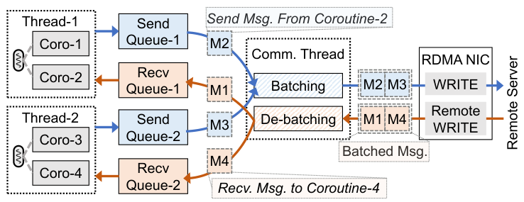
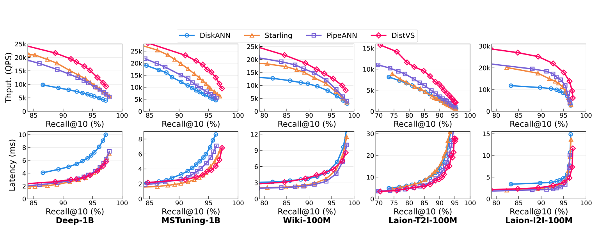
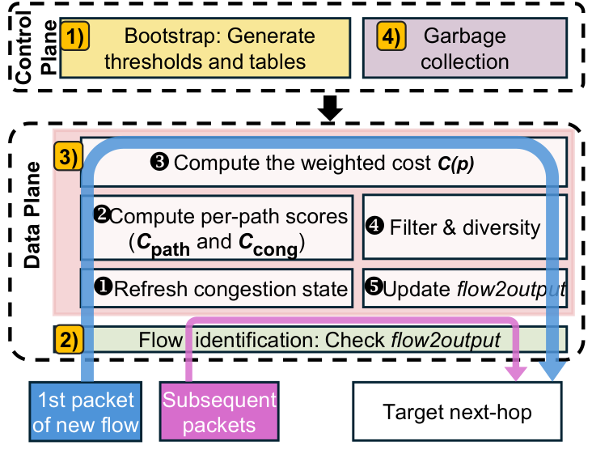
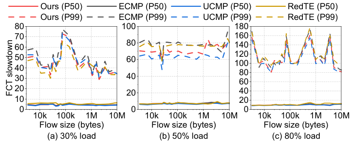
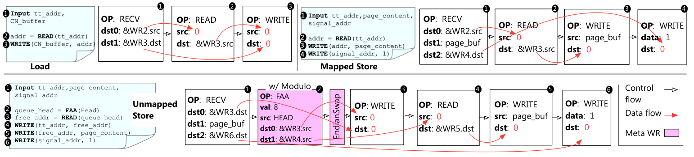
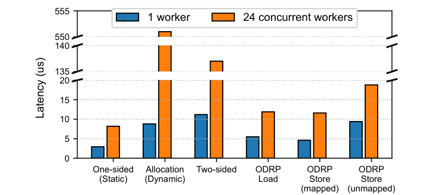
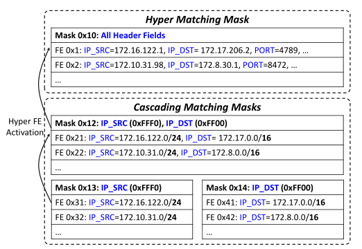
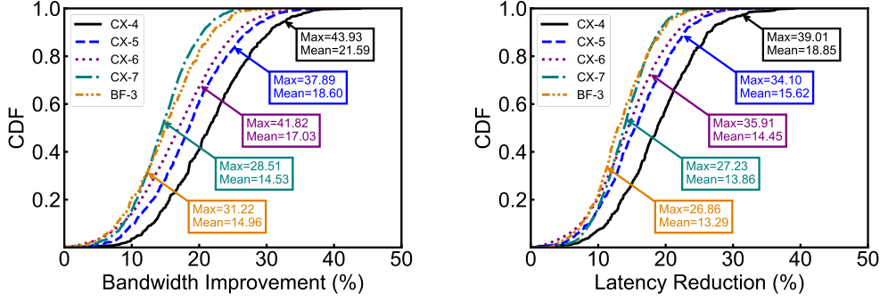

# 2026-11-13 RDMA 与分布式存储早报

[打开渲染页面](https://mingwangsong.github.io/rdma-daily/2026-11-13/)

本期为近期正式顶会论文回溯。未核实当日新增且正文可深入阅读的合格论文；数量以实际完成的深入阅读为准，不凑数。

## DistVS

## DistVS：把“取远端向量”改成“远端精排”，RDMA 搬的是候选 ID

**论文**：DistVS: Large-scale Vector Search with Compute-Memory Disaggregation。**机构**：香港中文大学、武汉大学、华为云；按论文发表时署名，第一作者后来任职变化不回填。**正式状态与日期**：已收入 NSDI 2026，论文集449–467页；会议2026年5月4–6日，书目发表月为2026年5月。本期是近期论文补读，非今日新发。**阅读范围**：正文§1–6、附录A/B及所有关键实验；未复现实验。官方视频链接可见，但本轮未取得可读内容；作者主页和GitHub检索未核实到DistVS源码，不以第三方仓库代替。

### 为什么不是简单加一层远端内存

DiskANN式检索把压缩向量放本地DRAM，把邻接表与原向量一起放SSD。图遍历每访问一个节点都可能触发磁盘IO，尽管原向量只是最终重排需要，并非每轮选择下一个节点都需要。将全部高精度压缩向量复制到更多计算节点，又会放大DRAM成本。DistVS的关键是同时改变**表示精度、放置位置和计算位置**，不是将磁盘读机械地替换成RDMA READ。

### PRESS 的实际查询路径

1. 计算节点保留全量低精度PQ；共享内存节点保留全量高精度PQ和图索引；SSD保存精确向量。论文实现的SSD在计算节点上，不能描述成已验证的独立NVMe-oF后端。
2. 内存节点维护按高精度距离排序的候选队列 Lhigh，每次取 beam width 个候选，返回它们的邻接ID。计算节点用本地低精度PQ计算这些邻居距离，维护 Llow。
3. 计算节点只把Llow中值得进一步确认的候选ID发回内存节点，后者用本地高精度PQ计算距离并更新Lhigh。高维压缩向量不在每轮跨网传输；稳态消息是候选和邻接ID，但初始查询向量仍需传递，不能称整个查询只含ID。
4. 当Lhigh没有未访问节点时，选择其中前Dfull个交给独立重排线程。重排线程用libaio读取精确向量、计算精确距离，返回top-k；遍历上下文可立即释放给下一条查询。默认 Dlow=2Dhigh、Dhigh=2Dfull，低到高精度精化比例µ=0.3。论文§3.1局部把µ写作“re-ranking ratio”，但这里是低→高精度精化，不应与最后SSD精排混淆。
5. 独立通信线程轮询每工作线程的无锁发送队列，将WR组成批，用单边RDMA WRITE写入对端预分配缓冲区，再拆批分发给远端协程；响应反向同理。单边WRITE只是传输，内存节点CPU实际执行距离计算，并不是完全CPU旁路服务。

图8（正式PDF第9页，论文印刷页456），Peiqi Yin等，NSDI 2026，[原文](https://www.usenix.org/system/files/nsdi26-yin.pdf#page=9)。这张图的关键是工作协程与RNIC之间多了一条专用通信线程：它能减少碎消息提交成本，但同时占用一个CPU线程、引入队列与批等待。论文没有给出通用的最优批等待阈值，不应直接推广为小IO尾延迟必然改善。

### 实验要怎样读

测试集群为5台服务器，每台Xeon Gold 6252N 2.30GHz、论文报告96 cores、756GB DRAM、ConnectX-5 RoCE；每台两块SATA SSD做RAID-0，约3.5TB、680MB/s。正文未明确链路速率，因此不能补写100GbE。DistVS用4个计算节点+1个内存节点，各8个线程，已包含通信和重排线程；DiskANN、Starling、PipeANN分别在5台机器独立检索、合计吞吐，每台也是8线程。向量均用PQ和Vamana图，出度64。

图9（正式PDF第11页，印刷页458），[原文](https://www.usenix.org/system/files/nsdi26-yin.pdf#page=11)。上排是QPS，下排是**平均查询延迟**，横轴为Recall@10。应该在同召回率比较，而不是任选曲线最高点：吞吐增益明显并不等于低负载延迟等比例下降；论文没有提供p99曲线。

- 表3的95%召回点：Deep-1B为14,292 QPS，对最佳Starling 10,095为1.42×；Wiki-100M为12,962，对PipeANN 10,087为1.29×。这些不是RDMA链路吞吐，而是整套查询算法和存储布局的端到端QPS。
- 表4揭示“节省内存”有适用范围。Deep-1B的DistVS合计89.2+307.3=396.5GB，高于DiskANN 224.7GB和PipeANN 259.4GB；Laion-T2I为50.4+50.3=100.7GB，低于DiskANN 125.7GB、PipeANN 140.2GB、Starling 230.5GB。低维大图的邻接表会使内存池很大，不能只报计算节点本地内存减少。
- 图12在相同内存预算下比较Low-only与High-only：Low-only误导遍历产生额外访问；High-only要传高精度PQ和图数据，RDMA流量约高一个数量级。这支持“远端算距离、只传ID”这一归因，比只看最终性能数字更有用。
- 图13仅验证1到4个计算节点、单内存节点的近线性扩展。每线程协程从1变2可以覆盖远端等待；再增大时吞吐不继续提升、延迟继续增大。图14在Laion-T2I 90% recall下，beam width=8的吞吐最好；增到16虽降低往返次数，却因选择性变差增加计算。减少网络往返不是唯一目标。

### 一致性与故障边界

附录A提出更新依次改内存图、高精度PQ、SSD原向量，再通知计算节点刷新低精度PQ，但未证明跨层更新的原子可见性或给出读写混合下的线性一致性协议。内存节点失效会丢失在途查询，作者认为并发量有界、查询短因而重算代价有限，并建议借助工业内存服务恢复；这不是已实现并评测的多副本failover保证。大规模部署还要验证单内存节点CPU饱和、图索引容量及故障域，而不能由四节点曲线外推百节点。

### 对分布式存储的可执行启发（以下为分析推断）

优先迁移到RAG向量检索服务，而不是通用KV缓存：在共享索引节点上执行小型过滤/距离计算，将大向量传输转成ID或候选结果传输。这样用远端CPU换带宽，是否划算取决于候选精化比、向量维度与内存节点CPU余量。可以先做2计算+1内存节点原型，保留全本地DiskANN、远端拉取高精度PQ、远端计算距离三组基线，固定召回率、线程预算和全局DRAM容量；记录每查询网络字节、RDMA WR数、内存节点CPU、平均/p99延迟和SSD IO数。

再将SATA替换成本地NVMe与NVMe-oF，分别测试精排线程/IO预算。论文的680MB/s SATA使“减少SSD访问”收益容易显现，高速NVMe可能改变收益分布。最后加后台更新与内存节点故障：为图、两级PQ和精确向量设置同一索引版本，先构建后发布版本、旧查询固定版本并延迟回收（建议方案，非论文实现），观察查询一致性、恢复时间和重复IO。若共享节点CPU先饱和，应先限制精化比例或按索引分片，而非盲目增加计算节点。

### 资料

- [正式论文与作者/机构](https://www.usenix.org/conference/nsdi26/presentation/yin)
- [完整论文PDF](https://www.usenix.org/system/files/nsdi26-yin.pdf)
- [官方报告视频](https://www.youtube.com/watch?v=Obqi9SYXVHc)（本轮未观看）
- [第一作者主页](https://yinpeiqi.github.io/)（用于核对资源，不用当前单位替代论文单位）
- 源码、slides：本轮未核实到作者公开的DistVS源码或独立slides；不制作虚构fork。

资料使用说明：未核实原图开放再分发许可。本期仅为解释特定批处理机制和核验吞吐/延迟结论引用图8及图9，保留作者、版本、图号和原文链接，配实质评论；不复制全文PDF、不以图片替代原论文，不作法律保证。PDF与全文提取仅作为工作资料，不放入公开仓库。

专用通信线程汇集各工作协程的无锁队列，以单边WRITE写入对端预分配缓冲区；远端仍需CPU拆批并处理距离计算。减少提交开销但多一个通信线程和批等待，不能据此断言p99改善。

来源：Peiqi Yin, Xiao Yan, Shiyuan Deng, Hui Li, Yifan Zhu, Xiangyu Zhi, Jingqi Mao, Ran Xu, Wenliang Zhang, James Cheng，NSDI 2026，图8，PDF第9页。原文：https://www.usenix.org/system/files/nsdi26-yin.pdf

5台集群，DistVS为4计算+1内存节点。吞吐优势不能解读成同等比例延迟下降，下排是平均延迟而非p99；测试SSD为680MB/s SATA RAID-0，高速NVMe收益需另测。

来源：Peiqi Yin, Xiao Yan, Shiyuan Deng, Hui Li, Yifan Zhu, Xiangyu Zhi, Jingqi Mao, Ran Xu, Wenliang Zhang, James Cheng，NSDI 2026，图9，PDF第11页。原文：https://www.usenix.org/system/files/nsdi26-yin.pdf

## LCMP

## LCMP：跨机房 RDMA 的路径选择，要先避开高代价路径，再分散新流

**论文与机构。** Dong-Yang Yu、Yuchao Zhang、Xiaodi Wang、Jun Wang、Haipeng Yao、Wendong Wang（北京邮电大学）；Wenfei Wu（北京大学）；Ke Xu（清华大学、中关村实验室）。EuroSys 2026，会议 2026-04-27—30；DOI 10.1145/3767295.3803593，正式录用与 proceedings 可由会议官网核验。本轮阅读 arXiv:2604.07836v1，2026-04-09公开，内含正式DOI和CC BY 4.0声明。这是近期旧文，不是今日新增。

### 为什么不能只按带宽选路径
跨机房链路同时存在容量和传播时延差异。UCMP偏好高带宽并不等于小RPC更快：一条高容量但250ms的路径可能输给低容量5ms路径。另一方面，各交换机收到的端到端拥塞反馈已经过一个长RTT，按“当前最低成本”一致行动，又可能使一批新流同时涌向同一出口。LCMP解决的是**流开始时的路径放置**，不是RNIC可靠传输、存储一致性或新的拥塞控制算法。

### 实际决策路径
1. **控制面准备慢变量。** 把路径传播时延、链路容量转成0—255离散分数；延迟达到配置上限时饱和，容量越大代价越低。权重与阈值提前安装，数据面只用整数加法、移位、比较和查表，而非实时做浮点优化。
2. **每个包先查流缓存。** 流ID命中则沿此前出口转发并刷新lastSeen，不重新选路。只有新流才走完整代价计算。这是避免多路径乱序的关键，也意味着长寿命流不能及时迁离拥塞路径。
3. **用本地队列补足长RTT反馈。** 交换机为每个端口维护队列占用Q、队列增长趋势T和持续高水位惩罚D。T用移位EWMA，非正趋势归零；D在持续拥塞时积累，低水位时衰减。三者归一成拥塞分数，不能把它理解成全路径所有瓶颈的实时全知信息。
4. **融合但不只选一个“最优”出口。** 路径分数与拥塞分数加权，默认保留代价最低的一半候选，再在这个集合中做hash选择。过滤负责避开坏路径，hash负责降低并发选择碰撞；如果所有流都选最小值，代价估计尚未更新时会形成羊群效应。
5. **保持映射与回收。** 以idle timeout回收缓存；端口失效时按到达包惰性删除失效映射并重选。论文称数据面快速故障切换，但这不等价于RDMA操作端到端无损恢复。切换时在途包、超时和重传仍需RNIC及上层处理。

**图2（PDF第4页）读图。** 第一包经过队列更新、代价融合和筛选，后续包直接命中flow2output。最值得迁移的是“慢路径质量＋快局部信号＋流级粘性”的分层职责；它没有让每个packet都走复杂调度。

### 实验必须区分仿真、仿真拓扑与真实硬件
正文§6.1给出8-DC逻辑拓扑：机房内100Gbps、DCI到spine为400Gbps、机房间40/100/200Gbps和5—250ms。**这不是八个真实高性能RDMA机房实测。** 实际小型验证使用9台服务器，8台构成两端，另1台用Mininet模拟传播时延/链路容量；作者明确因无高速RNIC而使用SoftRoCE，并用perftest生成流量。论文报告Tofino原型，但不能把全部FCT数字视为商业RNIC上的线速端到端结果。

图5的WebSearch、30/50/80%负载下，相对ECMP的中位FCT slowdown下降36—41%，P99下降56—68%；相对UCMP的中位下降76%，P99下降45—64%。slowdown是实际FCT除以独占网络理想FCT，不是吞吐提升百分比。论文三次重复；图6给出小型验证与NS-3的相关性，但相关性不证明所有真实RNIC行为均被准确模拟。

更适合做工程预期的是**图7（PDF第9页）**：13-DC真实拓扑形状、NS-3模拟，1/5/10ms对应200/1000/2000km，交换机buffer设为6GB以满足长距离PFC headroom。所有DC对的汇总中，相对ECMP中位几乎不变，P99仅改善约2—9%。原因是只有25.6%的节点对有多条候选路径，而且时延差从小型实验50倍缩为10倍。只看摘要“最高76%”会严重高估一般部署收益。

在具有多条路径的特定DC1—DC13对上（图8），相对ECMP中位改善7—11%，P99改善15—18%。这说明收益依赖实际路径多样性，不是把算法开关打开就能获得固定加速。

### 消融说明什么，没说明什么
图11在8-DC、30% WebSearch设置下，移除路径质量项，3438B流中位slowdown由6.8变26.0，P99由12.1变50.0；移除拥塞项，29.7MB大流中位由8.7变31.2，P99由17.1变58.4。前者说明延迟差异不能被局部队列替代，后者说明仅静态择路无法保护大流。不过权重扫描仍绑定该拓扑：路径与拥塞3:1、拥塞内部Q:T:D=2:1:1不应作为生产通用最优参数。

### 对分布式存储的可迁移点与边界
**适用路径：** 多机房对象复制、增量日志传输或远程读的多个独立RDMA流。应用不需要改verbs，但运维必须能修改DCI交换机并获取稳定拓扑、容量与延迟信息。仅单机房双口LACP场景不能直接套用此论文的跨机房收益。

**重要差异：** 常驻存储连接往往是长寿命QP，一条QP中承载许多业务请求。LCMP按流首包决策，后续请求不会触发重新平衡。如果一个QP只有一个flow标识，热点变化后的自适应能力可能很弱。试验必须记录“业务请求数”和“新流数”，不要混为一谈。

**验证建议（分析推断）：** 先在2条延迟/带宽不对称路径上比较ECMP、容量加权、仅路径质量、完整LCMP；分别使用短寿命QP和长寿命QP，注入小读RPC与大块复制混流。衡量请求P99、复制吞吐、QP重传、PFC暂停、流表命中/驱逐及端口失效后的恢复时间。若只在新QP创建时有效，优先研究连接池粒度而非盲目增加交换机代价项。

**工程成本：** 论文对50k流缓存给出约1.2MB估算，但正文每流字段合计20B而示例按24B计算，应视为含布局开销的估算，不是编译后ASIC资源证明。真实pipeline stage、寄存器碰撞、流表满时回退、空闲超时导致的重选乱序，都需要额外验证。LCMP不提供复制持久性、exactly-once或故障后提交语义。

### 阅读与资料
本轮阅读正文§1—8及artifact appendix，检查架构图和评估图；未复现实验。作者仓库README已检查，论文称代码Apache-2.0，但固定commit根LICENSE读取404，故本期不把完整代码重新分发或声称已fork。arXiv论文PDF首页明确CC BY 4.0，可连同作者、出处和许可声明备份；裁图只改变边界与分辨率，不改变图意。

- [EuroSys官方录用列表](https://2026.eurosys.org/papers.html)
- [DOI](https://doi.org/10.1145/3767295.3803593)
- [阅读版本与许可入口](https://arxiv.org/abs/2604.07836)
- [PDF](https://arxiv.org/pdf/2604.07836)
- [作者代码](https://github.com/dyyuCS/LCMP)
- [固定版本](https://github.com/dyyuCS/LCMP/tree/5333ee2a37052d3fa6424e78d342cbe8fa06443f)
- [作者归档](https://doi.org/10.5281/zenodo.18859753)
- [CC BY 4.0](https://creativecommons.org/licenses/by/4.0/)

慢路径质量与本地队列融合仅在新流发生，后续packet命中flow2output；这是保序与实时迁移之间的取舍。

来源：Dong-Yang Yu, Yuchao Zhang, Xiaodi Wang, Jun Wang, Wenfei Wu, Haipeng Yao, Wendong Wang, Ke Xu，EuroSys 2026，图2，PDF第4页。原文：https://arxiv.org/pdf/2604.07836

相对ECMP中位基本不变，P99约改善2—9%；只有25.6%节点对有多路径，因而收益被单路径流稀释。

来源：Dong-Yang Yu, Yuchao Zhang, Xiaodi Wang, Jun Wang, Wenfei Wu, Haipeng Yao, Wendong Wang, Ke Xu，EuroSys 2026，图7，PDF第9页。原文：https://arxiv.org/pdf/2604.07836

## ODRP

**论文**：ODRP: On-Demand Remote Paging with Programmable RDMA。**作者单位**：上海交通大学 SEIEE 并行与分布式系统研究所（IPADS）；Zixuan Wang、Xingda Wei、Jinyu Gu、Hongrui Xie、Rong Chen、Haibo Chen。**正式出处**：NSDI 2025，pp.1101–1115，会议及公开论文日期为2025年4月28–30日、4月28日。**新旧状态**：2025年回溯研读，不是今日新发，也不是未录用预印本。选择原因是与已经介绍的 OneSidedMW 形成技术脉络：细粒度内存管理是否能跳过服务器CPU，以及代价转移到哪里。

原文：https://www.usenix.org/system/files/nsdi25-wang-zixuan.pdf
正式收录及报告入口：https://www.usenix.org/conference/nsdi25/presentation/wang-zixuan

## 瓶颈来自哪里

远端交换系统既需要读写4KB页面，也需要分配、释放和权限隔离。单边RDMA擅长前者，但动态注册/撤销MR走控制路径并消耗内存节点CPU。静态给每个客户端预留大块MR很快，却无法把未用页面及时共享；改成小块动态分配可减少碎片，却把分配RPC和MR管理推到弱CPU上。ODRP不是让RNIC执行通用程序，而是针对Linux swap约束，把固定功能编译成短的、有数据依赖的WR链，减少每次请求需要的RNIC步骤。

## 一次请求如何执行

1. 内存节点初始化时把物理内存分成4KB页，用保存8字节页地址的环形FIFO管理空闲页；每个计算节点有独立的翻译表TT，映射swap地址到实际物理页。先注册相关资源，运行时不对每次4KB分配重新注册MR。
2. 计算节点使用RDMA SEND触发对应功能链，RECV将参数直接写入后续WR字段。load链先READ相应TT条目，再将结果填入WRITE的源地址，把页传回计算节点。不是客户端拿到一个不受限制的全池rkey后直接寻址。
3. store被拆成两条链。已映射页只需翻译、写入和通知；未映射页先用原子FAA领取空闲队列槽位，取页地址并写入TT，再写页数据，最后写完成标志。计算节点维护分配bitmap来选择链，避免让RNIC每次执行判断和分支。
4. 释放则查TT、用FAA推进队尾、将地址归还FIFO，并清空TT。FIFO而非bitmap的关键是把分配降为固定步数，避免扫描空闲位和CAS重试。
5. 环形队列的取模用Masked-FAA限制进位字段；端序转换将8个字节反序散布到8个SGE，以一个READ替代8次READ。客户端还预计算TT地址、WAIT/ENABLE索引与doorbell值，随下一次请求携带，用于重新激活已消费但未物理清除的WR。CPU开销被从内存节点移到客户端，并通过少发WR降低RNIC延迟。

图6（正式PDF第7页，论文p.1106，裁去图外正文）：load、mapped store和unmapped store三条链不能混为一谈。底部首次写入还要FAA、端序转换及TT更新，所以首次分配明显贵于重复覆盖。图是简化链，省略的WAIT/ENABLE分别有3、4、5条，不能按画出的框数估算真实WQE成本。来源为Wang等，NSDI 2025，上述原文；保留必要机制局部用于本文分析，不将开放访问等同于开放许可。

## 正确性依赖与失败窗口

**关键前提是swap语义，不是任意并发对象协议。** Linux交换子系统避免同一swap地址的并发操作，因此TT条目不需要通用细粒度锁。不同客户端的FIFO分配通过FAA串行化；队列空与归还并发时，论文依赖缓存行对齐的8字节读写原子性。把这套链搬进多人同时更新同一对象的缓存，必须另加并发控制，不能继承其正确性结论。

客户端只能通过受限连接和TT访问自己的页；越界TT通过MR权限拦截，空映射以零地址触发保护错误。空闲队列耗尽后，分配会读到零并中止，但队头已经推进，需要内存节点CPU恢复队列状态。客户端崩溃由心跳检测，内存节点扫描其TT回收页面。公平性亦采用CPU定期读硬件完成计数器核算配额。因此“零内存节点CPU”应理解为常规分页数据路径，而非初始化、故障恢复、预算管理都不需要CPU。论文没有给出内存节点断电后的数据持久性协议，不能用它直接承诺耐久存储。

## 实验条件与能支持的结论

测试床为1个内存节点、最多8个计算节点，InfiniBand交换机，100Gb/s ConnectX-5；每节点12核Xeon E5-2650、128GB DDR4，关闭超线程，OFED4.9和Linux4.15。每计算节点12GB swap；默认内存节点只给1核模拟弱CPU。基线均基于Fastswap：静态12GB、动态1MB MR、两边RDMA的4KB分配、动态4KB MR。不是以现代400/800GbE、RoCE拥塞或多内存节点集群测得。

- **图7，容量换性能**：ODRP的4KB管理在这些测试中达到理想远端页利用率，相对静态分配提升1.72–12倍。应用代价不是零：Quicksort执行时间比静态基线高9.7%，Kmeans高14.2%；Memcached性能开销7.2%，平均与最大查询延迟增幅均低于2%。不同应用的执行时间、吞吐和最大延迟不能互相替代，更不能把最大值称为p99。
- **图9，扩展性**：每节点4个Quicksort、50%本地内存，从1扩到8计算节点；8节点时ODRP达到静态基线87.3%的swap吞吐，执行时间开销14.6%，远端内存利用率为其3倍。这揭示RNIC链并没有消除开销，而是以较小性能损失换取共享池利用率。
- **图10，批量隐藏链开销**：高I/O depth的load吞吐达到静态READ/WRITE的92.1%；首次未映射store最慢，因为FAA路径吞吐低。被测应用超过60%请求是可批量预取的load，未映射store约10%，因此端到端结果不能泛化到持续大量新页分配的负载。
- **图11/12，延迟与消融**：单worker静态单边操作2.9µs，ODRP load 5.5µs、mapped store 4.6µs。朴素未映射store链35.9µs，客户端辅助回收WR减少16µs，单READ端序转换减少6.2µs，说明优化重点是WR依赖链，不只是网络RTT。

图11（正式PDF第12页，论文p.1111）：纵轴分段，必须注意断轴；蓝色1 worker、橙色24 workers。动态MR分配与两边RPC在弱CPU下受排队放大，ODRP仍高于原生静态单边，但避免同样的CPU队列增长。图反映这些操作延迟，不是存储应用p99。出处同上，裁去图外文字，保留坐标和图例，用于比较受限CPU与RNIC链的不同瓶颈。

## 分布式存储可以怎样用，先验证什么

**分析建议，非作者已验证结果**：最适合试验的是可重建、每页单所有者的远端冷页缓存，或计算节点独占的缓存分区。先保持数据落盘/副本机制不变，只替换内存池分配与读写路径。不要首先用于多写者共享缓存、锁表或事务状态，因为其并发和崩溃语义不同。

建议用2个计算节点和1个内存节点，比较静态预留、1MB动态池、4KB RNIC管理三种方案；保持总可用内存相同，扫首次分配占比10%/50%/90%、load预取深度1/4/10以及热点冷热切换，记录利用率、RNIC原子吞吐、客户端CPU、p50/p99、队列耗尽恢复时间。额外注入客户端断连、超配与内存节点重启，验证“已返回完成”页的可用性和泄漏。若新页占比高时FAA成为主瓶颈，下一步应考虑按客户端批量领取小段页而非盲目增大链并发。

部署前需确认网卡、固件、驱动对cross-channel WAIT/ENABLE、Masked-FAA及WQ复用的支持。论文虽用ConnectX-5，不代表用户的ConnectX-5 Ex＋RoCE/LACP环境可以直接复现：其结果来自IB单网络配置，未验证双口bond、GID选择或ECMP，且驱动版本较老。32GB swap的TT占64MB（每页8字节，约0.2%），还需计入每客户端工作队列和状态，不宜只按数据页计算池容量。

## 阅读与归档

实际阅读：正式论文正文§1–8、图6–12及相关实验说明；核对USENIX收录页，查看作者报告入口，但未逐段观看视频。未复现实验。正文给出的代码库 https://github.com/SJTU-IPADS/ODRP 本轮返回404，故未声称读过或备份代码；完整PDF未发现明确再分发许可，不将其作为公开附件。两幅必要局部图配实质分析和明确出处，不声称版权例外具有法律保证。

报告幻灯片：https://www.usenix.org/system/files/nsdi25_slides-wang_zixuan.pdf
作者PDF镜像：https://ipads.sjtu.edu.cn/_media/publications/odrp-nsdi25.pdf

三条链不同，未映射store还需FAA与TT更新；图省略WAIT/ENABLE，不能按可见框数当真实WQE成本。

来源：Zixuan Wang, Xingda Wei, Jinyu Gu, Hongrui Xie, Rong Chen, Haibo Chen，NSDI 2025，图6，PDF第7页。原文：https://www.usenix.org/system/files/nsdi25-wang-zixuan.pdf

保留断轴及图例；弱CPU导致动态分配/RPC在24worker下排队，ODRP并非零开销。该指标不是存储应用p99。

来源：Zixuan Wang, Xingda Wei, Jinyu Gu, Hongrui Xie, Rong Chen, Haibo Chen，NSDI 2025，图11，PDF第12页。原文：https://www.usenix.org/system/files/nsdi25-wang-zixuan.pdf

## ScalaCN

**论文**：Mitigating Scalability Walls of RDMA-based Container Networks。**正式出处**：NSDI 2025，pp.1049–1065，会议/论文集日期2025-04-28至30日；本期是旧文补读，不是2026-11-13新发表。**机构**：清华大学、阿里云、南加州大学、UIUC。作者 Wei Liu 同属清华与阿里云，其他作者及机构见[官方论文页](https://www.usenix.org/conference/nsdi25/presentation/liu-wei)。

## 为什么这篇对存储集群有直接价值

裸机上 ib_write_bw 接近线速，容器化服务却随部署规模扩大而变慢，未必是UCX协议选择或RDMA QP数量单独造成。论文研究的是 **SR-IOV VF + OVS/TC硬件卸载 + VXLAN overlay** 的RDMA容器网络。除verbs传输路径之外，RNIC还承担eSwitch匹配、封装与转发：相同数量的连接，如果流规则的匹配掩码分布不同，可能走出完全不同的芯片内查询长度。这个工作并未说明所有容器化RDMA都存在相同缺陷，更不能直接用于解释不经过该卸载路径的host-network服务。

## 故障不是简单的“RNIC资源不够”

作者长期观测约8千主机、4万RNIC，平均50万活跃容器、峰值约100万的生产网络。在其观测区间，RNIC相关故障既包括流表与统计信息不一致，也包括硬件查询与资源回收问题。表1中的代表性链条是：硬件流计数更新不及时 → 软件误判流已不活跃 → 删除/重新卸载流 → 软件转发与硬件转发反复切换。另一些问题来自流创建超时的驱动处理、VF资源回收竞态及VXLAN封装上下文耗尽。把这些现象都归入网络拥塞，会找错修复层。

最值得迁移的是S6：新掩码对应的流即使在高负载消退后仍然很慢。作者通过改变掩码数量推断：不同掩码组被顺序查询，同组内的匹配值则近似哈希查询。新建的组排在后面，因此总流量下降并不自动缩短该流的查询链。**这里“掩码”是匹配哪些报文字段/位的规则结构，不是只指IP子网长度；NVIDIA flow group与Intel matching recipe是相关术语。**

## 机制如何工作：先做受约束测试，再优化卸载规则

1. **把可观察硬件抽象成数据路径。** 容器通过VF使用QP资源，数据经过RNIC队列与eSwitch匹配表，再执行VXLAN封装/转发等动作。ScalaCN不声称拿到了厂商RTL，而是从公开API、驱动与可配置组件建立灰盒模型。
2. **过滤无效组合，减少测试空间。** 流表之间的跳转必须保持可达、不能形成环路；先剔除根本不能正确转发的配置，再改变表、掩码和队列等维度。否则“性能变差”可能仅仅是配置把包送丢了。
3. **局部敏感性与排除测试。** 固定其余条件，改变一个维度；当症状随之缓解/恶化，再通过组合置换和移除进一步定位关键路径。模型仍是推断，不能当作跨代硬件必然不变的结构事实。
4. **区分请求方向与数据方向。** 图10/§4.2中，改变本端出向和远端入向掩码会明显影响SEND/WRITE。READ的返回数据主要沿反方向，若没有同时增加返回方向的掩码，带宽可以仍约165Gbps，而请求延迟已经增长。这不是“RDMA READ不受流表影响”，而是被扰动的方向不同。
5. **建模并按需触发。** 用在途包平均匹配查询数预测带宽和延迟，带宽用径向基形式拟合，延迟用线性模型；预测下降达到经验阈值5%时才重排卸载。通过运行时监测核对状态，论文还采用时序逻辑模型检查处理不匹配状态。
6. **热流走首层精确匹配，其他流保留级联规则。** 每张表置一个最靠前的hyper mask，匹配完整报文字段；首次报文仍可通过cascading masks，确定实际通信后，把对应具体流提升到hyper mask。常驻流随后不必反复穿过多个不同掩码。级联掩码按过去60秒包数×掩码长度计算局部性优先级，近期高频、更具体的规则前移。
7. **用回收控制代价。** 精确匹配一条只覆盖一个具体流，节省查询却增加表项占用；因此hyper层采用LRU淘汰，级联掩码连续10分钟无活跃包后移除。高churn、低复用流量可能得不偿失，论文也确实报告少量退化。

### 图13：减少查询链，而不是增加网络链路

图中的箭头表示将已识别的具体流提升到hyper精确匹配层。收益来自让后续包优先命中，而不是把所有规则直接展平成无限大的精确匹配表。读图时应同时看到两项成本：首批包仍要走级联路径；精确表容量必须靠LRU管理。原图：Wei Liu等，NSDI25，图13，PDF第11页（正文1058页），从官方版本局部裁切。

## 实验：不能把重负载40%写成生产平均40%

- **测试平台与范围**：50主机微基准环境，每机4张RNIC，覆盖CX-4/5/6/7、BF-3与Intel E810；使用真实应用产生的流量（含训练与微服务），平均每日约400万条不同流。作者只比较相同型号RNIC之间的通信，避免混合型号互操作干扰。测量工具是RDMA perftest，不是文件系统吞吐或存储请求P99。
- **15K卸载流压力点，图14–15**：相对默认OVS卸载设置，平均聚合带宽提高40.4%，平均包转发延迟下降30.5%。CX-6在约8K流后出现更快下降只是该实验中的阈值，不是任何固件/规则下通用的8K限制。
- **实际生产负载，图18–19**：平均RNIC带宽改善约17%，平均转发延迟下降约15%，明显低于重负载点收益。曲线按设备展示改善百分比的CDF，不能读成原始带宽CDF或P99时延。论文标题摘要中1.4×/31%的总体表述，与正文更细的生产平均口径应区分。
- **CPU与流启动成本，图16/20**：监测成本随流数量增加，最终约占一个CPU核的5%；流启动延迟分解中OVS约70%、ScalaCN约18%、驱动约12%。18%是总启动开销构成，不是把任意业务延迟提高18%。
- **反例**：频繁创建流却通信很少的计算密集场景，精确项插入成本可能造成小于5%的退化；作者称这发生在其网络少于0.03%的RNIC上。这个生产比例不能外推到你自己的高churn存储作业。

### 图18–19：真实负载的分布揭示收益并不均匀

左侧为带宽提升，右侧为延迟下降，均为百分比CDF。CX-4的图示平均改善高于较新的CX-7/BF-3，说明芯片查询成本与既有工作负载共同决定效果。不能只取最大值43.93%来预算全站收益；容量规划更应先测本机型、规则分布和流复用率。原图：Wei Liu等，NSDI25，图18–19，PDF第13页（正文1060页），保留坐标与图例、局部裁切。

## 对分布式存储的具体落地方法（分析建议）

**优先场景**：Kubernetes中以VF承载RDMA的存储worker、远端缓存、Shuffle服务和共享存储网关，且存在OVS/TC卸载与overlay。这里存储IO同时受数据传输和租户网络转发规则影响。**不是直接适用场景**：仅使用裸机物理端口、没有eSwitch规则增长的测试，或性能瓶颈明确在SSD、内存带宽、CPU序列化。

一个可验证的小实验不需要复制百万容器：

1. 取同型号RNIC的两台隔离测试机，固定MTU、消息大小、QP数、NUMA绑定和固件；先测host-network基线，再测VF+既有卸载路径。
2. 在保持流数接近不变时，分别增加**掩码种类**与**同一掩码内的匹配值**。对READ/WRITE/SEND分别测双向带宽与平均/P99延迟；后者是新增验证，论文没有提供相同存储P99结果。
3. 同步记录OVS命中/未命中与重卸载事件、RNIC资源、TC规则数量、VF分配/回收及驱动超时。不能只看网卡总吞吐，否则可能漏掉少数新流的长尾。
4. 对一个存储工作负载做对照：固定对象大小和并发，切换长连接复用与短连接高churn；只在隔离环境试验语义等价的规则重排，检查转发正确性、包丢失和旧流延迟。
5. 先处理可用的驱动/固件修复，再考虑卸载策略。论文的C1/C2/C3/C5已有厂商补丁，但它没有给出适用于所有当前型号的版本矩阵；不能仅凭论文认为你现用固件还存在同一缺陷。

**可靠性边界**：ScalaCN处理网络规则和硬件状态，不提供存储写入原子性、故障恢复或幂等语义。VF解绑时的PCIe link-down及RNIC无响应是可能让多个存储会话同时失效的故障域，应用仍需要重连、超时和写入结果不确定处理。控制面不得把性能优化当作改变租户ACL/VXLAN隔离语义的理由；滚动上线要有回退到原规则集的能力。

## 实际阅读与参考资料

本次阅读官方PDF正文§1–8及相关图表，核对作者报告中的微基准/生产收益区分，检查项目页与固定版本带宽拟合脚本。未运行论文代码、未复现实验；项目公开的是部分测量/测试/分析代码，不是完整生产部署。

- [正式论文页](https://www.usenix.org/conference/nsdi25/presentation/liu-wei)
- [论文PDF](https://www.usenix.org/system/files/nsdi25-liu-wei.pdf)
- [作者报告](https://weiliu.pro/files/nsdi25_scalacn_slides.pdf)
- [项目与数据说明](https://scala-cn.github.io/)
- [固定版本代码](https://github.com/scala-cn/scala-cn.github.io/tree/64c262fb82afa7edbd222b4b57bed58e94db76ba)

原图仅选用于说明机制和生产实验结论的必要局部，保留作者与原文出处，未核实原图开放再分发许可；以带实质评论的有限引用处理，不将图集替代原文。公开源码阅读子集遵从仓库GPL v2并保留LICENSE；不公开完整PDF、报告或厂商二进制。项目样本中的MTU1024/GID3/4QP只是一个样本配置，不能概括所有实验。

新流先走级联规则，后续包提升到前置精确匹配；降低查询数但增加表项与维护成本。

来源：Wei Liu, Kun Qian, Zhenhua Li, Feng Qian, Tianyin Xu, Yunhao Liu, Yu Guan, Shuhong Zhu, Hongfei Xu, Lanlan Xi, Chao Qin, Ennan Zhai，NSDI 2025，图13，PDF第11页。原文：https://www.usenix.org/system/files/nsdi25-liu-wei.pdf

百分比改善CDF，生产平均约17%带宽与15%延迟收益，不能套用重负载40%结果。

来源：Wei Liu, Kun Qian, Zhenhua Li, Feng Qian, Tianyin Xu, Yunhao Liu, Yu Guan, Shuhong Zhu, Hongfei Xu, Lanlan Xi, Chao Qin, Ennan Zhai，NSDI 2025，图18–19，PDF第13页。原文：https://www.usenix.org/system/files/nsdi25-liu-wei.pdf
