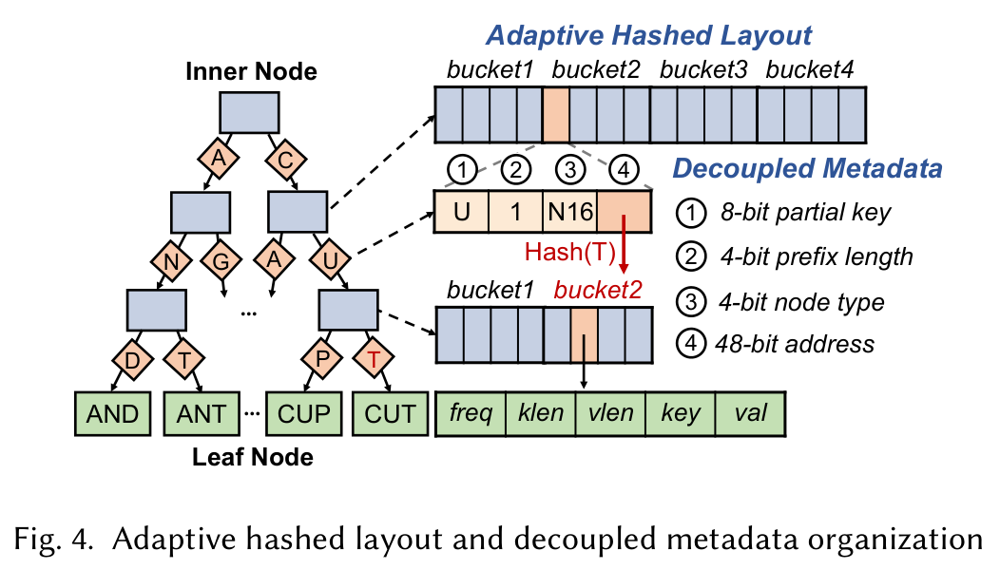
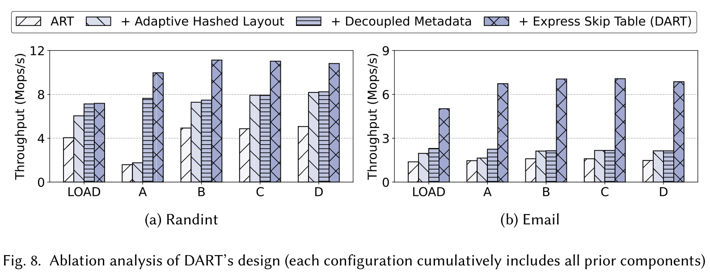
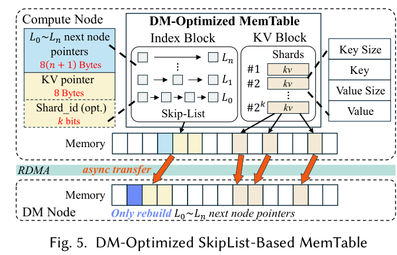
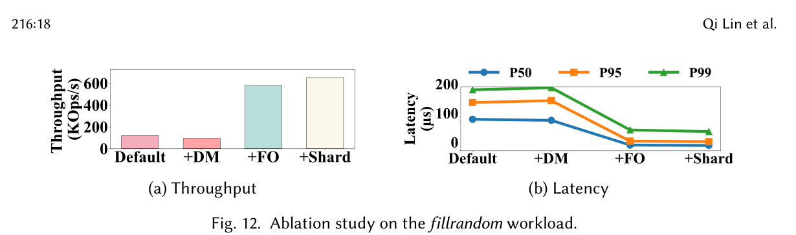
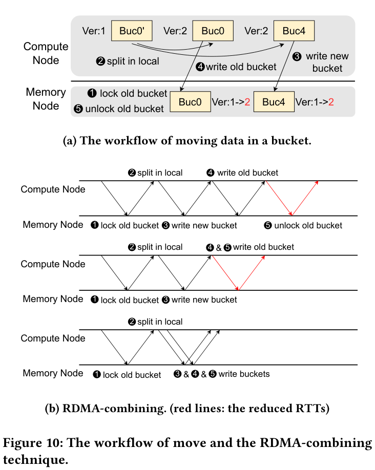
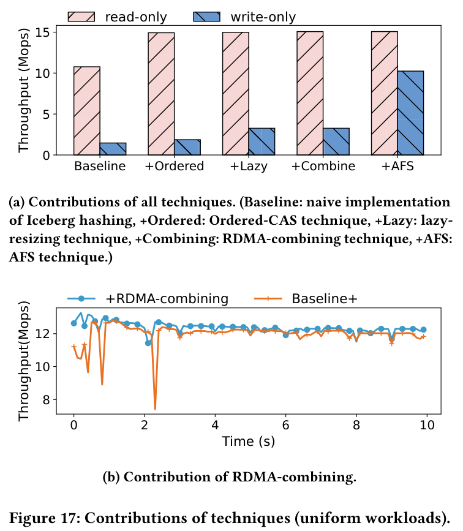
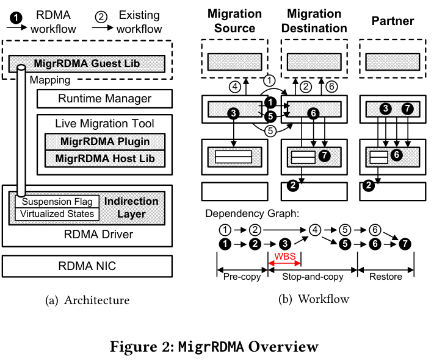
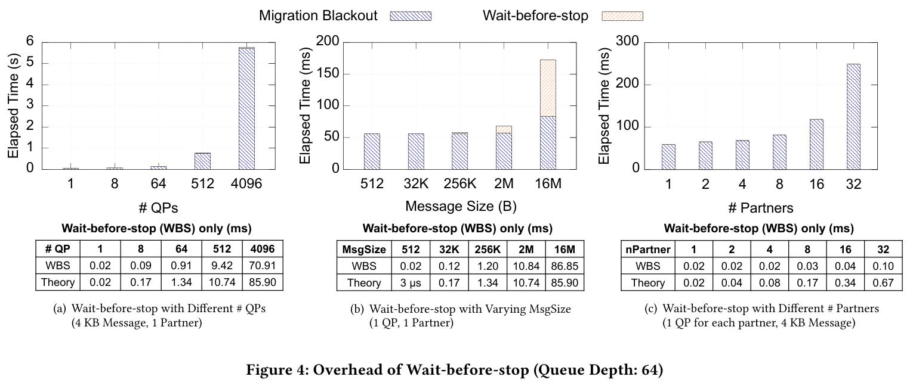
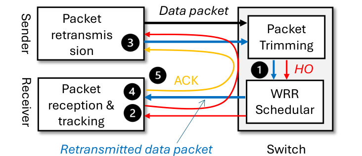
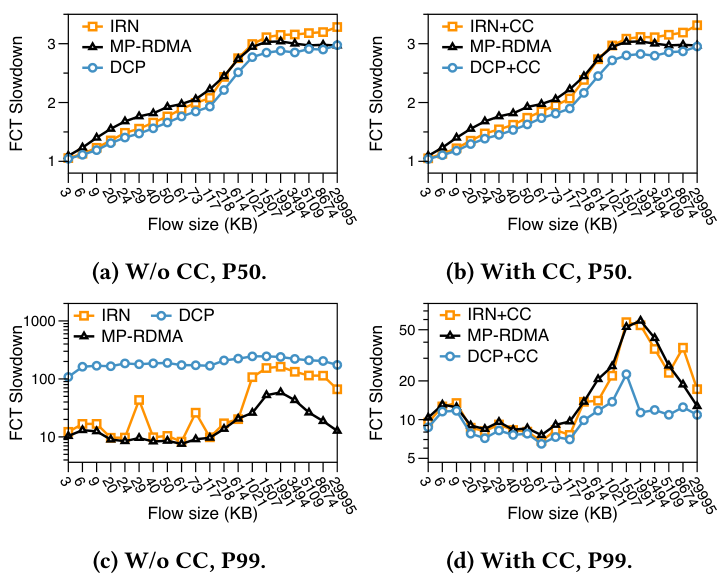

# 2026-11-14 RDMA 与分布式存储早报

[打开渲染页面](https://mingwangsong.github.io/rdma-daily/2026-11-14/)

本期为近期正式顶会论文回溯。未核实当日新增且正文可深入阅读的合格论文；数量以实际完成的深入阅读为准，不凑数。

## DART

## DART：把 ART 的串行远程遍历拆成“跳转表＋小桶＋原子发布”

**作者单位**：上海交通大学（主要团队）、Purdue University、北京大学。**正式发表**：Proceedings of the ACM on Management of Data 4(1), Article 022，2026年2月，SIGMOD 2026研究论文；2025年11月录用，非今日新增。DOI：[10.1145/3786636](https://doi.org/10.1145/3786636)。[SIGMOD官方录用名单](https://2026.sigmod.org/sigmod_papers.shtml)与论文首页互相核实。

### 为什么常规 ART 在 RDMA 上吃亏

ART 为不同长度键保留前缀层次，本地内存下连续追指针很便宜，但远端每层依赖上一层返回的地址，无法简单并发。传统节点还要先读头部元数据再找子指针；整节点读取虽可少一次往返，却放大网络流量。DART选择同时减少依赖往返和无效字节，而非只看带宽。论文§2测得直接移植ART对128B键值搜索在randint/email上分别需5/14.4次网络往返、6.5/7.7KB读取；这是动机测量，不能直接当成后续默认64B value实验。

### 一次点查的实际路径

1. **先定位 express node**：用键前缀查询可扩展哈希表。目录通常小于1MB，缓存在计算节点；从其地址计算出一个远端64B桶，一次RDMA READ获取跳转节点信息。桶内每槽8B：8位指纹、4位压缩前缀长度、4位节点类型、48位地址。指纹碰撞时并行遍历多个候选子树，不能把指纹等同完整键。
2. **跳过上层依赖链**：初始选择前缀长度2的幂对应节点；路径压缩跨越该长度时记录偏移。后台依访问频率、可节省层数及节点预算调整前缀长度列表。跳转表只是加速层，节点分裂/类型变化尚未同步时回退到较浅express node，不要求把两个结构原子更新为一个事务。
3. **每层只读目标桶**：在ART节点内部按下一字节partial key做哈希，默认取128B桶，再在本地线性找子指针。N8用64B，N16/N32/N64/N128用1/2/4/8个128B桶；N256直接映射256个指针。这样保留有序树语义，不是把整个索引改成只支持点查的哈希表。
4. **元数据跟着父指针返回**：每个8B compound pointer同时装partial key、压缩长度、类型及地址；不再额外读取子节点头。48位地址在实现里分为8位memory-node ID和40位节点内偏移，对应最多256节点、每节点1TB。这是编码边界，不是实测规模。

**读图**：图4（PDF第10页）右侧U/1/N16/addr槽同时给出下一层桶寻址所需信息，红色Hash(T)表示只取目标桶。其价值是把“先读元数据，再读指针”压成一次小读取；并非每个完整查询只需要一次RDMA。来源：Zhang等，DART，2026，CC BY 4.0，局部裁剪、未改图意。

### 发布、并发与失败边界

普通插入先在不可见位置写好叶子，再用RDMA CAS把8B指针装入空槽；更新是新叶子写好后替换指针，删除则CAS置空。分裂先创建新中间节点，连接旧子树和新叶子，再CAS替换父指针，因此可见性有明确原子发布点。CAS前客户端崩溃留下不可达分配，CAS后索引结构已发布；不能由此推导内存节点断电不丢数据。

**类型扩容并不只是一个CAS**：先把父指针类型设为Frozen，等待宽限期，再复制到新节点并原子替换地址/类型。宽限期按常规操作p95动态设定；超过宽限期的操作还必须事后检查冻结状态并必要时重试。因此“lock-free”不意味着不存在冻结、等待和慢路径。论文没有单独给出扩容发起者在Frozen期间失联的完备故障注入结果，落地时应验证接管与推进性，而非只验证内存内容未撕裂。

内存回收用扩展epoch机制，已删节点在e+2才回收；后台约每秒检查客户端epoch并推进全局epoch。失联客户端恢复时从粗粒度分配记录和树可达节点重建slab状态。需要检查死客户端是否阻碍epoch推进、回收积压是否消耗远端池。范围查询只保证每个返回项一致，**不保证与并发写构成原子快照**，这直接限制其作为事务扫描接口的使用。

### 实验与结果应怎样读

论文§5用3个计算节点、3个内存节点，计算节点双路Xeon Gold 6348（每CPU28核），限制1GB DRAM；内存节点128GB DRAM；100Gbps ConnectX-6 **InfiniBand**，不是RoCE拥塞网络。默认60M键、64B value、Zipf 0.99；randint为8B键，email为2–32B变长键、平均18B。YCSB A/B/C/D与LOAD分别代表不同读写比，168个client线程，3次运行；每个系统相同缓存预算，默认DART只缓存约1MB目录。B+树开源基线不支持变长键，因此email仅与SMART比较。

- 图6：randint吞吐相对各基线范围1.3–5.8×；email为2.4–3.4×。最高5.8×不能写成对所有基线、所有负载均成立。图6延迟是**平均延迟**，不是P99。
- 图8累计消融：节点小桶使吞吐最高提高1.7×；元数据解耦在写密集偏斜负载最高提高4.8×；再加跳转表最高提高3.4×。这是依次叠加组件的对照，不能把三个最大值相乘当成端到端收益。
- §5.3：哈希节点减少randint访问字节6.4–6.7×、email 2.1–2.3×；EST平均节约约2次/8.7次往返。长前缀email更受益于跳层，randint更受益于降低节点读放大。
- 图9：128B是本测试床吞吐和内存效率的折中；64B RDMA READ吞吐与128B相近，又增加桶碎片，因此更小未必更快。
- 图12/13反例：短范围扫描时B+树最高快2×；缓存足够大时DEX可接近DART。DART优势主要在受限客户端缓存、点查/更新密集场景，不能泛化为全负载最佳。

**读图**：图8（PDF第18页）每一组柱都累计保留前面组件。randint的A负载在元数据解耦后显著上升；email大幅跃升主要发生在加入EST后，支持“前缀深度决定优化收益”的解释。纵轴Mops/s，不同面板上限不同，不能跨面板仅凭柱高比倍数。来源同上，CC BY 4.0。

### 对分布式存储研发的具体落地点

优先评估远端元数据索引、变长对象键或缓存目录，而非大块数据吞吐路径。可先实现**8B父指针携带元数据＋128B节点桶**，再决定EST维护成本是否值得。必须满足RNIC原子8B操作及正确写后发布顺序、地址编码范围、跨节点回收机制；RDMA CAS可见不等同SSD持久化，也不提供跨键事务。

小规模实验建议：两计算节点＋一内存节点先比较原ART/小桶ART/小桶＋复合指针/完整DART，扫键长度、公共前缀、1–400MB客户端缓存、点查与短范围扫描比例。记录每请求RDMA次数/字节、CAS失败、CPU周期、P50/P99、Frozen持续时长和epoch待回收内存，而不只测峰值Mops。对CAS前后、节点Frozen后、复制中及切换后分别杀客户端，验证可达性、重复键、泄漏与恢复推进。RoCE上另加后台写流，检查EST省往返是否被共享网络尾延迟抵消。上述为实践建议，非论文已完成验证。

### 阅读范围与参考资料

已读作者版本PDF正文§1–7、算法1及实验图表，核对官方SIGMOD录用条目，并阅读作者仓库README构建/运行说明；未复现实验，未审计全部源码，未取得作者报告。论文明确CC BY 4.0，可备份全文与图；作者仓库未核实独立代码许可证，因此不把论文许可外推给源码，也不复制其全部实现。

- [论文原文（Purdue作者版本）](https://cs.purdue.edu/homes/csjgwang/pubs/SIGMOD26_DART.pdf)
- [正式DOI](https://doi.org/10.1145/3786636)
- [官方SIGMOD录用名单](https://2026.sigmod.org/sigmod_papers.shtml)
- [作者代码及复现入口](https://github.com/SJTU-DDST/DART)
- [CC BY 4.0](https://creativecommons.org/licenses/by/4.0/)

U/1/N16/addr 槽同时给出下一层寻址元数据，Hash(T)只取目标桶，把先读头部再读指针压为一次小读取，不意味着完整查询一次RDMA。

来源：Bowen Zhang, Shengan Zheng, Shi Shu, Jingxiang Li, Zhenlin Qi, Weiquan Huang, Jianguo Wang, Linpeng Huang, Hong Mei，PACMMOD 4(1), SIGMOD 2026，图4，PDF第10页。原文：https://cs.purdue.edu/homes/csjgwang/pubs/SIGMOD26_DART.pdf

randint A负载在元数据解耦后明显提升，email的主要跃升在加入EST后；各组件最大倍数不可相乘，面板纵轴不同也不能按柱高跨面板比较。

来源：Bowen Zhang, Shengan Zheng, Shi Shu, Jingxiang Li, Zhenlin Qi, Weiquan Huang, Jianguo Wang, Linpeng Huang, Hong Mei，PACMMOD 4(1), SIGMOD 2026，图8，PDF第18页。原文：https://cs.purdue.edu/homes/csjgwang/pubs/SIGMOD26_DART.pdf

## O3-LSM

## O3-LSM：远端内存不是答案，重组 flush 的执行权才是

**论文与状态**：*O3-LSM: Maximizing Disaggregated LSM Write Performance via Three-Layer Offloading*，PACMMOD 4(3), SIGMOD 2026，Article 216，正式发表月份 **2026 年 6 月**；已在 SIGMOD 官方接受列表核实，属近期补选，不是今天的新论文。**作者单位**：Arizona State University、Purdue University、Boston University，按正式 PDF 署名。接受列表将一位作者写作 Zichen Zhu / Google，PDF 为 Zhichen Zhu / Boston University；此处保留版本差异，不推定其任职变化。

### 1. 瓶颈不是“内存不够”，而是内存释放被 flush 执行绑定

面向解耦 LSM，已有 compaction offload 能削减计算节点（CN）与存储节点（DS）间的重复 I/O，却不能及时释放写入缓冲：本地 immutable memtable 堆满后，写线程仍会被限速。把 memtable 搬到解耦内存（DM）只延长缓冲时间。如果搬运需要逐键序列化、在远端重建完整 skiplist，flush 又必须取回 CN 执行，就用网络与重建开销换来了更长的等待，而非更高的稳定排空速率。

O3-LSM 的三个 offload 层次是 memtable、flush 和既有 compaction。真正的新边界是：**CN 保留 WAL、版本与可见性控制，flush 可以在有资源的 CN 或 DM 执行；远端 memtable 不必搬回 owner 才能变成 SST。**它不是把远端 DRAM 当作持久化副本，也不是纯 one-sided、零远端 CPU 的设计。

### 2. 沿数据路径看机制和一致性

**进入 DM：拆开索引与值，搬连续块，只修索引指针。**本地 mutable memtable 继续接收写入；不可变数据才允许下放。图 5 中，Index Block 保存 skiplist 层级链接及 KV 位置信息，KV Block 以长度前缀连续存放 key/value。RDMA_WRITE 把索引的序列化缓冲和连续 KV 区写入预注册 DM 内存；114 B 元数据描述原始/目标地址等重定位信息。DM 修复 skiplist next 指针、调整 KV 地址后，才把该 memtable 注册为可查询对象。这规避了逐个 KV 重新插入 skiplist；但索引仍需重定位，不能理解成任意内存镜像直接可用。

**读图**：左边的多层 next 指针是跨进程地址空间后必须修复的部分；右侧 KV 序列保持连续布局，所以数据搬运不再依赖逐键重建。下方箭头是异步传输，不代表 WAL 已被持久化到 DM。图 5，PDF 第 9 页；Qi Lin 等，2026，CC BY 4.0，裁剪栅格化，内容未改。

**形成 SST：控制面留在 owner，执行面可调度。**owner 在细粒度锁下获得数据库状态快照和序列号范围，先保证对应序列的 WAL 持久化。572 B flush 元数据还携带文件编号、目标层级、压缩/块参数、column family、WAL 编号及持久化偏移等。协议由 PREPARE、ASSIGN/ACCEPT、COMMIT、owner ACK 串联：调度器将任务交给本地 CN、DM 或其他 CN，执行者 RDMA_READ 不可变数据，按序列号合并，构建过滤器、索引和压缩块，写 SST 到 DS；只有输出持久化后才能 COMMIT。

**可见性不是由执行者决定。**owner 校验 COMMIT，安装 Manifest，随后移除 memtable 元数据并通知 DM 回收。Manifest 是论文规定的唯一发布边界；不能在远端写出 SST 的瞬间就宣称读者可见。安装/回收的顺序必须保证在途读者仍能访问 DM 数据，或退回已安装的 DS 版本。调度器通过心跳跟踪执行者；分配超时可重派，未发布的部分 SST 可丢弃。其贪心成本模型综合活跃 flush 线程、存储带宽占用及队列长度，再乘任务字节数；这是一种资源感知启发式，不是全局最优调度证明。

**分片使排空单位从整张表变成 key range。**取 key 的前 k 位划分 2^k 个互不相交范围；各 memtable 沿用一致边界。一个 KV shard 满后即可独立封存/传输，同范围的多个 immutable shard 可合并成一批（例如 64 MB）flush。这样一边形成 L0 SST，一边消除跨 memtable 的范围重叠，相当于提前完成一部分 L0 合并，并释放 shard 级并行性。代价是任务/元数据更细、热点范围可能挤在一个 shard；不能把均匀分布下的并行度直接搬到强热点业务。

**读取在 one-sided 和远端执行间切换。**CN 先查本地 active memtable，再查小型 key-offset LRU 缓存。命中意味着知道 KV 的远端位置，可一次 RDMA_READ；未命中先用 shard Bloom filter 过滤，再通过 RDMA_SEND 委派 DM 本地搜索。小值直接回传，大值返回位置再做 RDMA_READ。热度标记可在 offload 时预热 offset cache，批读采用 doorbell batching。缓存的是位置，不是值；真正减少的是远程 skiplist 指针追逐轮次，代价是 DM 搜索/轮询 CPU 与缓存失效、回收管理。

**失败语义及未证实部分。**论文 §4.6 以 CN WAL 为恢复权威：搬运失败重放 WAL，flush 失败丢弃未发布文件并重派；DM 故障重建相关 memtable；调度器依靠持久化记录恢复提交状态。实验未给故障恢复耗时或形式化正确性验证。我的工程判断是，落地时必须补齐任务代际/fencing、重复 COMMIT 幂等、rkey/offset 回收与在途读者竞争测试；不能从“能重放本地 WAL”推导出 CN 本地盘同时损毁仍不丢数据。

### 3. 实验读数：吞吐收益明显，但平台和对照必须一起看

**配置（§5.1）**：CloudLab c6220，双 Xeon E5-2650v2、64 GB DRAM、1 TB HDD；CN 人为限制为 2 GB RAM，DM 使用 4 核/64 GB。CN–DM 是 ConnectX-3 FDR **40 Gbps RDMA**，DS 则是 **1 或 2.5 Gbps TCP HDFS**。默认 1 CN + 1 DM + 3 DS，RocksDB 8.2.0。基线 Disagg-RocksDB、CaaS-LSM、Nova-LSM 有 8×64 MB 本地 memtable；O3-LSM 为 2 个本地 + 6 个远端，并配置 512 MB block cache、64 MB offset cache。50M 操作，默认 16 B key / 64 B value，value 扩展到 1024 B，Uniform 与 Zipf 0.99，三次运行取平均。DM 的 CPU、内存与网络投入不是免费资源。

- **写吞吐（图 8/9）**：1 Gbps DS 下，对上述三个基线最高分别为 4.1×、3.2×、3.9×；2.5 Gbps 下最高为 4.5×、3.4×、4.4×。这些是跨测试点最大值，不是任何负载都能获得的收益。2.5 Gbps、64 B 下 O3-LSM 为 0.415 Mops/s，而内存式 dLSM 为 1.23 Mops/s；后者不是等持久化语义的基线。
- **尾延迟**：50/50 读写混合负载中，论文报告 P99 最多下降 76%；不能把这一比例附在纯写吞吐的同一测试点上。点读测试先等所有 compaction 完成，主要读取 DS；此时收益不能简单归因于远端 memtable cache。
- **消融（图 12）**：只加 DM，吞吐反而下降约 18%。加协作 flush 后瓶颈才明显改变；最后 shard 优化达到 652 Kops/s。正文另给 100-memtable 条件下 flush 字节吞吐从 5 到 178 MB/s，不能把它误写成端到端操作吞吐提升 35 倍。

**读图**：左图 +DM 比 Default 低，说明远端容量不能代替排空路径优化；+FO 才是阶跃，+Shard 是后续增益。右图 P50/P95/P99 一起下降，但它没有证明所有操作都低于某个硬实时阈值。坐标单位分别是 KOps/s 和 μs。图 12，PDF 第 18 页；Qi Lin 等，2026，CC BY 4.0，裁剪栅格化。

- **单次 flush 并没有更快（表 3）**：平均端到端耗时由本地 baseline 的 882.7 ms 变为 936.9 ms，按表计算约增加 6.1%（正文约称 7%）；naive DM 为 1168.7 ms。提高总吞吐主要靠异步重叠、外移执行与并行排空，而非把每次 flush 的延迟压低。
- **写放大（表 2）**：50M、256 B 随机写时，列出的 compaction 写入总量从 59.3 降到 50.1 GB，减少 15.5%。L0 12.7→12.6 GB 几乎不变，收益主要出现在 L1 22.4→18.4、L2 24.2→19.1 GB。这是分层写入字节统计，不是系统全路径 WA 的绝对倍数。
- **远端搜索（表 4）**：Uniform 下纯 one-sided 指针追逐 P50 547.369 μs、8.426 Kops/s；委派搜索为 5.425 μs、366.975 Kops/s；再加 offset cache 为 5.370 μs、424.460 Kops/s。后两者的比较说明 cache 更多提升批量服务能力，不能把数十倍全部归功于缓存。
- **规模边界**：1→5 CN 的总吞吐最高约 2.9×，不是线性 5×；3 CN 从 1 DM 增到 3 DM，随机写 1.786→1.980 Mops/s，约 11%。共享内存/执行能力之外的瓶颈仍在。

### 4. 分布式存储研发：适合怎么试，不适合承诺什么

**优先迁移位置**是已有 LSM 存储的 immutable-memtable 队列与 flush executor，而不是先把整个引擎改成远端内存。适用前提是：CN 写缓冲或后台 CPU 常被卡住、旁路资源池有剩余 CPU/DRAM、CN–DM 比 DS 排空快，且 WAL/Manifest 的单一所有权能保持。若 NVMe + 100/200G 已把 DS 带宽抬高，收益可能转向 CPU 和序列化开销，必须重测；这篇论文没有现代全闪 RDMA 后端上的同等结果。

**最小验证矩阵（工程建议，非论文结论）**：先做 Default、仅 DM、DM+flush offload、再加 shard 四组；固定集群总 CPU/DRAM，并另列“额外资源”配置。用 64 B/1 KB/4 KB value、均匀/热点键、持续写与突发写，扫描 DM 容量和 DS 限速。记录操作吞吐、P99/P99.9、write-stall 秒数、队列年龄、每 GB 输入的 CN/DM CPU 核秒、RNIC 带宽、SST 重叠数和 compaction 字节。重点检查稳态到达速率超过 DS 排空时是否持续积压，而不仅看缓冲耗尽前的漂亮吞吐。

**故障与运维验收**：在 RDMA 传输中、SST durable 但 COMMIT 未达、Manifest 已安装但 DM 未回收三个窗口分别杀执行者/owner/DM，核查重复键与 sequence 可见性、快照读、孤儿 SST、重复任务和恢复时间；同时压测 offset cache 指向已回收区域的竞态。新增成本包括 DM 常驻轮询核、注册内存及 RNIC 状态、调度/心跳服务、WAL 回放依赖与跨节点问题定位。收益是减少 CN 写停顿，不是凭空增加后端持久化带宽。

### 资料与阅读范围

已阅读 27 页 PDF 正文，重点检查 §§4–5、协议流程与图 5/12、表 2–4/6；核对官方接受名单和代码仓库首页。未编译代码、未复现实验；未找到并核读独立作者报告，不将摘要数字当作复现结果。

- [正式 DOI](https://doi.org/10.1145/3802093) · [作者 PDF](https://cs.purdue.edu/homes/csjgwang/pubs/SIGMOD26_O3LSM.pdf) · [本地 PDF 备份](o3lsm.pdf)
- [SIGMOD 2026 官方接受名单](https://2026.sigmod.org/sigmod_papers.shtml) · [作者代码 O3-LSM](https://github.com/asu-idi/O3-LSM)
- PDF 第 1 页明确 CC BY 4.0；全文按原样备份，必要图仅裁剪。作者及来源见上，许可为 [CC BY 4.0](https://creativecommons.org/licenses/by/4.0/)。代码仓库显示多种许可证，未完成逐文件审查，因此本期只保留源码入口，不声称已 fork/备份源码。

图5：skiplist next指针跨地址空间需重定位，连续KV区避免逐键重建；DM数据非持久化权威。

来源：Qi Lin, Gangqi Huang, Te Guo, Chang Guo, Viraj Thakkar, Zhichen Zhu, Jianguo Wang, Zhichao Cao，Proceedings of the ACM on Management of Data 4(3), SIGMOD 2026, Article 216，图5，PDF第9页。原文：https://cs.purdue.edu/homes/csjgwang/pubs/SIGMOD26_O3LSM.pdf

图12：+DM吞吐降低，+FO带来阶跃，+Shard进一步改善；延迟图须区分P50/P95/P99，不能把flush字节吞吐和端到端ops混同。

来源：Qi Lin, Gangqi Huang, Te Guo, Chang Guo, Viraj Thakkar, Zhichen Zhu, Jianguo Wang, Zhichao Cao，Proceedings of the ACM on Management of Data 4(3), SIGMOD 2026, Article 216，图12，PDF第18页。原文：https://cs.purdue.edu/homes/csjgwang/pubs/SIGMOD26_O3LSM.pdf

## Shard

**正式发表／日期**：PVLDB 19(4):684–697，期号日期 **2025 年 12 月**，安排于 VLDB 2026 展示；Crossref 另记录在线发布日期 2026-03-18。不是今日新增。以期刊官方卷首与论文首页为准，不将会议年份写成首次发表时间。DOI：10.14778/3785297.3785309。
**作者单位**：中国人民大学（Hantian Zha、Yuansen Wang、Yuanhui Luo、Dafang Zhang、Yunpeng Chai）、阿里巴巴（Teng Ma，通讯作者）、Microsoft Research（Baotong Lu）、中国科学院计算机网络信息中心（Dongbiao He）、腾讯（Yuxing Chen、Anqun Pan），按论文首页当时署名。
**阅读范围**：正文 §1–6、算法1–4、实验图表及作者仓库 README；未复现实验，未取得额外报告。以下机制与数据来自论文，工程建议单列为分析。

## 瓶颈：一次查询少一个 RTT，可能比少读几百字节更重要

远端哈希索引吞吐不只受链路带宽限制。小请求下 RNIC 包率与依赖 RTT 常先饱和；把本地哈希结构直接搬到 RDMA，会把逐层访问、重读校验和扩容元数据检查都变成网络请求。Shard 选择 Iceberg Hashing 的低关联结构：第一层桶 64 个条目，第二层桶 8 个条目，第三层桶 1 个条目；多数键驻留第一层，溢出才访问两候选桶和后续层。每条 64 bit，包含 lock、7 bit 指纹、4 bit segment ID、4 bit长度和48 bit指针。线程缓存目录，通过单边操作访问远端结构。要注意，**一 RTT 是索引常见路径，不是任意长度 KV 的完整端到端访问承诺**；§3.5 明确变长键仍需指针追踪，多一个 RTT。

## Ordered-CAS：允许暂存重复项，但严格约束“哪一个版本可见”

插入先写 KV 块，再 READ 桶，从前向后找空位，CAS 发布条目。CAS 失败需检查占位者是否同键：同键转更新，否则继续找空位。查询按相同方向返回第一个匹配键；更新先写新 KV 块，CAS 将第一个匹配条目的指针切过去。删除方向相反，从第三层往第一层、从后向前清掉所有匹配项，最后删除前端可见副本。这样删除旧的后端副本不会让它在删除新版后“复活”。重复冗余项留到扩容时清理，避免每次插入都全表重查。§3.2.2 的线性化论证依赖该访问顺序和 RDMA READ/CAS 的协议顺序；不能将普通多字写直接等同于原子更新。热点下还借用 SMART 的本地锁表、读委托及写合并降低 CAS 冲突。

## 扩容：全局换代与桶搬迁分开，局部阻塞并不等于完全无阻塞

负载因子达到0.8，首个线程锁表，给每层追加新段，更新远端元数据后释放表锁。新段大小等于此前该层全部段总和。桶数据不由一个线程集中搬完，而由**首次访问旧桶的线程**惰性搬迁：CAS 锁旧桶，本地分流条目，写新桶，再写旧桶并解锁。缓存行内嵌版本位用于辨认不一致条目；将旧桶写回和解锁合并，再通过 doorbell batching 发出有序写，将搬迁额外开销压到两 RTT（§3.3、图10）。跨多轮扩容的陈旧桶不能只二分一次，需要按版本查找并顺序修复候选桶。

**读图**：红线代表消去的依赖往返，而不是减少了同等数量的数据字节。加锁仍在，最终写入新旧桶的先后语义仍在，收益来自合并发布步骤。对存储元数据索引迁移，这是比笼统“全部异步化”更可复用的设计。

线程发现目录换代后必须等所有线程同步才能继续，故慢线程仍能拖住全局进度。AFS 将检查间隔设为 α×表大小×(扩容阈值−当前负载)，默认 α=0.1：离阈值远时少检查，接近阈值时更频繁检查，以免新目录线程空等、旧目录线程持续将条目挤入溢出层。§3.5 对超时只提出减少参与线程计数再继续；没有给出完整的失效节点隔离、恢复写入或持久化协议。**分析**：把它移入生产存储前必须补上 epoch/fencing，不能仅靠超时把慢但仍能写入的线程当作已死亡。

## 实验证据：收益分清吞吐、短时跌落和尾延迟

- §4.1：三台机器，每台既作为计算节点又作为内存节点；每台36个计算核、4个内存侧核，共108计算线程；288GB DRAM／机，100Gb/s ConnectX-5 InfiniBand。每线程比较1–4协程，取最佳结果。正文的CPU型号/核数描述存在不易核对处，代码 README 另写 ConnectX-6；复现应以具体 artifact 配置核实，不能混写成同一平台。
- YCSB A/B/C/D/F，8B键＋8B值，均匀与 Zipf 0.99。作者修正了 RACE/CLevel 扩容并发的 missing 问题后比较，因此不是完全未经改动的上游基线。论文§4.1称预载“一万亿”条、随后“三万亿”操作，§4.8容量表也有量纲疑点；这些规模与报告的内存配置不易自洽，本期不将其当作已核实容量结论。
- 表3平均索引操作 RTT：Shard 查询1.00、插入2.59、更新2.00、删除2.00；RACE为2.03/12.79/3.03/3.03，SepHash为2.20/11.56/3.20/3.20。不能把这组平均 RTT 改写成 P99 延迟。图13查询达到每节点16线程后，作者观察 RNIC 包率饱和；Outback虽也是一次RPC，内存侧CPU限制扩展。
- 图16的持续插入测量：作者报告扩容相关性能下降恢复时间最差0.3s，SepHash 0.8s、RACE 4.8s；这是**吞吐曲线恢复窗口**，不是单请求停顿0.3s或尾延迟0.3s。
- 图17消融：Ordered-CAS使只读吞吐提升1.4×，惰性扩容使只写吞吐提升1.5×；加入 AFS 后只写吞吐提升4.1×（各自对应论文消融步骤，不可相乘成产品总收益）。RDMA-combining 总吞吐提升有限，但最差时段吞吐改善1.5×。图14确实比较尾延迟，不过这里不从图估造具体 P99 数字。

**读图**：上图只读柱在 Ordered 后基本不再增长，而只写柱最大变化来自最后的 AFS，说明瓶颈已从基本查询转成扩容协同。下图去掉 combining 的橙线在前约3秒出现更深跌落，后续稳态差距很小。要以时间序列和低分位吞吐评价它，不应只汇报平均 Mops。

## 对分布式存储：优先做远端元数据哈希索引原型，不直接替换持久数据引擎

**分析与可执行验证**：适合对象定位表、内存KV索引或文件系统元数据的点查路径，尤其持续插入扩容且内存节点CPU紧张的场景。第一步只迁移索引，保留现有数据持久化和复制层，分别计量索引RTT与取值RTT。先用三节点100Gb网络复现固定长度键，再加入16/64B变长键与大值指针；至少比较稳态读、读写混合、持续扩容和Zipf热点。

必须记录每操作 RDMA READ/CAS/WRITE 次数、RNIC包率、失败CAS、第二/三层命中率、同步等待时间、P99/P99.9与扩容窗口的吞吐低谷。分别关闭 Ordered、lazy、combining、AFS，验证收益落在哪个阶段；注入100ms调度暂停、节点断连、旧epoch迟到写，验证是否会卡住屏障或破坏目录一致性。新增内存节点时论文当前方案需重新选哈希函数并重建；一致性哈希仅在讨论中提出，尚不是已实现的在线弹性能力。额外成本包括目录缓存、冗余KV和惰性桶版本维护；回收旧KV、复制确认及崩溃恢复仍需独立设计。

## 资料

[正式论文 PDF](https://www.vldb.org/pvldb/vol19/p684-zha.pdf) · [官方卷首与日期](https://www.vldb.org/pvldb/vol19/FrontMatterVol19No4.pdf) · [DOI](https://doi.org/10.14778/3785297.3785309) · [作者代码](https://github.com/zhtshr/Shard)

资料说明：论文版权归作者，CC BY-NC-ND 4.0。此非商业学术评论保留原PDF；图10、17仅从官方论文提取完整图，未改变图中内容、坐标、图例，图旁给出实质解读。来源为 Hantian Zha 等，PVLDB19(4)，PDF第8/11页。[许可](https://creativecommons.org/licenses/by-nc-nd/4.0/)。代码仓库未发现根目录许可证，暂不公开复制代码。PDF版本及SHA-256见 metadata.json。

红线表示消去的依赖往返，不是等量字节减少。锁和新旧桶写入顺序仍存在，收益来自合并发布步骤。

来源：Hantian Zha, Yuansen Wang, Yuanhui Luo, Dafang Zhang, Yunpeng Chai, Teng Ma, Baotong Lu, Dongbiao He, Yuxing Chen, Anqun Pan，PVLDB 19(4):684–697; VLDB 2026 presentation，图10，PDF第8页。原文：https://www.vldb.org/pvldb/vol19/p684-zha.pdf

AFS动态调整检查间隔以减少旧目录造成的溢出和新目录线程等待；该结果不证明失联或慢线程下仍能保持推进性。

来源：Hantian Zha, Yuansen Wang, Yuanhui Luo, Dafang Zhang, Yunpeng Chai, Teng Ma, Baotong Lu, Dongbiao He, Yuxing Chen, Anqun Pan，PVLDB 19(4):684–697; VLDB 2026 presentation，图17，PDF第11页。原文：https://www.vldb.org/pvldb/vol19/p684-zha.pdf

## MigrRDMA

## MigrRDMA：把 RDMA 服务维护从“断连重建”改为可控迁移

**论文**：Software-based Live Migration for RDMA。Xiaoyu Li、Ran Shu、Yongqiang Xiong、Fengyuan Ren；主要单位为清华大学、微软研究院。**正式收录**：ACM SIGCOMM 2025，会议日期 2025-09-08～11，Coimbra，pp.99–113，DOI 10.1145/3718958.3750487。**状态：往期回溯，不是今日新发表**。本文以 SIGCOMM 版本为准，不把 APNet 2024 同名近似版本的数字混入。

### 为什么存储研发值得读

长期存在的 QP、注册内存和 one-sided 操作，使 RDMA 存储节点难以像普通容器一样搬迁：冻结进程并不冻结 RNIC，复制 CPU 内存也不包含网卡内部的传输状态。MigrRDMA 的选择不是导出不可见的 RNIC 状态，而是**在新主机提前建立等价资源，排空旧连接中的在途操作，再把应用看到的标识映射到新资源**。它解决计划内维护问题，不是宕机后的副本恢复或容灾协议。

### 沿实际迁移路径理解三个机制

1. **把昂贵建连移出停机窗口。** 内存 pre-copy 期间，在目的端提前恢复 PD、MR、CQ、QP、SRQ 等资源，通信对端也提前建新 QP；旧 QP 继续服务。MR 必须映射到原虚拟地址，不能像一般 CRIU 预恢复那样临时换个地址，否则 RDMA 地址语义失效。与迁移工具临时内存冲突的新区域延后至 stop-and-copy。对端的新旧 QP 复用 CQ，避免应用的 CQ 对象变化。代价不是零：迁移期间同时占用两套相关连接，建连和注册内存也会争用 RNIC、CPU/cache。

2. **只虚拟化应用会观察到的差异。** 本地 QPN 的 physical→virtual 映射服务于 CQE；lkey 使用进程级 virtual→physical 表。远端 rkey 和 QPN 可能由任意应用私有协议交换，不能假设能够解析交换消息，所以库向对端查询映射并缓存。RC 的远端 QPN 在建连时转换；UD 在发送操作时转换；READ/WRITE/ATOMIC 的远端 rkey 要在提交路径转换。迁移后使缓存失效，再按需查询。其成本更接近每次 verbs 调用的固定开销，而不是“每次 I/O 都增加一个网络 RTT”；但恢复后的冷缓存查询仍需单独测量。

3. **Wait-before-stop 保住完成与接收语义。** 暂停标志阻止新 WR 真正进入硬件，库将它们缓冲，而不直接阻塞应用提交。迁移线程轮询 CQ，使已经发出的操作先完成，并把消费的 CQE 写入 fake CQ，避免应用永久丢掉完成通知。恢复后先排空 fake CQ，再交付新硬件 CQ 的事件。预投递的 RECV 不能等到“接收队列为空”，因为可能根本没有对应 SEND；双方交换累计发送计数，确认已发送的消息全部被接收，只把未使用的 receive WR 带到新端重放。仅暂停与迁移端关联的 QP，不必停掉对端的全部流量。

**读图：Figure 2（PDF 第4页／印刷页102）**。左图关键是驱动中的暂停标志与 indirection layer，而不是在应用旁边多加一个代理；右图将资源预建立嵌入 pre-copy，并在最终恢复前建立排空边界。迁移端、目的端和通信对端都参与，不能把它当成只升级一台存储服务器就可透明部署的功能。

### 正确性边界：排空路径不等于任意故障下 exactly-once

正常路径以旧连接的已发出请求完成为切换前提，fake CQ 和接收计数解决“数据已经到达，但应用还未观察到完成”等状态差异。论文用递增 WR ID 检查 CQ 顺序、重复和丢失，并检查内容，实验未发现错误；这是测试证据，不是任意故障下的形式化证明。

论文还讨论网络异常导致等待超时后强制 stop-and-copy，并先重放已投递但未完成 WR，再执行缓冲 WR。**工程推断**：对于远端已执行、源端尚未观察到完成的 ATOMIC，不能仅由“未完成”推出“未生效”。将其用于锁、计数器或事务提交路径前，应专门注入 CQ 完成延迟、断链和迁移超时，验证是否重执行以及上层能否去重。不要将计划迁移的透明性泛化为主机突然断电时的持久化一致性保证。

### 实验应该怎样读，而不是只摘“3%～9%”

**测试条件（§5.1）**：6台服务器，分别承担迁移源、目的和4个通信对端；每台双路16核 Xeon E5-2698 v3、256GB内存、ConnectX-5 100Gbps RNIC，Arista 7260CX3-64 交换机。微基准基于 perftest；应用验证使用未修改二进制的 RDMA Hadoop。

- **预建立收益（Figure 3，§5.2）**：QP 数由1扩展到4096，预建立最多减少58%的 blackout。QP 很多时，总 blackout 仍会达到秒级，CRIU 处理复杂内存布局也在增长，不能用较小配置的结果承诺毫秒级维护。
- **排空成本（Figure 4，§5.4）**：QD=64、4KB消息、一个对端时，1/8/64/512/4096 QP 的 wait-before-stop 分别约0.02/0.09/0.91/9.42/70.91ms。单QP、一个对端、消息扩大到16MB时约86.85ms。规律是未完成字节量相对链路速率，而不是固定暂停常数。对端数实验使用逻辑通信伙伴，不能误读为32台物理服务器。
- **每次 verbs 的 CPU 成本（Table 4，§5.5.1）**：单 RC QP、64B消息、采样5秒且排除 busy-poll cycles。SEND 从123.7到128.3 cycles；RECV 59.4到64.7；WRITE 125.0到133.3；READ 127.3到133.8。3%～9% 指这些调用的 CPU cycles 增幅，不是业务吞吐下降或 p99 延迟增幅。
- **迁移过程（Figure 5，§5.5.2）**：16 QP、2MB one-sided 消息，对端 RNIC 计数器按5ms采样，发送端或接收端迁移的 blackout 均约150ms；pre-setup 的 brownout 中可见资源争用。5ms采样的带宽曲线不能证明微秒级尾延迟没有尖峰。
- **存储应用（Figure 6，§5.6）**：master加两个slave容器的小规模 RDMA Hadoop，在维护场景与原生 failover 比较。作者报告 DFSIO 吞吐损失为12.5%对65.8%，任务完成时间额外增加约3秒对20秒。该结果说明迁移可以比故障切换更温和，但不能推广为任意数据库、任意副本数下的收益，更没有生产存储 p99.9 延迟证据。

**读图：Figure 4（PDF第11页／印刷页109）**。注意三幅图纵轴单位并不相同：左为秒，中右为毫秒；上方柱体是 migration blackout 与 wait-before-stop，下面小表才明确给出 WBS-only。左侧4096 QP 的总停机接近数秒，排空本身只有70.91ms，因此继续优化排空不能消除全部迁移停机。中图16MB消息时排空明显上升，反映大批在途数据的网络成本。保留坐标、图例和下方数值表，避免只截柱体造成误读。

### 可迁移到什么存储路径，怎样验证

**优先对象**：计划内升级/均衡时，需要保持长连接与 MR 地址稳定的 RDMA 存储服务进程或缓存服务。不要先从含远端原子锁、跨节点提交状态的最复杂事务核心切入。若应用本已有廉价的无状态重连机制，应先测重连与迁移的总成本，未必值得引入整套虚拟化。

**部署门槛**：通信双方均需兼容的库/驱动；作者原型涉及约4500行内核、11000行库，以及 CRIU/runc 的改动。作者仓库针对修改版 MLNX OFED 5.4、CRIU 3.18，测试过 Ubuntu 20.04/22.04 与若干5.8/5.12内核；只实现标准 verbs API，perftest 需要旧 post_send 路径。新设备、DevX/直接门铃快路径、定制 verbs provider、GPU MR 不能据此默认支持。还须留出新旧 QP、内存注册和目的端预拷贝容量。

**建议最小验证**：3台主机分别作客户端、源端与目的端，先用4KB随机读写和256KB～2MB顺序传输，扫 QP=8/64/512、QD=1/16/64；与应用主动重连、服务 failover 两组比较。记录迁移全程 p50/p99/p99.9、超时重试数、blackout/brownout、CPU、RNIC连接占用和迁移复制字节，不能只报平均带宽。再用带序列号的写和可验证计数器做故障注入，检验重复完成、丢失完成、重复远端执行及恢复后的 rkey 缓存冷启动。最后在副本修复/compaction 并发时重测，确认维护没有把后台流量与前台尾延迟一起推过 SLO。

### 资料与阅读范围

已阅读 SIGCOMM 版本正文的设计、实现、评估与讨论（§1–6），核对 Figure 2–6 与 Table 4，并查看作者仓库部署说明；未运行原型。参考：[正式会议列表](https://conferences.sigcomm.org/sigcomm/2025/program/papers-info/) · [DOI](https://doi.org/10.1145/3718958.3750487) · [作者提供的SIGCOMM全文](https://raw.githubusercontent.com/hittingnote/migrrdma/master/docs/migrrdma_sigcomm.pdf) · [源码与部署说明](https://github.com/hittingnote/migrrdma)。作者仓库另有 ToN 扩展版本，本节不混用其结果。

图源均为 Li、Shu、Xiong、Ren，SIGCOMM 2025 作者提供版本。仅摘录支撑上述机制与实验评论的 Figure 2、4，两图紧邻实质分析，不替代全文；以必要学术评论的有限引用评估使用，不宣称已获得通用再分发许可。PDF首页并非开放再分发授权，故不公开备份整篇PDF；仓库未核实统一源码许可，暂只保存来源链接，不整体复制代码。

驱动间接层与三方协议同时参与；资源预建立不在停机窗口，wait-before-stop为在途请求建立排空边界。

来源：Xiaoyu Li, Ran Shu, Yongqiang Xiong, Fengyuan Ren，ACM SIGCOMM 2025，图2，PDF第4页。原文：https://raw.githubusercontent.com/hittingnote/migrrdma/master/docs/migrrdma_sigcomm.pdf

分别观察QP数量、消息大小与逻辑对端数。黑窗不是完整迁移耗时，WBS排空和恢复仍受对端数与在途工作影响。

来源：Xiaoyu Li, Ran Shu, Yongqiang Xiong, Fengyuan Ren，ACM SIGCOMM 2025，图4，PDF第11页。原文：https://raw.githubusercontent.com/hittingnote/migrrdma/master/docs/migrrdma_sigcomm.pdf

## DCP

## DCP：丢弃数据，但不要丢掉“哪里丢了”的信息

**Revisiting RDMA Reliability for Lossy Fabrics · ACM SIGCOMM 2025，85–98 页**  
**单位：香港科技大学 iSING Lab、华为。** Wenxue Li 为港科大作者、工作在华为实习期间完成；主要参与作者包括 Xiangzhou Liu、Yunxuan Zhang、Zihao Wang、Wei Gu、Tao Qian、Gaoxiong Zeng、Shoushou Ren、Xinyang Huang、Zhenghang Ren、Bowen Liu、Junxue Zhang、Kai Chen、Bingyang Liu。正式在线发表 **2025-08-27**，会议 **2025-09-08 至 11**；这是已正式发表的回溯精读，不是今日新论文。

### 瓶颈与数据路径

丢包恢复与多路径乱序之间存在冲突：Go-Back-N 一次丢包可能重传整个后缀；简化 selective repeat 又可能把乱序误判成丢包，而尾包或重传包再丢只能等超时。DCP 的关键不是更激进地猜丢包，而是让交换机显式保留丢包证据。

1. **交换机先裁掉载荷，再可靠递送包头。** 出端口数据队列超过阈值时，保留含包序号的 header-only（HO）包、设置 DCP 标记，送入独立控制队列。加权轮询 WRR 给控制队列足够带宽，同时避免数据队列饿死。DCP 不要求整个数据平面无损，但依赖一个受保护的窄控制平面。
2. **HO 必须经过接收 RNIC 返回发送端。** 标准 RDMA 头只有目的 QPN；接收端才能从 QP 上下文找到发送方。因此这不是交换机直接发回的普通 NACK。返回 HO 的 MSN、PSN 精确指示消息及分组，发送端只重传真正被裁掉的数据，不因乱序而误重传。
3. **重传队列在主机内存，调度在 RNIC。** 每 QP 的 RetransQ 由 RNIC 独立管理；直接对每个 HO 顺序读取队列项、WQE、载荷会串行消耗 PCIe 时延。DCP 批量抓取重传事件和 WQE，批量大小受拥塞控制剩余窗口限制，再 DMA 载荷。论文给出的单包串行路径例子中，1 KB/2 μs 只相当于约 4 Gb/s，故“重传精准”还不足以保证吞吐。

**读图 3：** 红色 HO 路径先到接收端再返回发送端；蓝色重传数据仍走数据平面。右侧 WRR 不是细节装饰，它决定丢包反馈能否可靠传输。若存储后台重建压满链路，仅增加 selective repeat 而不保护反馈路径，未必能消除尾部超时。来源：Li 等，SIGCOMM 2025，图 3，PDF 第 5 页。

### 乱序、完成语义与异常路径

乱序直放需要修改线协议。Write 每个分组都携带 RETH；SEND 带 SSN，WRITE_WITH_IMM 的最后一个分组也带 SSN，用来匹配接收 WQE；MSN 表达发送队列中的消息顺序。接收端直接写入对应应用缓冲，不先聚集到重排缓冲。这里验证的重点是 Send、Write、Write-with-immediate，不能据此声称所有 RDMA verb 均兼容。

若可靠 HO 保证“只重传真正丢失的包”，接收端就能用**每消息已收包计数**替代分组 bitmap。消息完成位、CQE 状态位及 QP 的 eMSN 共同保证 CQE 按消息顺序产生。论文以每 QP 8 个在途消息为例，计数器加两个标记共 2 B/消息、16 B/QP。这一并发假设不能直接套到大量微小请求的存储客户端。

**“免 RTO”只适用于正常拥塞恢复。** 控制队列无损仍有交换机 radix、数据包/HO 大小比和 WRR 配比条件；极端 incast、控制包丢失、链路或交换机故障会破坏假设。兜底计时器超时后，发送端重传最早未确认消息的全部分组并推进 retry epoch；接收端丢弃旧 epoch、重置相应计数，避免重复包被误算。作者明确承认 bitmap-free 部分部署难度较高，且可独立替换成传统 bitmap。因此可优先验证 HO 恢复，而不必同时押注无 bitmap。

### 实验证据：不要把最高倍数当存储收益

| 证据 | 条件及结果 | 应如何解读 |
|---|---|---|
| 原型，§5–6.1、图 10 | P4 交换机、100 GbE FPGA RNIC、PCIe Gen3×16、300 MHz；两台交换机各接 8 张 RNIC。人为注入 0.01%–5% 丢包时，相对 Mellanox CX5 的 goodput 提升 1.6–72× | 对照含 GBN 恢复，且高端结果对应高丢包；不能宣称现代 selective-repeat RNIC 或生产存储也有此倍数 |
| 集合通信，图 12 | OpenMPI，16 张 RNIC 分成 4 组；DCP+AR 对 CX5+ECMP，AllReduce/AllToAll JCT 最多下降 33%/42% | 同时改变恢复与路由；这是集合通信，不是存储端到端测量 |
| 常规负载，§6.2、图 13 | ns-3：256 主机、16 leaf/16 spine、100 Gb/s、每链路 1 μs、交换机 32 MB；WebSearch，负载 0.3/0.5 | 作者报告各大小分组汇总的 P95 FCT 相对 IRN 降低约 5%/10%，相对 MP-RDMA 降低约 16%/12%；不是 P99，更不是全业务平均延迟 |
| 重 incast，§6.3、图 16 | 50% WebSearch 背景加 5% 的 128:1 incast；对 DCP/IRN 关闭或加入 DCQCN，MP-RDMA 保留其原生控制 | 不带 CC 的 DCP 虽 P50 最好，P99 却最差；加 CC 后 P99 相对 MP-RDMA、IRN 约降 31%、29% |

**读图 16：** 上排 P50 接近，不能据此宣布“无需 CC”；下排显示 HO 触发的快速重传在过载下会继续加剧拥塞。注意 (c)、(d) 的纵轴范围不同，都是 slowdown 而非微秒，不能按曲线高度跨图直接比较百分比。DCP 的可靠性与 DCQCN 的限速互补，二者不是替代关系。来源：同上，图 16，PDF 第 11 页。

控制平面也不是无限安全：表 5 中，关闭 CC、radix 16、255:1 incast 时 HO 丢失率为 0.16%；启用 CC 后测试条件内未观察到 HO 丢失。这个反例支持保留恢复计时器和 retry epoch，而不是删掉它们。

### 对分布式存储的工程判断（分析推断）

**最值得迁移的不是“去掉 PFC”口号，而是恢复信息与载荷争用资源的解耦。** 适合考察的路径是前台小对象读与复制/重建大流共存的 fabric，或大量分片同时返回数据的聚合读。其收益假设是减少误重传及等待丢包检测的尾延迟，现有论文尚未给出这些存储业务的直接证据。

部署不是修改 libibverbs 参数：需要两端 RNIC 支持新包头、消息计数/重传逻辑，路径中的交换机支持裁剪与独立控制队列。混用传统 RNIC、可绕过 DCP 的路由、MTU/封装导致头数据比变化，均须重新验证。成本包括主机侧 RetransQ、RNIC 上下文、PCIe 重传读取、额外包头带宽及控制队列配额；运维需新增 HO 丢失、重传循环与 epoch 异常监控。

接收缓冲完成或有序 CQE 不等于数据持久化，也不等于复制提交；存储系统仍需自己的持久化屏障、复制确认和失败原子性。故障注入必须覆盖接收端已写部分数据但未完成消息的窗口。

**建议的小实验：** 固定相同 AR 和 CC 配置，比较 GBN、现代 SR/IRN 式恢复与 DCP，另做 DCP+bitmap 消融；前台分别跑 4 KB、64 KB、1 MB 请求，后台运行复制/重建，逐步增加 incast 和低概率随机/尾包/HO 丢失。记录应用 P50/P95/P99/P99.9、重传字节、有效载荷带宽、PCIe 读取与控制队列占用；扫描 QP 数及每 QP 在途消息数，并校验数据、重复 CQE 和旧 epoch。先证明正常存储负载的尾延迟收益，再考虑 bitmap-free 节省的上下文空间。

### 阅读与资料

实际阅读：论文完整正文 §1–8、附录及关键图表；辅助读取作者报告中协议、bitmap-free/fallback 和实验部分。未发现经作者链接确认的开源实现，不以第三方笔记仓库充当源码。

- [论文原文](https://home.cse.ust.hk/~kaichen/papers/dcp-sigcomm25.pdf)
- [DOI 与正式发表记录](https://doi.org/10.1145/3718958.3750480)
- [SIGCOMM 官方名单及作者单位](https://conferences.sigcomm.org/sigcomm/2025/program/papers-info/)
- [作者报告](https://leewxgit.github.io/slides/dcp-sigcomm25.pdf)

资料说明：所读作者版本为 14 页；PDF 具有 ACM 传统版权告知，未发现完整公开再分发许可，因此不公开备份全文/报告。此处仅选机制图 3 与实验图 16 两幅低比例摘录，紧邻实质批评分析，用于必要学术评论，不替代原作；依据有限评论引用作个案评估，并非声称开放许可或法律保证。图号、作者、版本与来源均保留。

红色 HO 必须先到接收端再返回发送端，蓝色重传仍走数据平面；WRR 决定丢包反馈可靠性，不能只在 RNIC 侧增加 selective repeat。

来源：Wenxue Li, Xiangzhou Liu, Yunxuan Zhang, Zihao Wang, Wei Gu, Tao Qian, Gaoxiong Zeng, Shoushou Ren, Xinyang Huang, Zhenghang Ren, Bowen Liu, Junxue Zhang, Kai Chen, Bingyang Liu，ACM SIGCOMM 2025，图3，PDF第5页。原文：https://home.cse.ust.hk/~kaichen/papers/dcp-sigcomm25.pdf

上排 P50 不能代表尾延迟；下排表明无 CC 的快重传会加重过载。加入 CC 后 DCP P99 相对 MP-RDMA/IRN 约降低 31%/29%。两图纵轴范围不同，不能跨面板按高度估算百分比。

来源：Wenxue Li, Xiangzhou Liu, Yunxuan Zhang, Zihao Wang, Wei Gu, Tao Qian, Gaoxiong Zeng, Shoushou Ren, Xinyang Huang, Zhenghang Ren, Bowen Liu, Junxue Zhang, Kai Chen, Bingyang Liu，ACM SIGCOMM 2025，图16，PDF第11页。原文：https://home.cse.ust.hk/~kaichen/papers/dcp-sigcomm25.pdf
