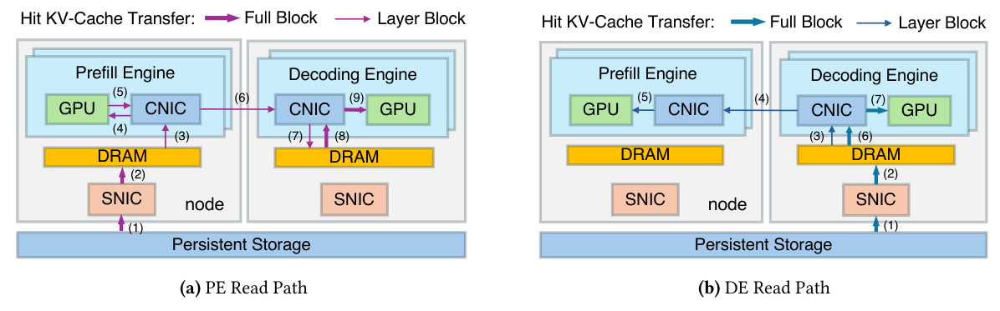
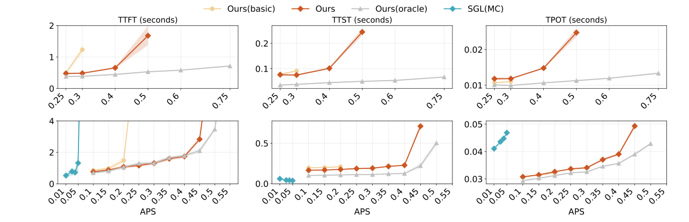
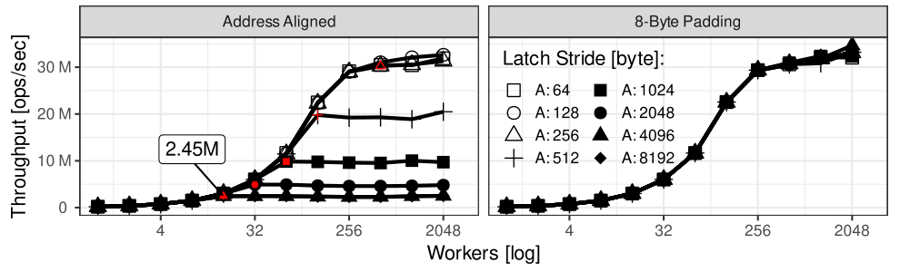
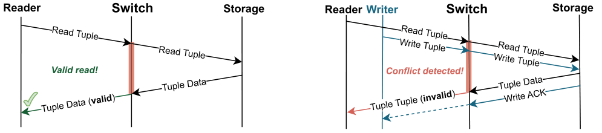
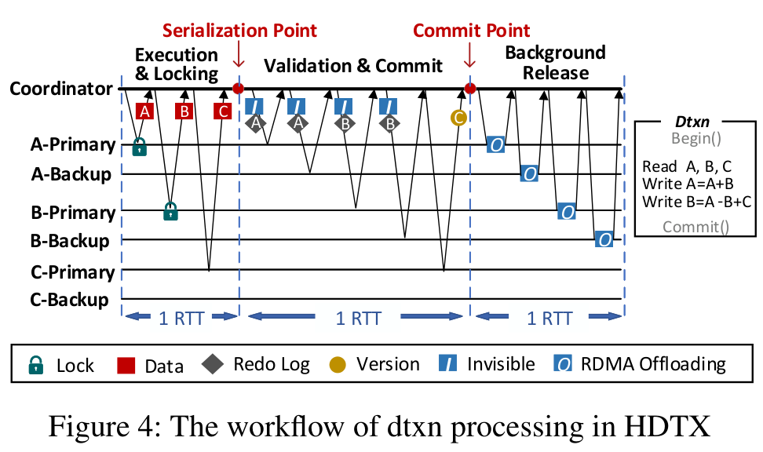
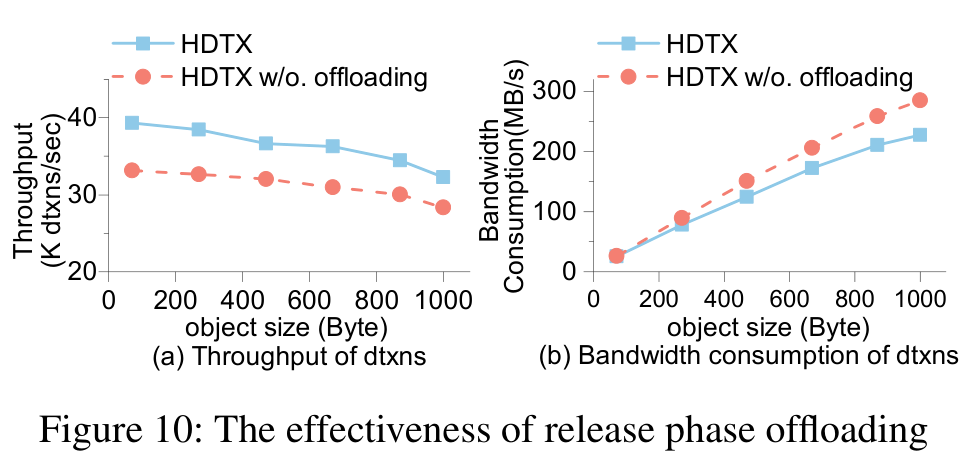
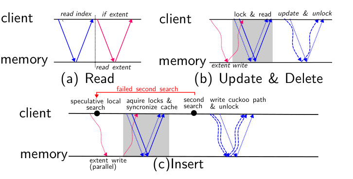
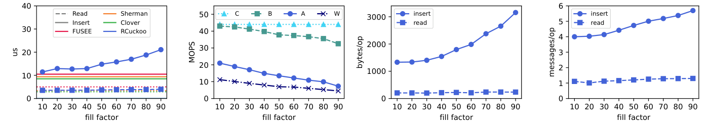
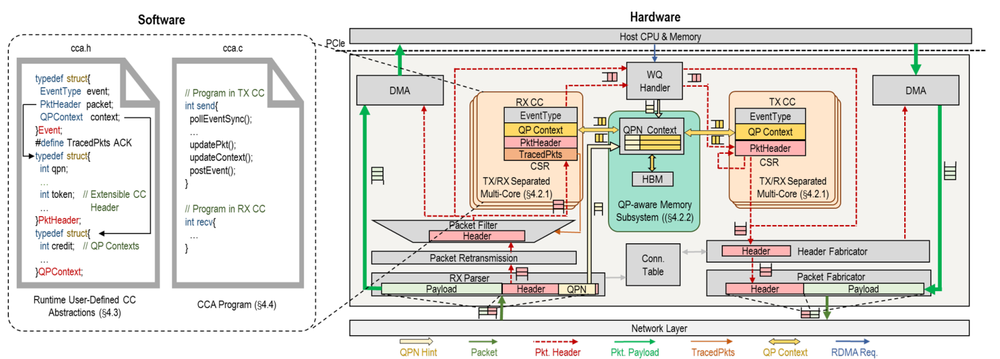
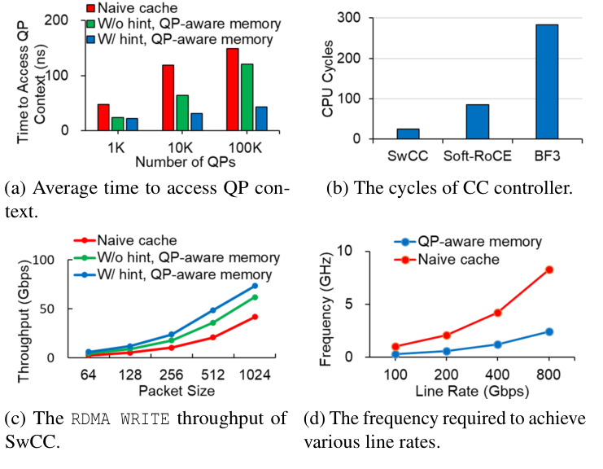

# 2026-11-15 RDMA 与分布式存储早报

[打开渲染页面](https://mingwangsong.github.io/rdma-daily/2026-11-15/)

本期为近期正式顶会论文回溯。未核实当日新增且正文可深入阅读的合格论文；数量以实际完成的深入阅读为准，不凑数。

## DualPath

### 问题不是 SSD 慢，而是可达带宽被数据路径割裂

DualPath 对应 SIGCOMM 2026 正式议程中的 **DualPath: Accelerating Agentic LLM Inference by Harvesting Disaggregated KV-Cache Storage I/O**。本次实际精读的是作者公开的 arXiv:2602.21548v2（2026-02-26，标题为 *Breaking the Storage Bandwidth Bottleneck in Agentic LLM Inference*），包含正文 §1–9、附录 A；下面数字均出自该版本，不冒充最终出版版差异已核对。主要单位：北京大学计算机学院、清华大学、DeepSeek-AI；这是旧文新增深读，不是今天新发表。

多轮 agent 的请求具有长历史、短追加：64K trace 平均 157 轮，每轮追加 429 token、生成 176 token，平均已有上下文 32,721 token（表2）。高 KV 命中减少了重新计算，却增加了读取压力。每 GPU 一张 400Gb/s 计算网卡，8 GPU 节点却只共享一张 400Gb/s 存储网卡。传统 P/D 分离只允许 prefill 节点读取历史 KV，decode 节点的存储口闲置。**3FS 已能打满单个存储口，继续优化 SSD 延迟并不能消除这个端口集中瓶颈。**

### 图4：完整块读盘、逐层 RDMA、只回传新增 KV

常规 PE 路径：存储 → PE DRAM 缓冲；逐层把历史 KV 搬入 PE HBM，计算未命中 token；把该层完整历史与新增 KV 送到 DE DRAM；全部层准备好后，DE 将完整 prompt KV 搬入 HBM 开始 decode。

新增 DE 路径：存储 → DE DRAM；PE 每处理一层，通过计算网络读取 DE 中该层历史 KV；计算后只把未命中 token 的新 KV 写回 DE 缓冲，与已经读入的历史拼接。这样不是把同一历史完整来回复制两次。DE 缓冲延迟 HBM 占用，代价是多一次 DRAM→HBM 与 DRAM 带宽消耗。每累计完整 token 块（论文举例 64 token）即写入持久存储。

磁盘使用 **Full Block=[layer,tokens,bytes]**，GPU 流水使用 **Layer Block=[1,tokens,bytes]**，避免把持久层请求碎成每层一个 I/O。块按 trie 保存；层块可直接拼成完整块（附录A.5）。这对分布式存储最直接的启示不是“换成 RDMA”：**介质访问粒度与计算消费粒度应分离，通过中间缓冲流水转换，而不是强迫 SSD 承接细粒度逐层访问。**

论文描述的是性能数据路径，不提供跨节点掉电恢复、写入确认的持久化屏障、部分块原子提交或多版本缓存一致性协议。因此“调用持久化”不能被解读为完整故障语义已解决。

### 绕经 RNIC 的意义：让所有 GPU PCIe 流量进入同一 QoS 域

即使是本机 H2D/D2H，也由配对 CNIC 发起 GPUDirect RDMA，而不直接依赖 CUDA copy engine。原因是 GPU PCIe 缺少可用 QoS，copy engine/GDS 路径与模型通信争抢 PCIe 时，单纯给网络包设置优先级无法隔离它们。统一经 CNIC 后，计算通信进入高优先级 VL，KV 进入低优先级 VL；NIC 和交换机配置加权仲裁，约 99% 带宽预留给高优先级，KV 借用空闲容量，同时避免彻底饥饿（§5、附录A.1）。这不是给 KV 永久限速到1%。实测提交单个 cudaMemcpyAsync 的开销约 5–7μs，RDMA Write 提交约1μs，doorbell batching 进一步摊薄开销；这只是提交成本，不是完整搬运延迟。

无瓶颈分析有前提：GPU–NIC 同 PCIe switch、负载均衡、计算网络无拥塞、后端可以持续供满存储口。每节点8 GPU、存储带宽50GB/s、DRAM约500GB/s时，推导的 P/D 节点比范围为 **1/7 ≤ P/D ≤ 7/2**（§4.2，式9）。不能将该结论泛化为任意存储网络下“天然无拥塞”。实验是 InfiniBand；RoCE DSCP/TC/PFC 是作者给出的移植方案，非同等规模 RoCE 实验结果。

### 两级调度同时管端口和 GPU，不能只看最短队列

调度器先根据未完成 token 数与节点存储读队列选择 PE：排除 token 超阈值的过载引擎，优先填充短读队列节点，再在候选中选 token 最少者。DE 先按组总 token 负载分配，再在有足够 HBM 的引擎中平衡 token 与请求数量。最后，整个请求选择 PE/DE 中较短的读取队列，**当前实现不把单请求切成两路同时读**。引擎内以预先拟合的 attention 时间估计装批，超过 compute quota 就对末尾请求做 chunked prefill，减少不同 GPU 等待最慢 attention 的同步空洞。阈值不是万能常数：附录使用约3秒可读取 token 的队列阈值、5秒可处理 token 的负载上限、300ms compute quota。

### 实验：提升的是可承载到达率，不能改写为 P99 改善

平台每节点8张 Hopper GPU、8×400Gb/s InfiniBand CNIC、独立400Gb/s存储口、双CPU；3FS无内部DRAM缓存。DS 660B 默认2P4D、DS27B 1P1D、Qwen32B 1P2D。DualPath为DeepSeek每节点分配80GB DRAM，Qwen为320GB；SGL(MC)每节点可用1.5TB DRAM。SGL(MC)组合SGLang/HiCache/Mooncake，但并行方式与框架不同，作者明确只将内部 Basic→DualPath 作为提升倍数依据，SGL 的失败配置标为 N/A，不当作无限慢。

- **离线（图7–9）**：批量全部轨迹的 JCT。DS660B常规配置最大1.87×加速；DS27B最大1.78×。另一个 P/D 配比扫描平均1.64×、最大2.46×，不是同一实验里的统一 headline。追加/生成变长时计算占比升高，读路径优化收益受限。
- **在线（图10）**：Poisson agent 到达，SLO设为 TTFT≤4秒、TPOT≤50ms；DS27B和DS660B可承载APS分别提升1.67×和2.25×。图中阴影是结束前150秒波动，不是P99；TTST/TPOT超过SLO的点被省略。作者声称未增加decode开销，不等于给出了所有故障/拥塞条件下的尾延迟保证。
- **消融（图12右）**：相对Basic，逐层prefill平均JCT下降17.21%；叠加双路径后累计下降38.19%；再加调度累计下降45.62%。这些是相对同一基线的累计比例，不能相加。
- **规模（表3）**：离线2P4D/2K agents的3167秒，对比48P96D/48K agents的3201秒，属于负载随资源扩大的弱扩展；在线0.4→8.8 APS提升22×，对应2P4D→44P88D，不能称为单节点性能提升22×。

### 给存储研发的落地实验

**优先试验点：KV存储客户端的目的端选择与读任务转发，而不是改写后端一致性协议。**先搭1P1D和1P2D，每节点独立存储NIC与更宽的计算RDMA路径，保留相同3FS/对象存储后端，对照PE-only、双路径无调度、双路径有调度三组。固定模型、上下文命中率、请求到达率与内存预算，扫块大小、P/D比、存储口限速及背景collective占空比。至少采集SNIC利用率/队列、RNIC PCIe吞吐、DRAM带宽、TTFT P50/P99、TPOT P99、JCT、GPU空泡和单位请求CPU。

**收益成立条件**是客户端入口带宽不均、旁路节点确有闲置入口、计算网络有剩余带宽。若瓶颈已是后端SSD队列/存储交换机上联，总入口聚合只会前移队列，无法创造容量。通用存储中没有P/D天然角色，可将思想迁移到具有空闲入口的读取代理，但会增加一次转发、内存复制、权限边界和代理故障处理，不能照搬论文倍数。

**需补齐的工程语义（本报告推断）**：块键应包括模型/权重版本、token前缀、层和布局版本；完整块以校验和及原子可见标记提交；中转DE故障后，读请求需幂等重试或重算，不把部分层当成命中；为低优先级KV设定最小进展保证并测试collective持续占满时是否超时。这些不是DualPath已证明的特性。

### 阅读材料与范围

已读作者v2全文、图表与附录，未获得最终ACM全文逐项差异核对；未发现可核实的完整DualPath开源实现或作者报告，论文实现是内部框架约5K行修改。底层项目可辅助理解，但不等于可复现系统：[3FS](https://github.com/deepseek-ai/3FS)、[DeepEP](https://github.com/deepseek-ai/DeepEP)、[FlashMLA](https://github.com/deepseek-ai/FlashMLA)。[正式会议议程](https://conferences.sigcomm.org/sigcomm/2026/program/papers/) · [v2 PDF](https://arxiv.org/pdf/2602.21548v2) · [版本与来源](https://arxiv.org/abs/2602.21548)。

DE先读历史KV后，PE逐层取用，只把新增KV写回；完整块用于后端I/O，层块用于计算流水。图中DE DRAM缓冲节省HBM但增加DRAM和CNIC压力。

来源：Yongtong Wu、Shaoyuan Chen、Yinmin Zhong 等（实际阅读v2作者表13人），SIGCOMM 2026（正式议程确认）；解读基于作者 arXiv v2，图4，PDF第5页。原文：https://arxiv.org/pdf/2602.21548v2

DS27B/660B在线APS容量分别提高1.67×/2.25×；阴影只是末150秒波动，不是P99。TTST、TPOT超出SLO的数据点被省略，不能把画面中曲线解释为无限负载稳定。

来源：Yongtong Wu、Shaoyuan Chen、Yinmin Zhong 等（实际阅读v2作者表13人），SIGCOMM 2026（正式议程确认）；解读基于作者 arXiv v2，图10，PDF第12页。原文：https://arxiv.org/pdf/2602.21548v2

## RDMA同步语义与400G原子瓶颈

**论文**：Synchronizing Disaggregated Data Structures with One-Sided RDMA: Pitfalls, Experiments and Design Guidelines。**ACM TODS 50(1), Article 4，2025-03-06 发表；2025-02-03 接受**。这是 SIGMOD 2023 工作的 40 页期刊扩展版，不是 SIGMOD 2025，也不是今日新论文。**机构**：TU Darmstadt、TU Munich、Google、DFKI；Jacob Nelson-Slivon 的工作在 Lehigh University 完成。

**为何现在读**：远端索引节点、共享缓存目录和对象元数据经常同时踩中两个坑：应用层没有锁冲突，RNIC 内部却串行化；头尾版本一致，也不意味着中间数据来自同一时刻。本文新增的 ConnectX-7/400G 实验证明，单纯升级链路并不消除前者；交换机辅助同步则展示另一条路径，但不能直接当作生产级容错方案。

## 1. 根因不是网络乱序，而是内存访问语义被过度推断

同一 RDMA READ 横跨多个 cache line 时，PCIe completion 按地址交付，不意味着每条 cache line 也按地址从内存取出。一个读者可能先取得相等的头尾版本，然后才取得正在被修改的中间数据；bookend versioning 会把 torn read 判为成功。甚至“先用一个 READ 取得版本和数据，再单独读版本复核”也不总是正确：第一次 READ 可以先看到旧数据、后看到新版本，第二次版本仍是新的，错误便漏检（§4.2）。

严格版本方案必须先单独读同一 cache line 内的 latch+version，等待完成，再读数据，执行本地操作后再次读版本验证。不能仅因放在同一 QP 就把前两次 READ 重叠；论文区分了 completion 顺序与实际远端读顺序。这里讨论的是保护本地操作期间数据不变的 **latch 语义**，不是任意事务隔离或持久化。只要求 KV GET 返回一个一致快照时，可省去操作后的额外验证，但仍不能省掉初始快照一致性保护（§6）。

替代方案也并非免费：CRC64 是概率性检测且计算开销随数据长度增长；FaRM 风格逐 cache-line 版本利用 coherent DMA 检查每条线，但每 64B 需要额外 2–8B 元数据，且字符串等连续布局要处理版本插空。论文在其环境下观察到，小于等于 64KiB 时逐线版本较强；大对象时额外一次固定 RTT 的版本方案更容易摊薄成本。不能把这个交叉点视为所有 RNIC 的常数。

## 2. 为什么没有业务热点，CAS 仍会退化

作者以每 worker 独占一个 8B latch 排除逻辑冲突，却发现 4KiB 对齐使吞吐退化到近似所有线程争抢同一个 latch。其**逆向推断**是 RNIC 内部锁表主要依赖地址低 12 位；不同远端地址可能映射到同一硬件槽。这不是厂商公布的内部规格。

对策是让 latch 地址低位分散：块间加 8B padding，或把 latch 独立紧密排列。代价是页布局、地址转换和局部性改变，因此不能只跑 CAS 微基准。悲观锁的进一步优化包括同 QP CAS 后投机 READ、WRITE 与解锁重叠、异步解锁；最后一种必须直到 completion 后才能复用本地发送缓冲。用普通 WRITE 释放同时被 FAA 更新的读写锁则可能丢失解锁：FAA 从旧 RNIC 缓冲读出锁状态，随后覆盖 WRITE 的释放结果。论文仅在特定 CAS-only 条件及写入顺序假设下讨论 write-unlatch，不能泛化为通用优化。

**读图（原图17，p.23）**：左图固定对齐后，大 stride 曲线很早饱和，图中标注约 **2.45M ops/s**；右图仅增加 8B padding，曲线便重新重合并扩展。数据是原子操作吞吐，不是事务吞吐，也不是尾延迟；所以正确结论是“这套 400G 配置仍有地址布局引发的物理冲突”，不是“400G 不比 100G 快”。

## 3. 从 RNIC 移到交换机：不只搬走锁，还必须管理 RDMA 协议状态

交换机保存 tuple→version，奇数表示写锁持有。写者先向交换机取锁，随后数据 WRITE 穿过交换机到存储节点；交换机看到目标 WRITE ACK 后自动递增版本并释放锁，避免客户端再发一次解锁。读请求经过时保存其版本，读响应返回时再次检查，并把有效/无效标记嵌入 tuple 响应。若上层还需要 latch 语义，客户端操作后仍要向交换机复查版本。

**读图（原图23，p.29）**：右侧写入落在读请求和响应的红色区间，即使取回的数据看起来完整，也必须标成无效后重试。机制不是推测 cache line 的先后，而是把整个远端读取包在交换机可见的版本窗口中。代价是所有相关读写必须经过同一个负责该 tuple 的交换机。

实现细节决定它能否运行：RDMA 响应不带原始地址，所以交换机维护 client→tuple 和 client→version；对某些请求直接应答会使客户端与存储端 PSN 不同，还需要 PSN offset 调整表。论文另用“最近处理 PSN”寄存器检测重传，避免重复执行 latch；写数据时把新版本注入 tuple header，交换机故障后从存储节点重建版本表（§5.5）。这些是论文描述的恢复机制，**不能据此认定已证明任意在途写、并行 QP、多交换机切换下的线性化和无损恢复**。文中原型按客户端槽保存当前请求状态，增加并行 outstanding 请求需要另审索引和状态生命周期。

## 4. 实验证据与边界

- **100G 基线（§2.4、图4–5）**：8 节点，双路 Xeon Gold 5120、512GB、ConnectX-5、InfiniBand EDR，内存放 RNIC 所在 NUMA 节点。原子微基准为 4 计算+1存储；64B stride 下独立 CAS 在128 worker约51.2M ops/s，同一地址争用峰值2.32M，约8 worker后不再扩展。512 worker附近下降涉及客户端QP cache thrashing。
- **400G 新实验（§5.1、图17）**：两台单路 EPYC 9554P，各64核、768GiB，每机两张 PCIe5 ConnectX-7，Tofino2 400G RoCE；同一原子区域仅由一个 RNIC 处理，不能假设跨 RNIC 原子一致性。测试规模与100G不同，不能直接对比峰值作硬件代际排名。
- **真实系统边界（§3.5、图10）**：NAM-DB，4计算+4存储，112 worker，20M tuple。256B tuple 的均匀/轻微偏斜只读负载中，锁流水化约翻倍；高偏斜时收益消失。这里不是所有负载2倍，更不是P99减半。
- **交换机原子（§5.4、图22）**：四个100G客户端连接Tofino1，最高2048 worker，每worker同步等completion；争用和不争用均约110M ops/s，约为其NIC-to-NIC基线两倍。该结果不是400G全系统事务吞吐。
- **交换机读写（§5.5、图25–26）**：1KiB tuple的读写延迟拆解约达到基线两倍性能；伸缩实验为4计算+1存储、140,000 tuple、64–1024B、四种读写比例、最多512 worker。**没有事务**；目标100G连接及CPU超订阅会限制伸缩。未据此提供P99或持久化收益。

## 5. 对分布式存储的落地顺序（分析建议）

**先改可验证的软件瓶颈，不先买可编程交换机。** 对共享缓存目录、远端B+树内节点、slab/extent元数据，第一步审计所有“一个READ取得数据+版本”的实现，明确 snapshot 与 latch 语义。构造 writer 全字段同版本写入、reader 检查全字段一致性的 torn-read 压测；“跑一天没错”只提供反例搜索，不能替代排序语义证明。

第二步做“地址布局×对象大小×并发×热点”矩阵：stride 64/256/512/4096B，对照+8B padding和独立latch数组；对象256B/4KiB/16KiB；均匀与热点；同步/异步解锁；记录ops/s、P50/P99、CAS重试、每请求RDMA数、CPU周期和NIC带宽。逐线版本增加内存/网络开销，独立锁数组增加地址翻译，必须计入真实查找路径。本文吞吐数据只提供试验优先级，不替代本机测量。

交换机方案优先试于容量可控、热点稳定的小元数据，而非任意大KV；需要P4交换机、路径可控、足够寄存器、PSN状态管理及降级路径。用丢包/重传、客户端持锁退出、WRITE已到但ACK未到、交换机重启四类注入验证恢复，再谈生产化。对NVMe-oF数据面不能直接迁移“ACK即解锁”为“已持久化”：RDMA传输完成不等于SSD持久化完成。

## 资料与阅读范围

已读期刊正文§1–7（p.1–36），核对参考文献与末页收稿信息；重点复核§3.2、§4.2–4.3、§5.1、§5.4–5.5和图17/23。作者代码README已读，仓库标题与README明确对应SIGMOD2023基础版，未核实含2025交换机扩展；未执行硬件复现，未发现可核实的扩展版报告链接。

- [正式出版记录](https://doi.org/10.1145/3716377)
- [作者机构PDF](https://www.informatik.tu-darmstadt.de/media/systems/pdf_publications/rdma_sync_tods.pdf)
- [DFKI出版记录](https://www-live.dfki.de/en/web/research/projects-and-publications/publication/16453)
- [作者基准仓库](https://github.com/DataManagementLab/RDMA_synchronization)，本次看到commit `f658c2e7cdf77af2d9776cb01e4b1e3604a21df8`；`frontend`为锁与基准，`distexperiments/experiments`为脚本。未找到明确根目录LICENSE，故不公开打包源码，不把公开可读称作宽松开源许可。

图17、23均为Jasny等，TODS2025最终期刊版的少量原图裁切，仅用于紧邻的实验与机制评论，保留轴、图例、来源及图号；原PDF载明非个人/课堂再发布需许可，本报告不公开镜像全文。两幅图是40页作品中的最少必要片段，不构成图集或替代原作；有限学术评论引用是本次使用依据，并非对任何司法辖区的法律保证。

左图大stride下原子吞吐约2.45M ops/s早饱和；右图增加8B padding后曲线重合并扩展。是原子吞吐，不是事务吞吐或尾延迟，不能据此断言400G不比100G快。

来源：Matthias Jasny、Tobias Ziegler、Jacob Nelson-Slivon、Viktor Leis、Carsten Binnig，ACM Transactions on Database Systems 50(1), Article 4，图17，PDF第23页。原文：https://www.informatik.tu-darmstadt.de/media/systems/pdf_publications/rdma_sync_tods.pdf

写入发生在读请求和响应之间时，交换机把数据标为无效，避开对PCIe取数顺序的错误假设；要求所有相关访问经过同一负责交换机。

来源：Matthias Jasny、Tobias Ziegler、Jacob Nelson-Slivon、Viktor Leis、Carsten Binnig，ACM Transactions on Database Systems 50(1), Article 4，图23，PDF第29页。原文：https://www.informatik.tu-darmstadt.de/media/systems/pdf_publications/rdma_sync_tods.pdf

## HDTX

**Fast Distributed Transactions for RDMA-based Disaggregated Memory** · USENIX ATC 2025，正式论文，pp.943–958；会议 2025-07-07 至 07-09，论文集 2025 年 7 月。**近期补读，不是今日新发表。** 作者 Haodi Lu、Haikun Liu、Yujian Zhang、Zhuohui Duan、Xiaofei Liao、Hai Jin、Yu Zhang 均来自**华中科技大学**，计算机学院及大数据技术与系统国家工程研究中心等研究平台。正式身份由 USENIX 会议论文页和论文集扉页核实。

## 为什么值得存储研发读

问题不是 RDMA 写入本身慢，而是分布式事务的锁定、校验、备份提交、主副本提交串起多个 RTT，而且将新值既放进日志又从计算端重传到数据区，重复占用网络。HDTX 面向**计算节点运行事务、内存节点几乎不执行前台逻辑**的主备远端内存架构。最有价值的迁移点是小对象元数据事务、远端内存 KV 和复制日志的 apply 路径，不是直接替换 NVMe-oF SSD 写入协议。

## 机制：省的是依赖链，不是省掉一致性工作

**① Redo log 让校验和提交可以同轮进行（§4.2、图4）。** 计算端先用批处理 FAA + Read 获取写锁和数据；只读对象不加写锁，保留版本供后续验证。下一轮一边读只读集的版本和可见位，一边向主、备写 redo log，并将写集置为不可见。只有所有副本日志确认且只读验证成功，事务才对客户端提交。第三轮仍存在，但放到后台：以日志更新数据，更新版本，恢复可见位并解锁。图中 **2 RTT 是无争用、元数据缓存命中等条件下的提交临界路径，不是完整释放仅需两轮**；执行中发现新对象、锁等待、地址查找都会增加往返。

这里 redo/undo 的差别来自 RNIC 操作顺序：undo 方案必须先将数据标为不可见，再原地写新值，Atomic→Write 需要 Fence；redo 方案先 Write 日志再 Atomic 修改可见性，不会在提交阶段覆盖旧值，可避开这条额外依赖。验证失败时丢弃 redo、恢复可见性并释放锁即可，但日志传输带宽已经付出。该优化并非让高冲突事务“无代价回滚”。

**读图：** A、B 是写集，C 是只读集。第二轮对 A/B 的主备日志传播与 C 的版本验证并行；红色 Commit Point 右侧的 O 才是后台 offloading。把右侧全部删掉会得到错误的“日志写完即所有读者立刻看到新值”的理解。原图：Lu 等，ATC 2025，图4，正文 p.947（PDF p.6）；[原文](https://www.usenix.org/system/files/atc25-lu.pdf#page=6)。

**② RNIC 自己做 redo→数据区的本地复制（§4.3、图5–6）。** 内存节点初始化两条 work queue。一条接收计算端发来的源地址、目的地址和长度，把这些信息覆写到另一条队列的待执行 WQE；另一条以 Wait 阻塞，Recv 完成事件解锁后，Enable 促使 RNIC 取新的元数据，再执行 Write。完整释放用两次 Write 更新数据和版本，再 FAA 更新可见位/释放锁。计算端只发触发与地址信息，不再把整份新值重传。它省的是 fabric 上的第二份 payload，**不是消灭内存/PCIe 数据移动**。队列 WQE 会耗尽，后台 CPU 线程仍需批量补充；“不用内存端 CPU”应限于前台逐事务 apply，不可理解为节点永久零 CPU。

**③ 64 位原子锁中放两个排队计数器（§4.4）。** 可见位与两组 current/max 计数放进 8 字节，普通队列 16+16 位、优先队列 15+15 位，另有保留位。FAA 分配 ticket，同优先级 FIFO，高优先级在当前持有者释放后先于普通队列取锁；不是抢占正在执行的持有者。等待端 RDMA Read 轮询，并按队列长度间隔退避。溢出用 canary 和 CAS 重置处理。实验把 20% 请求标为高优先级，因此其延迟改善不能解释为所有请求同时得到相同比例收益。

## 实验：把硬件前提、基线和消融放在一起看

- **平台（§5.1、作者报告 p.22）：** 5 台服务器，每台 128 GB DRAM、1 TB Intel Optane DCPMM、双路 Xeon Gold 6230（每处理器 20 核，2.10 GHz）、ConnectX-3 40/56 GbE。默认 1 个计算节点、2 个内存节点双副本；内存节点仅保留一个初始化 CPU 核，DCPMM App Direct。报告补充 **DDIO OFF**。采用 RC，Write 后 Read 日志末字节作为本文平台的远端持久化完成机制。不得把这一条件泛化为任意 RNIC/PCIe/SSD 的持久化保证。
- **基线：** FORD 与面向 DM 改写的一侧 RDMA FaRM，**不是原版 Microsoft FaRM 的端到端产品对比**。各实现均使用协程、outstanding requests、doorbell batching。宏基准 16 线程×7 worker 协程，三次试验取平均。
- **TPC-C（图8）：** 默认 20 warehouses，92% 读写事务，最大对象 672 B。对 FORD，HDTX 吞吐提高 **84.7%**、平均延迟降低 **72.1%**、p99 降低 **60.9%**。三种指标不能互换。SmallBank 的对象 16 B、约 85% 读写；TATP 最大 48 B、约 80% 只读，HDTX 与 FORD 性能接近，说明这不是对任何访问比例都同样有效的优化。
- **FCP 消融（图9）：** 64 个 coordinator，每事务访问两个对象，改变写比例及 uniform/skew 分布；偏斜访问下对禁用 FCP 的版本，平均延迟最多降低 **67.7%**。这是同一系统的协议消融，比直接归因宏基准全部收益更可信。
- **释放卸载消融（图10）：** 加背景 RDMA 流量制造高网络负载，每事务四个对象，尺寸 64 B–1 KB。对禁用卸载的 HDTX，网络带宽消耗最多降低 **19.1%**、吞吐最多提高 **18.5%**。曲线两端并不意味着这两个最大值一定发生于同一对象尺寸。

**读图：** 右图随对象放大，去掉卸载的网络流量增长更陡；左图两条吞吐均下降，说明卸载减少复制开销，但没有消除大对象成本。尤其 64 B 附近右图几乎重合，不应宣称小对象也节省固定 19.1% 带宽。原图：Lu 等，ATC 2025，图10，正文 p.953（PDF p.12）；[原文](https://www.usenix.org/system/files/atc25-lu.pdf#page=12)。

- **优先锁（图11）：** skewed workload 下随机挑选 20% mission-critical 请求，相对 CAS、普通 FAA 锁，这部分请求的平均延迟分别降低 57.1%、52.8%，尾延迟分别降低 50.2%、63.3%。作者正文此处称 tail latency，勿自行加称 p99.9。
- **扩展性边界（图13）：** 最多只有 3 个计算节点、420 个 coordinator。TPC-C 超过单节点 140 coordinator 后，各系统吞吐均因冲突下降，HDTX 更好不等于线性扩展。§5.1 还将 latency 定义为相邻已提交事务间隔；做自身系统对照应额外记录从请求到响应的完整延迟与排队时间。

## 故障与迁移：该验证什么，不能直接承诺什么

**作者的故障协议（§4.5）：** fail-stop、非 Byzantine；锁租约依赖时钟速率近似一致，默认租约 1 ms。等待者看到超时且数据仍可见，按死锁处理并 CAS 移交锁；不可见状态超时则恢复 coordinator。恢复者检查 redo 和事务状态：已有对象更新，或客户端已被确认提交，就继续 Release，否则可 abort。内存节点在 Release 前故障使事务终止；Release 期间故障由新计算节点修复该副本。网络分区只允许 primary partition 服务。**正文没有给出覆盖这些窗口的故障注入性能曲线**，故不能从正常路径结果推断恢复 RTO。客户端提交确认如何成为恢复者可靠可观察状态，也应在生产移植时专门审计，不只照搬文字规则。

**工程分析与建议（非作者实测）：**
1. 先在远端内存 KV/文件系统元数据的 2–4 key 原子更新试验 FCP，保持现有复制、校验和 fencing。用热点比例、写比例、对象大小扫描测 commit 延迟与 commit→visible 延迟，后者是后台释放欠账的直接指标。
2. 移植 RNIC-offload 前先做设备能力探针。作者代码依赖 **MLNX_OFED 4.x**，README 明确 5.x 因 API 变化不兼容；不能把 ConnectX-3 的 Wait/Enable 路径当成任意现代 RNIC 的可移植 verbs。没有该能力时保留 FCP、用内存端线程 apply，分开量化 CPU 代价与省下的 fabric 字节。
3. 在相同双副本和持久化域下，对比 baseline/FCP/FCP+offload/FCP+offload+priority 四组；统计 RNIC bytes、PCIe/内存带宽、队列补充 CPU、abort/retry、锁等待分位数及普通请求饥饿。64 B、256 B、1 KB，写比例 10%/50%/90%，前台优先流量 0%/20%/80% 足以初筛收益是否来自预期路径。
4. 逐一在日志仅到一个副本、全部日志到达但未确认客户端、确认后尚未 apply、部分副本已可见、持锁 coordinator 暂停后恢复等位置注入故障；检查无脏读、无已确认事务丢失、旧持有者不能继续写，以及恢复时间。切换到 NVMe SSD 时必须重新设计 flush/FUA 与恢复协议，不能沿用 read-after-write 即持久化的假设。

## 阅读与资料

已读论文正文 §1–7、相关参考文献条目，核对原图4/10和实验正文；已读作者 25 页报告，并查看公开仓库 README、许可、事务提交入口及 Wait/Enable 实现位置。未运行硬件复现实验，未观看报告视频。

- [正式论文页](https://www.usenix.org/conference/atc25/presentation/lu) · [PDF](https://www.usenix.org/system/files/atc25-lu.pdf)
- [作者报告 PDF](https://files.usenix.org/s3fs-public/conference/protected-files/atc25_slides-lu_haodi.pdf) · [报告视频](https://www.youtube.com/watch?v=xUZ2m3U_qvk)
- [代码](https://github.com/CGCL-codes/HDTX) · 核对版本 `9f9272b9aae0560d4fb30cb4d19f9d1bb8ff7e11`，根许可 Apache-2.0；第三方目录另行处理，未做全仓公开镜像。

图4与图10仅作为相邻机制/实验批评所需的少量原图引用，保留标识与原文入口；不以开放访问等同再分发许可，不公开转载完整论文或报告。使用依据及归档明细见本期资料清单。

A、B是写集，C是只读集。第二轮对A/B的主备redo日志传播与C的版本验证并行；Commit Point右侧才是后台offloading。因此2RTT只描述提交临界路径，不能理解为全部副本已完成apply、版本更新和解锁。

来源：Haodi Lu、Haikun Liu、Yujian Zhang、Zhuohui Duan、Xiaofei Liao、Hai Jin、Yu Zhang，USENIX ATC 2025，正式发表，pp.943–958，图4，PDF第正文947 / PDF 6页。原文：https://www.usenix.org/system/files/atc25-lu.pdf

高背景网络负载、每事务4个对象、64B–1KB扫描。对象越大，不卸载的网络流量增长越陡；两组吞吐均随对象放大下降。64B附近带宽接近，不能把最多19.1%的节省当作所有尺寸固定收益；最多18.5%吞吐改善也不必与该最大带宽节省同点发生。

来源：Haodi Lu、Haikun Liu、Yujian Zhang、Zhuohui Duan、Xiaofei Liao、Hai Jin、Yu Zhang，USENIX ATC 2025，正式发表，pp.943–958，图10，PDF第正文953 / PDF 12页。原文：https://www.usenix.org/system/files/atc25-lu.pdf

## RCuckoo

**论文**：Cuckoo for Clients: Disaggregated Cuckoo Hashing。**作者与单位**：Stewart Grant、Alex C. Snoeren；论文署名均为 University of California San Diego（UC San Diego），不是作者目前任职单位。**正式发表**：USENIX ATC 2025，pp.959–972，会议 2025-07-07 至 07-09；官方页面注明论文于 2025-07-07 向公众开放。**本期状态**：既有正式论文补读，不是今日新论文。

## 问题不是“锁一定慢”，而是锁和数据布局没有协同

远程小 KV 的乐观哈希索引通常把 8 B 槽位留给指针，使 CAS 能原子替换指针；代价是先读索引再读 value，存在依赖的两轮 RTT。将 value 内联能省掉第二轮，但更新不再局限于 8 B，必须处理并发写、撕裂读，以及 cuckoo 插入时的多槽位搬迁。传统独立双哈希让搬迁链横跨随机远程地址，逐项读、逐项加锁会把一次插入放大成多轮网络访问。

RCuckoo 的思路是同时改变**候选地址分布、锁编码和 RNIC 内存位置**，而非简单给哈希表加锁。它面向被动远程 DRAM，正常数据路径仅用单边 RDMA，内存端 CPU 不执行请求逻辑。没有提供范围查询。

## 数据布局和真实操作路径（§3）

- 每行通常 8 个等宽 entry，末尾有 8-bit version 与 64-bit CRC，CRC 覆盖整行及版本。小 value 内联；大 value 使用 48-bit extent 指针与长度编码，extent 来自预注册、按 client 分离的内存区。key/entry 尺寸建表时固定。
- 锁是 RNIC device memory 中的位图，实验每 bit 保护 16 行。masked CAS（MCAS）可在一次操作中修改一个 64-bit 范围里的多个锁位。多组锁按地址递增加锁以避免死锁；未拿齐的重试必须释放已持锁。虚拟锁以取模映射到物理锁位，可扩展表规模，但引入 false sharing。
- **读**：本地计算两个候选行并同时读；相邻行用一个 covering read 覆盖。验证 CRC 后返回内联值，一轮 RTT；extent 还需第二轮读。不需要加锁，但 CRC 失败要重试。
- **更新/删除**：第一批发送 MCAS 和受 SEND FENCE 约束的行读取；成功后第二批写 entry、version/CRC，再按序解锁。无竞争常见情况两轮。extent 更新先写新 extent，再发布索引，旧 extent 通过空闲标志和客户端扫描回收。
- **插入**：先用本地 64 KB 索引缓存做 BFS 猜测搬迁路径；随后锁定路径覆盖的行，并读回这些行刷新缓存。拿到锁后必须再次搜索，只允许使用已锁行；缓存过期不影响正确性，但可能重试。找到路径后从空槽向前逐行搬移，最后写新 entry，并解锁；找不到则释放、重试。实验最大搜索深度为 5，超限返回表满，而不是无限搜索。

**图3读法**：灰区是“锁获取 + 行读取”合批，不是先读旧缓存再直接写。插入的第二次本地搜索是正确性关口；红色回环表示猜测失败导致重新联网。蓝色写曲线仍逐行有序推进，不能误解为多行原子写。来源：Grant、Snoeren，ATC25 正式版，印刷 p.962 / PDF 第5页，Figure 3。

**为什么局部性有效**：第二候选位置不是独立随机地址，而是相对第一个位置的随机偏移；偏移范围具有概率长尾，保留少数远距离选择，避免固定邻域太小导致表很早填满。实验设 f=2.3，每行8项时最大填充率超过95%，68%的键两个位置相距不超过5行；在100K行表填至95%的实验中，95%的插入搬迁路径跨越不超过32行。于是一次 MCAS 更可能覆盖整条链，covering read 也更划算。代价是局部热点与读放大，需要在局部性、表利用率、锁竞争间调参，不能把95%当作任意数据分布的保证。

## 故障恢复：修复表，不等于完整容错存储（§4）

客户端 fail-stop 若留下锁或不完整的行，另一个客户端在持续失败达到100 ms 后检查：行CRC若不断变化，说明可能是活跃热点，重置计时器。确认故障后以 CAS 获取该表区域的 repair lease，保证同一区域只由一个恢复者修复。逆向搬迁保证中途通常表现为重复项、坏CRC，或两者；恢复者逐项检查两个候选位置，修正CRC、去除重复，再解锁。恢复过程本身可由下一恢复者继续。

**重要边界**：论文没有实现可靠的慢客户端隔离协议；§4.4 明确承认超时后旧客户端仍可能回来继续写，并提出独立 liveness/fencing 方案，但测试床未实现。不能把100 ms超时解释成“租约到期会自动撤销旧 rkey”。论文也不解决内存服务器失效、持久化与复制；动态 resize 留待后续。因此更适合缓存或可重建索引原型，不能直接替换强持久化元数据服务。

## 实验：小对象收益清楚，插入密集时并非全胜（§5）

配置为9台双路 Xeon E5-2650 2.20 GHz、每机256 GB DRAM、ConnectX-5 双口网卡及100 Gb/s Mellanox Onyx交换机；1台内存服务器、8台客户端。实现依赖 OFED-4.9 的 masked CAS 和 device memory。主要实验：100M entry 表预装90M，key/value 各32 bit，Zipf θ=0.99，最高320客户端；比较 FUSEE、Clover、Sherman。FUSEE 关闭复制以单内存节点运行；Clover允许客户端索引缓存；Sherman有范围查询和不同内存端CPU假设，功能不等价。

- Figure 6：论文报告320客户端下 YCSB-B（95%读、5%更新）最高2.5×、YCSB-A（50%读、50%更新）最高7.1×比较系统吞吐；这是特定偏斜、小值条件下的吞吐比，不是延迟降低比，更不是对每个基线都7.1×。FUSEE在作者平台未能扩至250以上客户端，也应纳入可比性判断。
- **更值得用于容量规划的反例**：纯插入吞吐从近空表11.5 MOPS降到90%填充时4.5 MOPS；FUSEE最高9.1 MOPS且不依赖填充率。高填充、持续插入时，RCuckoo会输，并非所有混合负载都占优。
- Figure 8(b)：在100M项表85%→95%的插入阶段，dependent hashing+BFS相对independent hashing+DFS使p99插入RTT数量减少约一个数量级；这是网络轮次数，不是端到端p99延迟同倍缩短。
- Figure 8(a)：截断插入RDMA批次模拟fail-stop，约500次故障/秒前吞吐保持较高；不包含上述延迟旧写、内存节点失效或真正部署控制面恢复。

**图7读法**：横轴是填充率；从左到右实际分别是延迟、吞吐、bytes/op、messages/op。原图caption把(a)/(b)名称交换，本文按坐标轴解读。填充提高时，读几乎不受影响，插入延迟、消息量和字节量一起上升；这是搬迁路径/重试变多，而不是简单“网卡变慢”。第二面板W曲线对应11.5→4.5 MOPS，说明容量利用率与写入SLO必须共同规划。这里A/B是读/插入混合，不能与Figure 6的读/更新混为一谈。来源：同论文，印刷p.969 / PDF第12页，Figure 7。

## 对分布式存储的可执行启发（分析推断）

优先迁移到**远程小对象索引、块指纹→位置映射、可重建的缓存目录**，不直接迁移到大块payload路径。内联值避免指针追踪，RNIC锁位图减少PCIe原子往返；但CPU要承担CRC、BFS与缓存管理，网络承担覆盖读、搬迁写和重试，device memory与MCAS是硬件/驱动前提。虚拟锁会使不相关分片互相争锁，需要监控每物理锁位的冲突与持锁时间。

最小验证用1台内存节点+2台客户端即可：固定NIC、队列数、CPU绑定，扫8/16/64 B entry、50/80/90/95%填充、均匀/Zipf0.99、读/更新与读/插入两类负载；分别关闭dependent hash、RNIC device-memory锁和索引缓存做消融。记录吞吐、p50/p99、CAS重试、每操作字节/消息、路径长度和分配放大。上线门槛不是复现峰值，而是在目标填充率与热点下达到p99预算，并通过暂停客户端超过100 ms后恢复写入的对抗测试；没有可靠fencing就只用于可丢弃缓存。

## 阅读与参考

已读正式论文全文§1–6、恢复讨论与实验，实际渲染核对Figures 3、7；未运行实现、未观看报告视频。检索作者主页与论文，未找到可确认对应本论文的公开代码地址，故不冒用同名Rust cuckoo项目，也未fork。官方页面提供演讲视频入口。

- [正式论文 / 报告入口](https://www.usenix.org/conference/atc25/presentation/grant)
- [论文PDF](https://www.usenix.org/system/files/atc25-grant.pdf)
- [作者托管PDF](https://cseweb.ucsd.edu/~snoeren/papers/cuckoo-atc25.pdf)
- [会议技术日程与公开日期](https://www.usenix.org/conference/atc25/technical-sessions)

资料说明：本文只保留支撑机制、性能评论所必需的Figures 3、7局部截图与原创分析，来源为USENIX正式版。未见明确通用再分发许可，不归档整篇PDF；两图按学术评论的有限引用评估，不替代原论文。

灰区合批锁获取与行读取；插入锁后第二次搜索是正确性关口，猜测失败触发重试。蓝色写仍逐行有序，不能视为多行原子写。

来源：Stewart Grant、Alex C. Snoeren，USENIX ATC 2025，pp.959–972，图3，PDF第5页。原文：https://www.usenix.org/system/files/atc25-grant.pdf

原图caption把(a)/(b)名称交换，按轴从左到右实际为延迟、吞吐、字节量、消息数。纯插入W从近空11.5 MOPS降至90%填充4.5 MOPS；这里A/B为读/插入混合，非Figure 6读/更新。

来源：Stewart Grant、Alex C. Snoeren，USENIX ATC 2025，pp.959–972，图7，PDF第12页。原文：https://www.usenix.org/system/files/atc25-grant.pdf

## SwCC

### 技术判断
SwCC 值得存储团队关注的不是“另一种拥塞算法”，而是把算法变更与网卡硬件发布解耦：在 RNIC 内用 C 编程实现逐包拥塞控制，同时通过专用 QP 状态通路避免把普通 CPU 的访存成本带入线速路径。它是 100Gb/s FPGA 原型，不是可直接安装到现有 ConnectX 上的固件，也没有证明生产存储 p99 延迟收益。

### 问题成因：放到网卡上还不够
在 100Gb/s、1KB 包的设定下，论文给出的包到达间隔只有 89ns。若每次事件都先经普通 cache/DRAM 读取 QP 信用、拥塞窗口、包头和时间戳，再执行算法，程序处理周期就可能超过包间隔。按 QP 保序又让同一热点流无法任意分散到许多线程；增加并行线程不等于提高单流事件处理能力。硬连线算法响应快但难升级，主机软件可编程但增加 PCIe 与软件栈延迟，直接使用 DPA 也会受到状态访存限制。

### 数据路径与一致性：用硬件准备状态，用软件做决策
1. RX Parser 从来包抽出 QPN，提前通知 QP 表预取状态。包继续经过 PSN/重传处理与 Packet Filter，约 60ns 的现有流水线成为隐藏片外访问的窗口。TX 侧同理，在 WQ Handler 切分大消息时提前提供 QPN。
2. QP 表不是普通 64B cache line：每项 128B 容纳一个 QP 的完整 CC 状态，128KB、4 路组相联 SRAM 可驻留 1K QP，LRU 换入换出到网卡本地 DRAM。论文列出的本地/主机后备访存量级为 100ns/1200ns；这不是“永不 miss”，而是降低 miss 代价并将其与前端重叠。
3. 硬件在触发核心前把状态、包头与事件类型写入 64 个 RISC-V CSR。32 个用于 QP 状态、16 个用于包头、16 个用于事件与配置；CSR 到通用寄存器读取只需一个周期。程序通过 pollEventSync、updateContext、updatePkt、postEvent 处理事件，而不自行遍历状态表。
4. TX 与 RX 使用分离的核心组；QPN mod N 将同一 QP 固定映射到一对 TX/RX 核，减少连线与逻辑负担。两者仍可能同时访问同一 QP，因此状态项带硬件锁：事件获得项所有权后才触发，运行结束释放；占用时尝试其他事件。每个事件只持有一个 QP 项且 run-to-completion，没有多项锁依赖。这个机制解决 CC 状态竞争，不提供上层存储事务一致性。
5. TX 程序检查窗口/信用/速率是否允许发送。信用不足时返回 LoopBack，重新排队；有信用则扣减并 Send。RX ACK 增加信用，数据包事件可生成反馈。0–64B 扩展 CC 包头支持 INT/credit 等信号；过滤器可只让指定 opcode 触发程序，避免无关包消耗指令周期。底层重传仍是 go-back-N，并非无损依赖或可靠性问题已被消除。

### 关键实验：哪些是实测，哪些不是
- **平台与基线**：3 台双路 Xeon Silver 4214（2.20GHz）、256GiB DDR4-2400，U280 FPGA 与 ConnectX-5，经 Wedge100BF-32X P4 交换机连接。SwCC 逻辑 250MHz；包含 DCQCN、TIMELY、HPCC、Swift、Homa 五种 C 实现。基线包括 CX-5、Soft-RoCE、RDMA-HLS 与 BF3 PCC，不是同一个硬件仅替换算法。
- **图7，1KB RDMA WRITE 控制环 RTT**：正文 §5.2 给出 SwCC 与 RoCE 平均约 3.1µs；图须区分平均值和 1%/99% whisker。摘要、表1和引言有 3.1/3.3/3.4µs 的不同表述，因此这里取该实验段的约值，不把它写成任何存储请求的 p99 SLA。
- **图10，吞吐**：SwCC-8 代表 8 个 TX 加 8 个 RX 核，而不是总共8核；与使用8个 PU 的 CX-5 都在约512B及以上达到100Gb/s线速。除 RoCE-1 外使用24个 QP。Soft-RoCE 即使24线程也只有约24Gb/s。不能把这一结果表述为任意小包、单QP均线速。
- **图11，机制消融**：1K/10K/100K QP、均匀随机选择、1亿个1KB WRITE，QP-aware 方案的状态访问时间比普通 cache 至少减少50%。单对核心、10万流的小包测试中，普通 cache 吞吐约为专用状态通路的40%。DCQCN 执行周期方面，Soft-RoCE约3倍、BF3约11.4倍于SwCC，但它们的时钟与微架构不同，不能把周期比当成端到端加速比。
- **图11d 是模型估计**：单QP、1KB消息达到800Gb/s所需核心频率，普通cache为约8GHz，专用通路约2.4GHz。论文没有800Gb/s ASIC实机，也没有ASIC功耗实测。
- **图12/14，拥塞实验**：两发送端各起5条流，每流2K个2KB消息。与CX-5对比在100Gb/s；与Soft-RoCE对比降到10Gb/s，因为后者不能跑满100Gb/s。后者正文给出 TIMELY/DCQCN/HPCC 的FCT倍率14/39/42，图14另列平均、99%、99.9%分位；正文没有给出每个倍率对应所有分位的逐项数值，不能改写为“p99降低42倍”。CX-5 的DCQCN内部实现不可见，约90µs停止发送与SwCC的连续调速差异意味着并非完全同算法对照。

### 原图解读
**图4：状态准备必须在程序执行之前。** 图中 QPN Hint 绕到 QP-aware Memory，再将 QP Context 导入 CSR，才是缩短控制处理间隔的关键。若只保留 RISC-V 核、却把状态查找放回通用内存路径，不能期待复现线速结果。TX/RX 分离降低连线复杂度，论文测得 Fmax 最多提升16%。

**图11：把状态驻留、预取与核内执行成本分开读。** 左上展示QPs超过1K驻留容量后的访问代价；左下说明小包更容易被控制事件周期限制，而非链路带宽限制；右下是潜在ASIC频率估计而非测试板实测。四面板共同支持“专用状态路径”而不仅仅“多加核心”。

### 分布式存储迁移：优先验证控制环，而非直接换网卡
可迁移目标是复制/EC修复与前台4KB读写混跑时的发送端准入：前台小请求和修复大流可使用不同的反馈/credit策略，但必须先验证硬件事件预算和QP热点。SwCC本身未展示存储服务、SSD持久化、租户公平性或故障重连数据，收益目前只是机制推断。

**最小验证方案（分析建议）**：保留论文3节点拓扑，以两发送端模拟前台随机4KB请求和后台1MB修复；固定总负载、QP数及CPU预算，对比CX-5 DCQCN与SwCC同参数策略。逐步扫1/24/1K/10K QP、50%/80%/95%负载以及突发fan-in，分别记录goodput、RPC p50/p99/p99.9、交换机队列、PFC时间、重传、CC事件排队、QP表miss。只在基准重复后加入窗口或credit方案，才能区分收益来自算法、控制环、缓存局部性还是硬件差异。

落地门槛包括FPGA开发与驱动维护、每端硬件替换、状态SRAM容量，以及扩展包头开销。无需扩展头的算法可以与商业NIC互通；需要自定义反馈时远端也须SwCC，INT方案还需可编程交换机插入指定位置的元数据。表4中 SwCC-8 使用112K LUT、124K寄存器、220 BRAM、32 URAM；BRAM明确为11%，不能沿用正文“所有资源不足10%”的笼统说法。控制程序异常、重载时信用恢复、QP重建与租户隔离没有充分实证，应在实验网进行故障注入而非直接上线。

### 阅读与参考资料
已阅读全文设计与评估（§1–7）及附录A复现说明，检查作者报告的设计页、官方仓库README；未运行FPGA或复现实验。本文属于2025年已发表研究回补，不是今日新论文。检索另发现SwCC-Sec后续条目，本篇不将未获取全文的扩展版结果混入ATC版。
- [USENIX正式论文与报告入口](https://www.usenix.org/conference/atc25/presentation/huang-hongjing)
- [论文PDF：pp.1243–1260](https://www.usenix.org/system/files/atc25-huang-hongjing.pdf)
- [作者报告](https://files.usenix.org/s3fs-public/conference/protected-files/atc25_slides-huang_hongjing.pdf)
- [官方代码 RC4ML/SwCC](https://github.com/RC4ML/SwCC)

资料说明：原图仅节选图4、图11用于上述机制及实验评论，保留坐标、图例和出处；不构成全文替代。未找到论文全文再分发许可，PDF不进入公开备份；代码许可未核实，暂保留原仓库链接。

QPN Hint提前预取完整QP状态并送入CSR，避免事件执行阶段的普通访存；并不是只在NIC上加一个RISC-V核。

来源：Hongjing Huang, Jie Zhang, Xuzheng Chen, Ziyu Song, Jiajun Qin, Zeke Wang，USENIX ATC 2025，图4，PDF第7页。原文：https://www.usenix.org/system/files/atc25-huang-hongjing.pdf

状态访问、核周期、吞吐、ASIC预测分别呈现；右下800Gb/s为估算，不能写成实测。

来源：Hongjing Huang, Jie Zhang, Xuzheng Chen, Ziyu Song, Jiajun Qin, Zeke Wang，USENIX ATC 2025，图11，PDF第12页。原文：https://www.usenix.org/system/files/atc25-huang-hongjing.pdf
