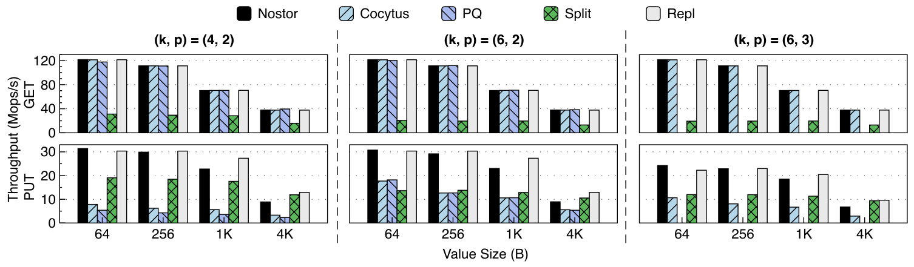
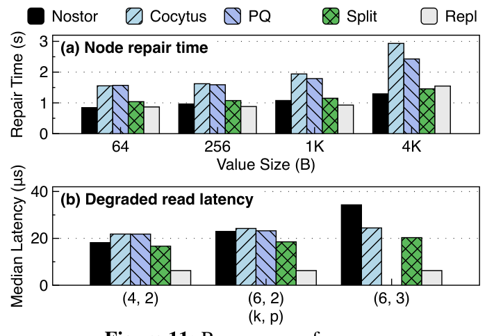
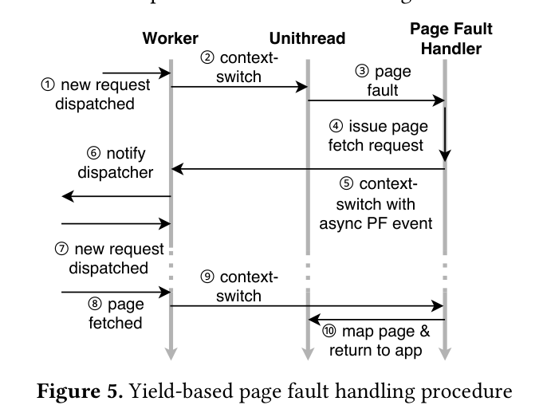
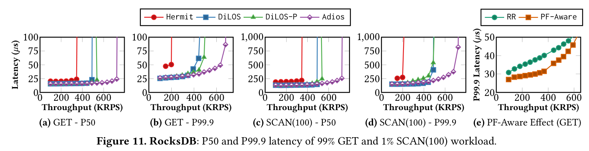
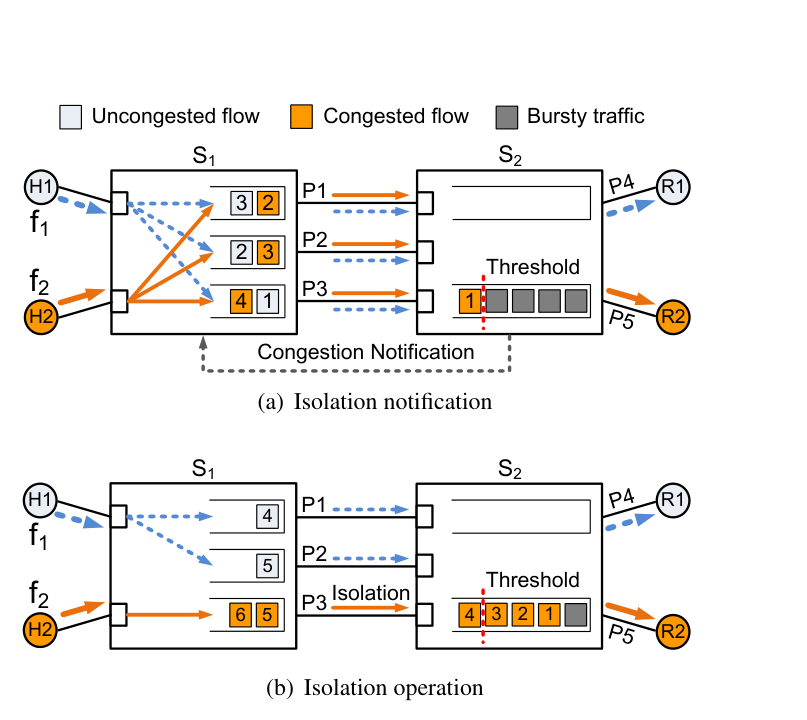
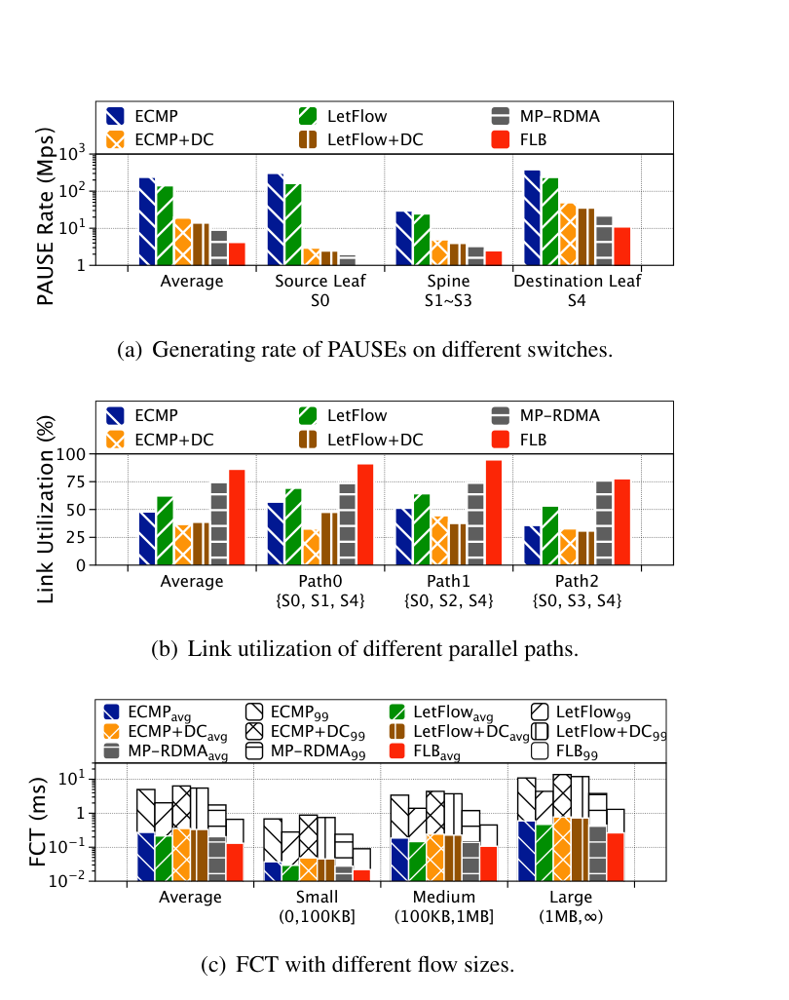
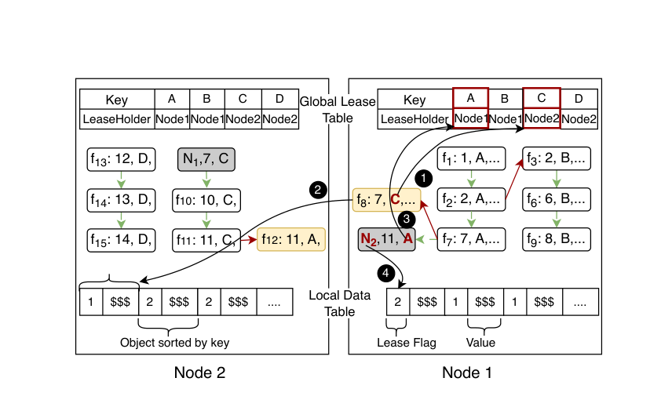
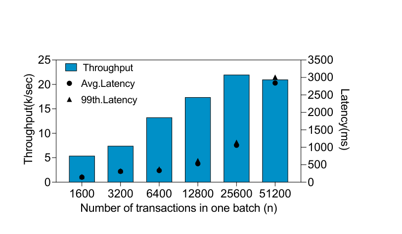

# 2026-11-16 RDMA 与分布式存储早报

[打开渲染页面](https://mingwangsong.github.io/rdma-daily/2026-11-16/)

本期为近期正式顶会论文回溯。未核实当日新增且正文可深入阅读的合格论文；数量以实际完成的深入阅读为准，不凑数。

## Nos / Nostor

## Nos：把纠删码的条带协调移出微秒级内存写路径

**Stripeless Data Placement for Erasure-Coded In-Memory Storage**，OSDI 2025 正式论文，pp.821–838，会期 2025-07-07 至 09；本期为旧文补读，不是今日新发表。作者单位为清华大学（Jian Gao、Jiwu Shu、Bin Yan、Yuhao Zhang）和华为（Keji Huang）。

### 核心问题：编码算得快，条带放置仍可能拖慢请求

内存 KV 的值常小于 1 KB，RDMA 已把网络降至微秒级。此时传统 EC 的两种条带策略都付出可见成本：对象内切分使一次 GET 要访问 k 个节点，放大网络 IOPS；跨对象条带若静态哈希，尚不存在的对象留下空洞，若动态组条带，又需要额外元数据查询及集中协调。Nos 改变的是**数据放置和编码时机**，不是发明更快的 RDMA 原语，也不是声称 XOR 已取代所有 RS 码。

### 数据怎样写：先建立容错副本，再在各备节点独立压成校验

Nos 的 (k,p) 中 p 是可容忍失效数，k 是每个校验项最多混合的对象数。它要求 k>p，并按 SBIBD 对称平衡不完全区组设计建立 v=k²−k+1 个故障域的亲和矩阵：每个主节点有 k 个合法备节点，每两个主节点的合法备节点集合恰好交于一个节点；主节点不能备份给自己。每次选择其中 p+1 个备节点，先发送完整对象/更新 delta，然后备节点从不同来源各取一个对象，最多 k 个 XOR 成一个校验项。逻辑上暂存主副本加 p+1 备份，编码后的理想**额外冗余**为 (p+1)/k，而非 RS 的 p/k；总数据占用需再加主副本的 1。这一额外备份不是可随意去掉的浪费，它为多节点失效时避免循环依赖提供保证。

例如 k=4、p=2，需要13个故障域、每次从4个合法备节点选3个。不必把某组主对象固定绑成全局条带，所以备节点可各自选择组合和时间；但“无条带”不代表无放置限制，更不代表可任意向全体节点复制。k=6 时需要31个故障域，宽条带 k≈100 对应约万级故障域，不适合照搬。

Nostor 是上述设计的 Rust 内存 KV 原型，通信为**用户态 RDMA 上的 RPC**，服务器 CPU 仍维护 hash map、版本及编码。一次 PUT 的具体步骤是：

1. 主节点为对象追加新版本并分配单调 SN；算出新旧值 XOR delta，插入/删除把缺失一端当作零。
2. 并行发给该对象 p+1 个备节点。备节点前台线程仅入复制队列，避免编码进入关键路径；首次插入可绕开允许集合中的慢节点。
3. 复制完成后主节点推进已提交序号 CSN、回收旧版本，才向客户端返回。其承诺是返回写已可见且具有规定节点故障容错，不是 SSD 持久化或全机房掉电耐久。
4. 备节点后台只消化已提交 delta，CSN 随 RPC 携带。尚未提交的 delta 重新入队；正常 GET 读已提交版本，避免备份未齐的新版本被提前看到。

后台编码也不是简单凑齐就 XOR：每个复制源有独立队列，等待某源超过10μs就跳过以免阻塞，并形成不足 k 个对象的 partial parity；另以按来源分类的 partial-parity 队列，后续把不冲突来源的对象补进去。并发后台线程先为新 key 安装 placeholder，再完成校验项，避免把同一对象的两个 delta 都识别成首次插入。实现使用 DashMap 分片读写锁和对象版本队列锁，不能写成全程 lock-free。

### 故障窗口：编码完成与写入提交是两件事

主节点可能在部分副本入队后、客户端收到返回前崩溃。此时各备节点先停止消化该源队列，交换**所有待处理 delta 的 SN 集合**以确定提交边界，丢弃未提交后缀，再完成已提交队列，达到一致状态后提供降级读。只交换“最大 SN”不足以推断哪些写真正复制齐全，这是恢复协议的重要细节。

降级读先向仍活着的备节点询问校验元数据，选包含失效对象最少的校验项；读取该校验及其他 encodee，通过 XOR 还原。若其中还有失效对象，SBIBD 结构保证可以先恢复它们，递归不会再向更深层展开。最坏单请求可能读取 O(kp) 个对象，尽管把顺带恢复的对象摊销后不超过每失效对象 k 个读取。因此“平均恢复工作量可控”并不等于“单次降级读延迟更低”。

原型**不支持降级写**：主节点失效，或无法向 p+1 个存活合法备节点复制时，写被阻塞。故障模型仅 fail-stop，不处理 Byzantine；网络分区可能阻塞 PUT。替换节点须分别恢复主数据和校验后才上线；新校验组合可以与失效前不同。论文不建立跨对象事务、跨机架相关失效、持久化日志恢复或通用分区下写可用性。

### 实验：为什么有收益，什么场景会输

测试在 CloudLab 的16台 c6525-100g：每台24核 AMD 7402P、128 GB DDR4、单端口 ConnectX-5 Ex 100Gb，Ubuntu22.04/kernel5.19、DOCA-OFED2.10、ISA-L2.31.1（AVX2）。每物理机运行两个 server，各18个逻辑核（12前台+6后台），client占余下12个逻辑核、每线程32协程。**两个 server 共用一台物理机不等于两个独立故障域**；作者因资源受限模拟到31个 server，实际部署必须独立放置。文中测试网络 MTU 为9000B，不能与 verbs 4096B path MTU 混写。

基线 Cocytus 被逐行移植到同一 RDMA 框架，并非原版 TCP 直接对比；PQ 把编码换为 P+Q，Split 在对象内切块，Repl 为 p+1 路复制。PQ只支持p=2。因而主要差异在条带分配、编码和请求扇出，而不是某组独享高速网络。

- **图3/§6.2.1**：≤256B 时，Nos GET 吞吐为 Split 的3.92×（k=4）、6.06×（k=6），近似 k 倍支持“扇出耗尽网络 IOPS”的解释；1KB/4KB时收益降至2.40–3.57×。其余不拆对象的 GET 基线相近，所以不是 Nos 对所有读路径都更快。
- **同图的 PUT 反例**：64B Nos与Repl相近；1KB/4KB吞吐分别只有Repl的87.4%和69.7%，因为 Nos 多发一个备份，大值先触及网络带宽。相对Cocytus/PQ的收益主要来自避开条带分配和同步，不宜归功于“XOR比矩阵计算快”一个因素。
- **图9–10/§6.3，真实 Twemcache trace**：作者报告比各EC基线吞吐提高至1.61–2.60×。四条trace从56B到2506B平均对象、7%到94%写覆盖不同混合负载；总体吞吐横轴不是纯PUT吞吐。PUT p99 仍比 Repl 高26.8%（Cluster31）和39.6%（Cluster12），所以“类似中位延迟”不能换成“尾延迟一样”。
- **图11/§6.4**：k=4,p=2双server失效重建时，Split修复耗时比Nos高16.4%；这不是Nos耗时减少16.4%的同一口径。64B降级读在p=2下，Nos比Split平均慢16.5%；特意选择k=6,p=3使递归出现的最坏节点组合时，比Cocytus慢35.0%、比Split慢62.4%。不能用常态吞吐掩盖恢复尾部。
- **图12/§6.5**：填充5000万对象，Repl实测内存是Nos的1.23–2.35×；不仅要计入冗余字节，还要计 encodee key、hashmap、版本和待编码队列。小对象下元数据成本明显，理想编码比例不能直接当实际容量预算。

### 对分布式存储：先在可重建内存层验证，别直接替换持久 EC

**工程推断**：最匹配的是低延迟内存 KV、热对象缓存和共享远端缓存的容错层。对于频繁更新小对象，避免读扇出和同步条带分配可能比减少一次 XOR 更重要；对于大块不可变对象、SSD容量层或宽条带冷数据，额外网络副本和刚性故障域通常不划算。KV cache中可重建的page/token块也可比较，但其对象大小往往远大于本文小KV，应先验证是否已带宽受限，不能借56B结果预测几十KB块收益。

建议先选 k=3,p=1 的7个独立故障域，比较同RPC框架的Nos、复制、对象内/跨对象EC：扫64B/256B/1KB/4KB及实际缓存块、写比例、Zipf偏斜、到达突发；记录吞吐、p50/p99、每请求RPC数、出网字节、编码CPU、未编码delta队列深度与真实内存占用。原作者MWE至少7节点，但仅验证无故障微基准成功，并不证明恢复协议。

必须在复制未齐、复制齐而CSN尚未传播、后台XOR进行中三个窗口注入主/备失效，核查所有已ACK写是否可读；并测一次故障后写阻塞范围及修复期间业务p99。扩缩容要验证subcluster重映射和同机架共故障，避免把31个进程当31个独立容错节点。若要生产应用，还需补幂等重试、故障检测、重建限速及持久来源恢复方案，再重新测性能。

### 阅读与参考资料

已阅读正式PDF正文§1–8，重点核对§4设计与证明、§5并发/恢复、§6实验及图3/9–12；检查作者仓库README和MIT许可证，未复现实验、未观看完整报告视频、未逐行审计实现。

- [官方论文页与报告入口](https://www.usenix.org/conference/osdi25/presentation/gao)
- [正式PDF](https://www.usenix.org/system/files/osdi25-gao.pdf)
- [作者实现与复现实验说明](https://github.com/IcicleF/Nos)
- [RPC引擎文档](https://docs.rs/rrppcc)；[RDMA封装文档](https://docs.rs/rrddmma)（进一步阅读入口，本轮未逐项审计API）

GET只有Split因k路扇出明显落后；大值PUT下Nos仍低于Repl，不能用小对象结果承诺大块复制加速。单位Mops/s，三列分别为不同(k,p)。

来源：Jian Gao, Jiwu Shu, Bin Yan, Yuhao Zhang, Keji Huang，OSDI 2025，图3，PDF第10页。原文：https://www.usenix.org/system/files/osdi25-gao.pdf

上图修复时间秒，下图降级读中位延迟微秒；(6,3)特选递归恢复最坏组合，Nos黑柱最高。两图衡量的不是同一故障指标。

来源：Jian Gao, Jiwu Shu, Bin Yan, Yuhao Zhang, Keji Huang，OSDI 2025，图11，PDF第13页。原文：https://www.usenix.org/system/files/osdi25-gao.pdf

## Adios

Wonsup Yoon、Jisu Ok、Sue Moon、Youngjin Kwon · 论文署名机构：KAIST · EuroSys 2025，2025-03-30 正式出版（会议 3 月 30 日至 4 月 3 日），pp.870–885 · 既有研究回顾，非今日新发表
核心判断：即使单次 RDMA 读取只有微秒级，worker 同步轮询仍可能同时造成请求队首阻塞与 RNIC 并发不足。Adios 的价值不是简单改成异步 API，而是把缺页处理器、轻量线程和调度器放到同一保护域，让等待真正可以被其他请求的执行覆盖。对 mmap 远端页、分布式缓存 miss 和短 RPC 数据路径，这比只继续压低单次 verbs 延迟更值得测。

### 机制：等待的线程挂起，worker 与 QP 不必一起停下来

在 DiLOS 式路径中，worker 遇到远端缺页后发 RDMA READ，再忙等完成；它不能处理队列中后续请求，每个 worker 通常也只有一个未完成 fetch。Adios 基于 OSv unikernel 0.55，将应用与内核置于同一地址空间/保护域，避免缺页处理到用户调度器之间的边界切换。请求进入后获得一个 unithread；缺页处理器提交读取即保存上下文并 yield 给 worker；worker 接收其他请求，并在启动新 unithread 前轮询一次完成队列；原页到达后恢复该缺页处理器，完成映射再返回原应用代码。这里仍然轮询 CQ，但不再把一个 worker 独占在某一个 fetch 上。

unithread 将网络请求、上下文和统一栈放在同一预分配缓冲区；上下文 80 B、切换 40 cycles，对照 Shinjuku 的 ucontext_t 为 968 B、191 cycles（表 1）。每请求最低 4 KiB，而非三块独立的 4 KiB 缓冲/用户栈/异常栈；默认预分配 131,072 个，最低仍占约 512 MiB。它并不是零成本协程，较深栈和突发并发都需额外容量规划。
放开并发后，各 worker 的缺页数会失衡。PF-aware dispatching 只在空闲 worker 中按 outstanding page-fault 数排序，再分配新请求，而不是试图迁移已经进入硬件 QP 的 WQE。它以 QP 队长作为暂时拥塞信号，避免“CPU 同样空闲，I/O 队列却不同”的盲目 round-robin。另一个独立改动是将响应发送完成交由 dispatcher 的 CQ 轮询与回收，worker 不再同步等 TX 完成。专用 reclaimer 核主动回收，避免本地空闲页耗尽后全路径冻结。

### 实验：GET 尾延迟收益比吞吐收益更大，但有明确配置边界

三节点测试：计算/内存节点为 Xeon Gold 6330 2.0 GHz、256 GB DDR4、ConnectX-6 Dx 100GbE，压测节点为 Xeon 6226R、ConnectX-5。两条 100GbE 链路直连；8 个 worker，加 1 个 dispatcher 和 1 个 reclaimer。计算端 4 KiB 页、远端 2 MiB 大页，本地缓存通常只容纳工作集 20%；open-loop Poisson 请求，NIC 时间戳测请求响应。基线包括 Hermit、DiLOS 和 5 μs 抢占间隔的 DiLOS-P。不能把直连结果当成有交换机拥塞、多个租户或故障情况下的保证。

最贴近存储的实验使用 RocksDB 8.3.2 的 PlainTable + mmap，40 GB 工作集、8 GB 本地内存；不是常规 SSD 上的 BlockBasedTable/LSM 压测。在 490 KRPS 下，GET 中位数与 P99.9 延迟相对 DiLOS 分别改善 1.37×、7.61×，整体峰值吞吐改善 1.47×。相对 DiLOS-P，分别为 1.33×、2.71× 和 1.34×。PF-aware 相对 round-robin 的 P99.9 改善最高 27%，这是独立消融，不能把完整系统 7.61× 全归因于 QP 调度。
40 GB 随机数组、8 GB 缓存微基准中，RDMA 利用率升至 82%；TX polling delegation 单独使峰值吞吐提高 1.15×，并在无 delegation 的峰值 1,749 KRPS 处改善 P99.9 8.05×（图 9）。反面结果同样重要：低负载下多了切换与 bookkeeping，0.2 MRPS 的 P99.9 比 DiLOS 高约 6%；全工作集在本地时，DiLOS 的简单路径反而更快。Memcached 即使大幅改善尾延迟，吞吐也仅提高约 5%–7%，最终受 RNIC 队列容量限制。

### 落地到分布式存储：先移植调度原则，不直接移植 unikernel

分析与建议：优先在缓存 miss 的 RDMA READ 路径、远端页拉取或 metadata RPC 上比较“每请求忙等”与“协程 yield + completion 恢复”。在现有 Linux 服务中，先做显式异步远端读取，可以避免立刻重构页故障与隔离模型；如果必须透明 mmap，普通 userfaultfd 的跨边界成本需单独测，不能承诺复现论文收益。
最小验证采用 2 个存储/计算节点和 1 个压测端，固定总 CPU 核数，扫描缓存命中率 10%/20%/80%/100%、1/4/8 个 worker、99% GET + 1% 长操作。分别启用 yield、QP outstanding 感知分配和 TX 完成委派，记录吞吐、P50/P99/P99.9、每 QP 深度、RNIC 利用率、上下文内存和超时请求数。尤其要把专用的两个核算进 CPU 成本，不让“省 CPU”的说法掩盖实际资源占用。
边界：原型面向 UDP 请求，协作调度无法公平抢占长纯计算任务；单 dispatcher 伸缩约十个 worker 核，更多核需进一步设计。论文不是复制、一致性或远端失效恢复方案，未给出节点故障恢复实验。生产版需另加有界 outstanding、CQ 错误处理、超时/取消、buffer 生命周期和失败重试语义；yield 期间缓冲不可提前复用，completion 也不能等同于持久化。这些是迁移检查项，而非论文已实现的保障。
阅读范围：正文 §1–8、表 1–2、图 5/7–13；补读作者报告文本与仓库 README，未运行代码。[正式 DOI](https://doi.org/10.1145/3689031.3717475) · [会议录用名单](https://2025.eurosys.org/accepted-papers.html) · [论文](https://yoon.ws/publication/adios-eurosys25.pdf) · PDF 公开备份尚未完成 · [作者报告](https://yoon.ws/publication/adios-eurosys25-slides.pptx) · [代码](https://github.com/ANLAB-KAIST/adios)。论文首页明确 CC BY 4.0，所用两图无第三方另注；报告未核实独立再分发许可，源码根目录未见统一 LICENSE，故此处仅链接，不将论文许可套用于报告和代码。

发读后切回 worker，完成后恢复缺页映射。

来源：Wonsup Yoon, Jisu Ok, Sue Moon, Youngjin Kwon，EuroSys 2025，图5，PDF第6页。原文：https://yoon.ws/publication/adios-eurosys25.pdf

GET P99.9 饱和拐点后移；(e) 纵轴不从零开始，PF-aware 单独最高改善 27%。

来源：Wonsup Yoon, Jisu Ok, Sue Moon, Youngjin Kwon，EuroSys 2025，图11，PDF第11页。原文：https://yoon.ws/publication/adios-eurosys25.pdf

## FLB

## FLB：拥塞流应该收拢，而不是继续铺满所有路径

### 为什么负载均衡反而扩大故障域
RoCE 的 NIC rate shaper 将包间隔平滑化，传统固定 50µs flowlet timeout 经常等不到可换路边界。更细粒度喷洒虽然能平衡平时的负载，却把一个拥塞目的端的流分散到更多上游入口；PFC 按优先级暂停而不按流暂停，无辜的复制、读请求随之被阻塞。本文的关键不是“更积极换路”，而是在未拥塞时细粒度换路，拥塞时把责任流收拢到尽可能少的路径。

### 数据路径与控制机制（§3）
1. 源 ToR 记录流上一包所用路径与包间隔 Δt。只有新路径更快且路径时延差满足 `0 < Dold − Dnew < Δt`，才迁往候选中的最低时延路径，否则保留原路径。这保证按所测时延估计，后发包不会赶超前包；不是无条件 packet spraying。默认每两倍 base RTT 采样一次，单向时延减历史最小值获得排队分量，避免依赖绝对时钟同步。
2. 目的 ToR 的出口队列超过隔离阈值 K 后，在 PFC 之前发 CNM，带流 ID、拥塞流数；源 ToR 把责任流加入 isolation table，收拢到隔离路径，正常流不得使用这些路径。隔离路径数按责任流收敛速率之和除以单链路容量决定，避免把新的瓶颈推回源 ToR。拥塞消退发解除 CNM；解除消息丢失依靠不活跃条目超时清理，不应理解成任意活跃流都能立即恢复。
3. “threshold-free”仅指无需固定 flowlet 切换阈值，并不代表没有拥塞阈值。附录 A 的保守 K 区间包含 RTT、链路容量、流数和 PFC 阈值，需预留反馈期间的在途数据空间；PFC 的 ingress threshold 与隔离用的 egress threshold 不能混用。
4. 可选 FLB+RC 不迭代探测带宽：先发送一个 BDP，收到拥塞 CNM 暂停，按 `C/n` 设置恢复速率，收到解除再发。纯 FLB 与 FLB+RC 是不同实验配置；不能把后者的仿真收益归给前者硬件测试。

### 实验：把实机和仿真分开（§4）
实机用 20 台 Dell 5820、Xeon W-2255 十核、64GB、ConnectX-5 100GbE，Wedge 100BF-32X 可编程交换机，DPDK 20.08、Ubuntu 20.04.1；默认路径速率实际设为 40Gbps，3 条并行路径，交换机 22MB 共享缓冲。它不是“已证明现有 RNIC 无修改可直接运行全部方案”的生产部署实验。

图8用 Web Search 重尾流，平均1.6MB，瓶颈负载0.6，部分发送端叠加突发。FLB 相对 ECMP+DCQCN、LetFlow+DCQCN、MP-RDMA 的平均 FCT 分别下降48%、42%、30%；相对前两者的99分位 FCT 最多下降88%。平均改善与尾部上界来自不同对照，不能合写“延迟下降88%”。图8a中目的叶子仍可能出现 PAUSE，而源叶子/中间层下降，支持的是压缩传播范围，不是完全去除PFC。

图9把链路从10扫到100Gbps，PAUSE产生率最多下降96%；图11另测对称/部分40→25Gbps非对称路径，乱序程度显著低于MP-RDMA，但采样时延仍可能滞后，工程上不宜宣称严格实时零乱序保证。图12优化隔离阈值相对20%/30%固定缓冲比例分别减少82%/89%的PAUSE；图13同一Web Search设置中FLB+RC比纯FLB再降低15%平均FCT。300主机、10叶+10脊、3:1超售等更大拓扑是NS3仿真，不是实机扩容。

### 原图怎么读
图6(a)的橙色责任流同时占据P1/P2/P3，目的端P5拥塞会把影响带回多条路径；(b)把其限制在P3，让蓝色流使用P1/P2。隔离牺牲责任流的路径自由度，换取无关流的可用性，并未增加目的端带宽。

图8必须联合看三行：PAUSE计数、链路利用率、平均/99分位FCT。只看利用率可能掩盖受害小流尾延迟；只看平均FCT又不能判断PFC扩散是否消失。纵轴有对数尺度，不能凭柱高线性估计降幅。

### 对分布式存储的迁移与落地条件（分析）
最合适的是同一RoCE优先级上前台4KB读、复制大流和EC修复混跑的多路径fabric。先复现“单个目标拥塞拖累其他目标”的拓扑，再评估隔离，而不是先改UCX/JUCX参数。它不能解决单QP落在单LACP成员的硬限制，也不能让2×100Gb单流自动达到200Gb。

需要P4交换机或等效可编程转发能力、路径测量和反馈；多层拓扑还依赖显式源路由。表1在10万并发流设置给出FLB SRAM 4.12%、gateway 9.56%、ALU instruction 8.2%，占用并非零；CRC16流标识及条目老化在海量QP下的碰撞/容量行为值得另测，正文没有完整生产规模验证。

最小验证：三路径，两前台目标加一个拥塞目标，固定4KB随机读与1MB修复流；扫fan-in、50–90%负载、路径降速、反馈丢失和阈值K。对照ECMP+DCQCN、现有flowlet方案和FLB，记录每目标p99/p99.9、无辜流goodput、PFC暂停持续时间/传播端口数、重传与乱序、交换机状态耗尽。只有前台尾延迟改善且修复吞吐不被不可接受地牺牲，才值得进入灰度。论文未覆盖交换机重启状态重建、混合部署或持久化语义。

### 阅读与资料
实际阅读：论文§1–4、§6及附录A，重点逐段核对§3和§4；对照作者13页报告的机制与评估页，未观看视频。未找到作者明确提供的代码仓库；论文和报告全文没有核实公开再分发许可，保留原始链接与本地研究副本，不将全文混入公开发布包。

从多路径扩散到P3隔离，保留P1/P2给无关流。隔离限制传播而不增加目的端带宽。

来源：Jinbin Hu, Wenxue Li, Xiangzhou Liu, Junfeng Wang, Bowen Liu, Ping Yin, Jianxin Wang, Jiawei Huang, Kai Chen，USENIX ATC 2025，图6，PDF第7页。原文：https://www.usenix.org/system/files/atc25-hu-jinbin.pdf

目的端仍可PAUSE，但上游影响收窄；需同时看平均与99分位，图有对数轴。

来源：Jinbin Hu, Wenxue Li, Xiangzhou Liu, Junfeng Wang, Bowen Liu, Ping Yin, Jianxin Wang, Jiawei Huang, Kai Chen，USENIX ATC 2025，图8，PDF第9页。原文：https://www.usenix.org/system/files/atc25-hu-jinbin.pdf

## RTSFaaS

## RTSFaaS：将远程抢锁变成批内依赖规划与租约交接

### 解决的不是“RDMA太慢”，而是串行通信次数太多
远程2PL每次取锁、解锁都要跨网，OCC虽能缓存但热点写会触发校验失败与重做。RTSFaaS把事务的一致性规划放在批执行之前，通过数据亲和调度减少远程访问，再按确定的依赖顺序移交对象访问权。迁移价值在分布式缓存/元数据批处理，不应把FaaS结果直接称作存储引擎加速。

### 数据路径、串行化与所有权（§3）
1. Driver统计每worker的任务数和每key访问次数，对负载均衡分数与数据亲和分数默认等权求和，将请求发给最高分worker。批请求分配结束后，每对象指定一个主要leaseholder，平分时按最小worker ID决定。每对象在worker缓存层只有一个副本，底层TiKV仍负责复制持久化。
2. Planning与execution不重叠。Driver给workflow分配全局时间戳；多key函数先拆成单key函数。worker按key排序，建立跨workflow的时间依赖和workflow内部参数依赖。访问远程对象的函数元数据被发给其leaseholder，插入“virtual vertex”，从而在持有数据的节点上串起全局访问顺序。这里节省的是执行期远程锁竞争，代价是批收集、排序、元数据交换与图遍历。
3. 数据按key顺序存入预注册内存，每值前有16位lease flag。执行器根据lease表定位地址，且只有flag等于自己的worker ID才能访问；遇到virtual vertex时原leaseholder改变flag，允许远端执行；远端结束后交还。数据通常仍驻留原主要leaseholder，并非每次交接都迁移数据。论文声称的冲突可串行化依赖正确识别全部读写集与图边，不是单个flag就提供事务语义。
4. 控制消息走RDMA WRITE推送、接收端本地轮询的环形缓冲，消息有首标记、长度、尾完成标记；receiver处理完至少半个buffer才回写head，sender的保守head副本避免覆盖未处理消息。论文依赖WRITE顺序来判完整；推广时必须验证所用QP、内存可见性与CPU/RNIC顺序保证，不能跨QP套用“所有RDMA写都是FIFO”。

### 失败窗口和边界（§4.2–4.3）
批执行完成先生成各worker缓存快照，全部成功后回写TiKV，轻量日志记录快照/回写进度。快照阶段失败则加载原始数据并重做批；写回阶段失败则用快照重试写回。500ms快照间隔、5000QPS条件下，文中报告快照后重试233ms、完全丢失后重做729ms，但另有Docker启动20.31秒和连接恢复15.66秒，后两者才是冷恢复主要成本，不能宣传“毫秒级完整容灾”。跨多个对象写回的原子可见性、快照副本放置和外部不可逆副作用还需实现级审计。

依赖读取必须提前探测完整读写集；无法解析的读取保守广播到所有worker，增加通信。单逻辑leaseholder对热点key仍会串行化。应用约束失败通过workflow前置条件检查及禁用后续函数处理，不等于支持任意执行中途外部错误。没有硬件级fencing细节证明崩溃旧节点重返后绝不访问旧rkey，生产采用前必须补充epoch与撤权方案。

### 实验：20倍不是同硬件协议对比（§5）
RTSFaaS部署5台Xeon Gold 6230、128GB DDR4、ConnectX-3 40/56GbE，RDMA RTT约7µs；1 driver+4 worker，容器各8CPU/32GB，每worker缓存2GB。图9对照Boki/Beldi运行在EC2 c5d.2xlarge，8vCPU/16GB，VM RTT100–120µs，且worker数与后端不同；RTSFaaS固定500ms批间隔。因此中位延迟700ms处，相对Boki/Beldi的movie review吞吐2×/6×、travel reservation 4×/20×、banking 5×/17×，只能作为系统级结果，不能归因纯RDMA或纯租约机制。

更可信的机制比较是§5.3：在相同RDMA环境重实现Remote Lock与Remote OCC+Local Cache，4 worker各20核/64GB，20,000个对象。全写、事务长度2、Zipf θ从0扫到1时，OCC约在θ=0.6达23k/s，θ=1降到16k/s，说明缓存命中收益被热点冲突抵消。读比例、事务长度的实验分别在图11、12；长度从2到8时各方案吞吐下降，热点下OCC更明显。不要将摘要1.7×/2.1×笼统写成所有工作负载固定加速。

图13将图构建/遍历成本与锁、访问、验证开销拆开，证实通信成本被规划成本替代。图14批大小1,600→51,200：吞吐在25,600附近饱和，继续增批主要增加平均和99分位延迟；图上约22k/s和约1秒级延迟仅为读图量级，不是微秒RPC结果。

### 原图怎么读
图6的global lease table标记主要持有位置，底部lease flag标记当前执行权限，两者不能混淆。virtual vertex促使本地让权，远端函数还需等参数依赖就绪；只有把这两套状态与TPG一起解释，才明白为什么不用每操作CAS抢锁。

图14是迁移判断最重要的反证：RDMA原语RTT为微秒，最终业务延迟仍可为秒，因为批收集和依赖规划在关键路径上。横轴翻倍到51,200并没有更多吞吐，却显著拉长尾延迟。对低延迟存储，不应为了吞吐照搬论文默认500ms批间隔。

### 分布式存储如何试用（分析）
可先用于可批处理的namespace/配额/索引更新，或写密集的共享缓存元数据；不要先替换要求低p99的同步4KB IO路径。条件是读写集合可预测、操作可拆解、重放幂等、缓存主权明确，且能够接受批边界的持久化与可见性约束。收益预期应从“每操作需要多少次远程锁/验证”推导，而不是直接套用20倍。

最小实验：固定4节点、同RNIC/CPU预算，比较CAS锁、OCC缓存、亲和+TPG三种方案；额外关闭亲和调度/关闭批处理以做消融。扫对象热点、读写比例、事务长度、1–20ms批窗口，分别计入端到端排队、图构建、跨worker访问与TiKV提交时间，记录p50/p99、abort率、CPU、内存、RDMA操作数/事务。注入执行中、快照中、部分写回、旧worker重连四种故障，检查重复执行及旧权限访问。若规划与等待吃掉RTT节省，即应保留现有单请求路径。

### 阅读与资料
实际阅读论文§1–5（含恢复与限制），重点核对§3–5全部机制/实验；查阅作者报告与代码README、许可证，尚未运行代码或复现。源码README将核心调度模块标为active development，安装指令还指向MorphStream的FaaS分支，复现实验应先固定版本核对脚本，不能默认当前main与论文完全一致。

全局表保存主要驻留位置，lease flag保存当前访问权；virtual vertex和参数依赖共同控制执行。

来源：Jianjun Zhao, Haikun Liu, Shuhao Zhang, Haodi Lu, Yancan Mao, Zhuohui Duan, Xiaofei Liao, Hai Jin，USENIX ATC 2025，图6，PDF第8页。原文：https://www.usenix.org/system/files/atc25-zhao-jianjun.pdf

25,600附近吞吐饱和，继续增批主要增加平均/99分位延迟；微秒RDMA不等于微秒业务响应。

来源：Jianjun Zhao, Haikun Liu, Shuhao Zhang, Haodi Lu, Yancan Mao, Zhuohui Duan, Xiaofei Liao, Hai Jin，USENIX ATC 2025，图14，PDF第13页。原文：https://www.usenix.org/system/files/atc25-zhao-jianjun.pdf
