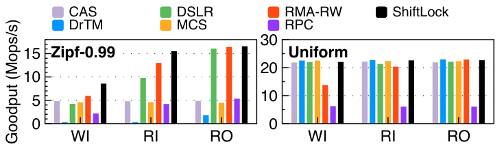
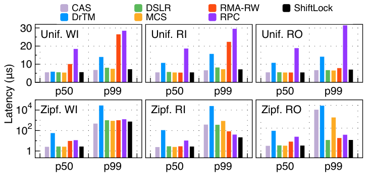
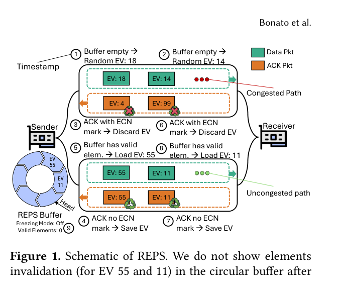
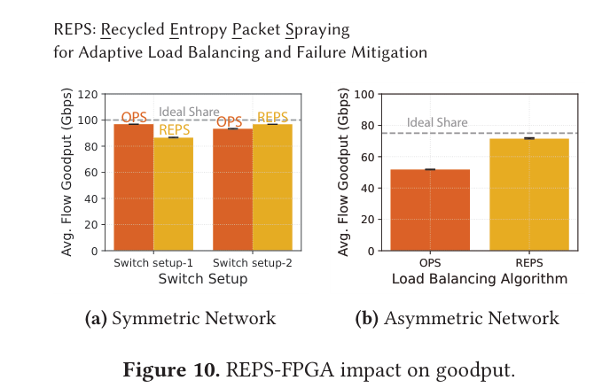
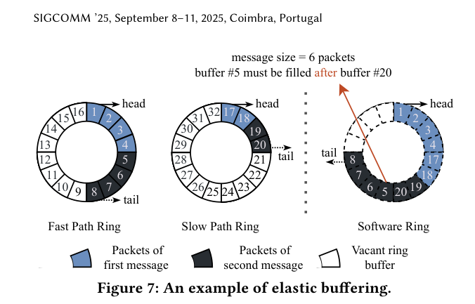
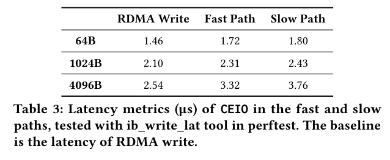
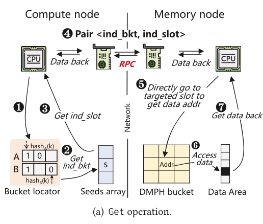
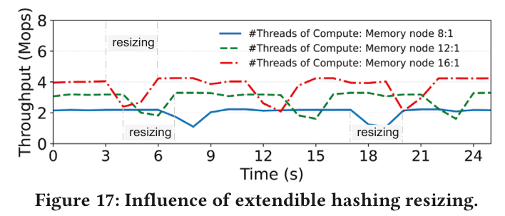
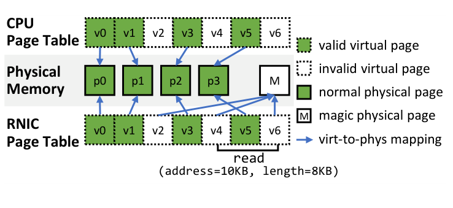
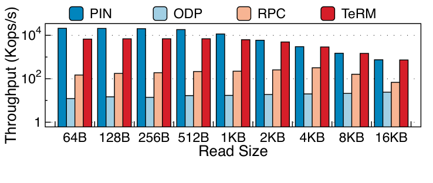

# 2026-11-17 RDMA 与分布式存储早报

[打开渲染页面](https://mingwangsong.github.io/rdma-daily/2026-11-17/)

本期为近期正式顶会论文回溯。未核实当日新增且正文可深入阅读的合格论文；数量以实际完成的深入阅读为准，不凑数。

## ShiftLock

## 为什么值得存储研发关注
热点元数据锁的问题不是 CAS 单次延迟，而是失败重试把同一个 RNIC 的入站处理能力耗尽。ShiftLock 把竞争者组织成分布式队列，让前驱直接通知后继，避免每个等待者反复访问锁服务器。它优化的是共享读写锁协议，不是事务提交或数据持久化。

## 机制：把重试改成交接，但不能丢掉读写公平性
16 字节锁包含 40 位队尾、23 位读者计数、1 位 epoch 与 64 位释放计数。写者通过扩展 CAS 模拟 FetchAndStore，一次交换队尾并形成 MCS 式队列；不使用普通 CAS 重试循环，否则排队本身又会制造竞争。每客户端一组 DC Initiator / DC Target QP，队尾编码节点号与 DCT QPN，避免全连接 RC 带来的平方级连接状态。

读者原子增加计数，没有写者队尾即可进入。写者入队时记录已有读者和释放计数，只等待它之前的读者完成，不能把后续到来的读者也无限计入等待。写者存在时新读者停下；连续交接 N 次写锁后翻转 epoch，让已经等待的一批读者进入，再通过 ModeChanged 消息把释放阈值交给下一写者。本文取 N=16，目标是限制读写双方饥饿，不是始终让吞吐最高。

队列交接通过预先投递的接收缓冲与可靠消息完成，不需要锁服务器 CPU 在正常路径处理 RPC，也不要求每个客户端另起轮询线程。客户端在释放等协议动作中处理通知，硬件 ACK 保障消息交付。代价是依赖 DC 传输和 128 位扩展原子操作；作者实现面向 Mellanox/InfiniBand，不能直接承诺任意 RoCE/RNIC 可运行。

## 失败窗口：租约恢复的是锁，不是业务数据
实验租约 10ms。释放计数连续三个租约不变时，客户端向服务器发起恢复 RPC；服务器检查 era、增加 era，并用扩展 CAS 重置锁、给释放计数增加 2^63，使等待者识别恢复并重新排队。旧 era 的恢复请求被拒绝，避免延迟恢复消息破坏已经重新使用的锁。方案使用有界时钟速率偏差和 RNIC 接收时间戳，不等同于要求全局精确时钟同步。

临界区必须在租约内完成。挂起的持锁进程、半完成元数据修改、锁服务器失效后的事务恢复仍需上层处理。论文故障实验按每次获取概率 10^-5 至 10^-2 跳过释放，不是任意网络分区或整机断电证明；其恢复检测较慢、失败接收者触发的 DCI 重置，也使故障条件下 goodput 低于 DSLR。存储落地应另设 fencing/version 校验和修改回滚，不可把“锁重新可获取”当作“旧写者绝不会污染数据”。

## 实验：热点收益明确，低竞争并非全面占优
六台机器（一个锁服务器、五个客户端），ConnectX-5 100Gbps InfiniBand、QM8790、128GB DDR4-2400；最多 240 个客户端。微基准含 1000 万个锁，不执行真实临界区工作；读比例分别为 50%（WI）、95%（RI）、100%（RO），比较均匀访问与 Zipf 0.99。基线包含 CAS 退避、MCS、RMA-RW、DSLR、DrTM 和 RPC，节点内通信额外加 1μs 用于公平比较。

图4的热点 WI/RI 中，相对 MCS，ShiftLock goodput 分别提高至 1.65×/1.27×；相对 RMA-RW 为 3.62×/1.26×。图5显示尾延迟收益，作者在该微基准比较中报告 p99 最高降低 76.6%，不能解读为所有负载都降低该比例。均匀低竞争负载中，CAS、DSLR、MCS 与 ShiftLock 接近，额外协议不是免费收益。

因果证据来自图6：一次获取与释放平均约 2.01 次原子操作，WI/RI 额外 RDMA READ 分别仅 0.36/0.20 次；DSLR 在 WI 中需要 7.92 次 READ。消除轮询使 RNIC 资源真正留给有效交接。但 WI/RI 扩展到约 80/120 客户端后趋于饱和，RNIC 瓶颈并未消失。表4也给出反例：WI 下 CAS-B 写者平均获取延迟比 ShiftLock 低 12.7%，ShiftLock 的优势主要在读者（快 7.44×）。RI 中 16B 原子操作本身比 DSLR 的初始原子操作慢 2.29×，靠等待时间减少 91.6% 才补偿。

N 的敏感性测试说明公平性有吞吐成本：N=∞ 比 N=32 多 3.3% goodput，却使中位延迟恶化 36.5%。应用层 TATP/TPC-C 使用事务轨迹和 2.8μs/7μs 忙等模拟执行，不是完整数据库端到端性能，不能直接用其最高 2.85× 推算存储服务。另一个真实 Redis SmallBank 实验从 5560 到 36550 ops/s，但 RedLock 使用 IPoIB，传输差异也参与了收益。

## 可执行的迁移实验
适合先试热点 extent 映射、共享缓存目录、读多写少对象元数据，而非直接替换跨故障域事务锁。先用一个服务端和两个客户端检查并发语义，再扩大到论文规模；扫描读比例、Zipf、临界区时长和客户端数，同时采集入站 RNIC IOPS、失败原子次数、交接次数、读写各自 p50/p99。对比公平性一致的 CAS 退避与队列锁，避免用饥饿换吞吐。

故障测试应暂停持锁者超过租约、断开接收者、注入过期恢复请求，并校验业务版本是否防止旧写回；单列恢复耗时、DCI 重建和服务端恢复 CPU 成本。只有确认硬件扩展原子/DC 能力、租约长尾和 fencing 方案后，才值得进入实际存储数据路径。

比较均匀与 Zipf 0.99，WI/RI/RO 分别为 50%/95%/100% 读；热点 WI/RI 相对 MCS 为 1.65×/1.27×，均匀场景收益有限。

来源：Jian Gao, Qing Wang, Jiwu Shu，FAST 2025，图4，PDF第9页。原文：https://www.usenix.org/system/files/fast25-gao.pdf

图中两组分位数展示公平交接的尾部收益；作者报告的最高 76.6% p99 降幅只对应论文特定微基准比较，不能外推成所有操作延迟降幅。

来源：Jian Gao, Qing Wang, Jiwu Shu，FAST 2025，图5，PDF第9页。原文：https://www.usenix.org/system/files/fast25-gao.pdf

## REPS

## REPS：让成功 ACK 携带路径记忆，而不是给每条路径建状态表

**REPS: Recycled Entropy Packet Spraying for Adaptive Load Balancing and Failure Mitigation**，EuroSys 2026 正式论文；会期 2026-04-27—30。本期补读，非今日新发表。作者主要来自 **ETH Zürich、Microsoft、Sapienza University of Rome**。阅读的是作者公开的 arXiv 2407.21625v6（2026-02-10）；以下图号属于这一版本。正式收录由会议论文列表与文中 DOI 交叉核对。

### 瓶颈不是只缺少一条路径，而是缺少“哪些路径刚刚成功”的廉价反馈

ECMP 按固定五元组散列，长流碰撞后可能持续挤在同一链路；逐包随机喷洒 OPS 消除这种碰撞，却会把同样多的包送给慢链路或黑洞。维护逐路径 RTT、带宽和拥塞状态又增加 NIC SRAM、更新频率与故障探测负担。REPS 不要求发送端知道交换机拓扑或具体路径编号，而是利用 **entropy value（EV）影响 ECMP 哈希，复用刚刚无拥塞到达的 EV**。

### 数据路径与状态转移

1. 发送端从固定大小环形缓存取最老有效 EV，使用后使其失效；没有有效项时随机生成 EV。EV 可以放在 UDP 源端口或 IPv6 flow label，交换机沿用 ECMP。
2. 接收端在 ACK 中回显对应 EV。发送端收到未被 ECN 标记的 ACK，就把 EV 放回缓存；被标记的 ACK 不回收。成功路径因反馈更快、更少被 ECN 淘汰而自然获得更多流量，不必估算每条路径容量。
3. 默认缓存 8 项，表1给出每连接总算法状态 **193 bit，约25字节**。这是负载均衡状态，不是整个 RDMA 连接的所有状态。开始一个 BDP 的数据主要随机探索，ACK 返回后才进入反馈循环。
4. 超时指示潜在故障后进入 **freezing**：停止随机探索，复用缓存中的近期好 EV，包括已经消费过的项。否则即使绝大多数流量已转移，随机探测仍会不断向故障链路送包。探测或定时机制允许退出；失败持续则再次冻结。论文也讨论用 packet trimming 帮助区分拥塞和故障，但这不是所有部署都具备的前提。

**图1解读：**橙色 ACK 的价值不是“确认收到”这一点，而是同时携带路径选择样本；带 ECN 的 EV 被丢弃，干净 EV 重新进入发送环。该图没有画出每次取出后的失效操作，不能据图误解为永久固定路径。路径记忆大量存在于飞行中的包和 ACK 中，低内存成本与 ACK 反馈频度相互绑定。来源：Bonato 等，REPS v6，图1，CC BY 4.0。

### 并非可直接开启的传统 RoCE 开关

逐包跨路径会导致乱序，REPS 的端点运输层必须支持乱序接收、直接放置与选择性重传。实验 FPGA 修改了具备 RDMA 能力的生产 NIC 的定制运输层，使用 256-bit SACK；这不是证明现成 ConnectX RC QP 修改 UDP 源端口就能工作。REPS 也不是拥塞控制替代品：仿真统一搭配支持乱序 ACK 的 DCTCP 变体，FPGA 使用其运输层的拥塞控制。收端 incast 使所有上游路径同样饱和时，路径选择不能增加接收端容量。

### 证据：仿真数量级与真实硬件必须分开

仿真使用 htsim，128/1024节点、两/三层 fat-tree、1:1至4:1超售，400Gb/s、4KiB MTU、70µs RTO，交换机及链路延迟各500ns；比较 ECMP、OPS、PLB、MP-RDMA、flowlet 等。图4的不对称配置把一条输出由400降至200Gb/s，32MiB流下 OPS FCT为 **1400µs，REPS为799µs**。这是指定仿真配置，不是生产存储 RPC 的 p99。

FPGA实验则采用 **100Gb/s端点、12.8Tb/s交换机、8KB MTU**，T0/T1 RTT约10/15µs；最多256连接的 EV 缓存占4KB，复用逻辑占器件不到0.04%。这项实现每时刻仅一个连接活跃，复用SRAM/逻辑，并非验证256个连接同时活跃的全部NIC成本。4KB缓存数字与193bit算法状态口径不同，不能直接互相推算整个连接成本。

**图10解读：**右图是不对称网络：16端点分布于两个T0，通过两台T1连接，一条T0—T1链路由400降为200Gb/s。REPS平均goodput距理想公平份额在5%内；OPS受慢路径限制，使其他链路利用不足。左图也必须看：健康网络某些交换机配置下 REPS 并不优于 OPS，供应商端口行为导致轻微退化，限制TX至95Gb/s后缓解。因此不能把右图写成所有健康网络都加速。图为平均goodput而非尾延迟。来源同上，图10，CC BY 4.0。

反馈并非免费。§4.5中 ACK 合并到16:1时，健康网络8MiB permutation场景优势消失；5%链路故障时，即使16:1仍有约5倍FCT差距。后者是故障实验条件，不能作为日常吞吐倍数承诺。论文提供仿真和FPGA证据，没有直接给出分布式存储业务验证。

### 对存储的可迁移点与验证方案

**分析推断：**最适合迁移到已有乱序运输层的复制、EC重建与远程内存批量搬运，尤其跨机架链路容量不齐或故障收敛期间；不优先用于所有路径都被同一接收机瓶颈限制的热点读。实施前检查 NIC 是否允许逐包 EV、ACK回显及乱序放置，确认ECN门限和运输层重传语义，不能仅修改交换机。

可做16节点双机架实验：小元数据RPC与32MiB重建流混跑，对比固定ECMP、OPS、REPS，分别注入半速链路、断链与接收端incast；测每端口goodput、RPC p99.9、重传量、乱序缓存、ACK PPS及CPU/RNIC占用。再扫 ACK 合并比例和冻结退出阈值。收益应由吞吐均衡与故障时损失降低共同支持；如果RPC尾延迟变坏或NIC乱序资源溢出，即使大流FCT改善，也不应直接投产。

**阅读与资料：**已读正文机制、故障处理、仿真/FPGA及限制，并检查作者仓库入口；未运行artifact、未观看报告。[正式会议列表](https://2026.eurosys.org/papers.html) · [论文PDF](https://spcl.ethz.ch/Publications/.pdf/REPS_Latest.pdf) · [DOI](https://doi.org/10.1145/3767295.3769320) · [作者实验仓库](https://github.com/tommasobo/REPS_EuroSys_Artifact)。两幅图按论文 CC BY 4.0 备份；全文上传仍待授权流程完成，当前未公开归档；代码仅给来源入口，本期未另做源码快照，不能把公开链接视作已备份。

ECN标记EV淘汰，干净EV回收；取出后失效避免误读为固定路径。

来源：Tommaso Bonato, Abdul Kabbani, Ahmad Ghalayini, Michael Papamichael, Mohammad Dohadwala, Lukas Gianinazzi, Mikhail Khalilov, Elias Achermann, Daniele De Sensi, Torsten Hoefler，EuroSys 2026，图1，PDF第2页。原文：https://spcl.ethz.ch/Publications/.pdf/REPS_Latest.pdf

FPGA平均goodput，并非尾延迟；不对称明显受益，健康配置可能轻微退化。

来源：Tommaso Bonato, Abdul Kabbani, Ahmad Ghalayini, Michael Papamichael, Mohammad Dohadwala, Lukas Gianinazzi, Mikhail Khalilov, Elias Achermann, Daniele De Sensi, Torsten Hoefler，EuroSys 2026，图10，PDF第11页。原文：https://spcl.ethz.ch/Publications/.pdf/REPS_Latest.pdf

## CEIO

## CEIO：RDMA 绕开 CPU，并没有绕开 LLC 与 PCIe 的资源争用

**CEIO: A Cache-Efficient Network I/O Architecture for NIC-CPU Data Paths**，SIGCOMM 2025 正式论文；会期 2025-09-08—11，本期为旧文补读。按所读论文署名，主要单位为 **香港科技大学、电子科技大学、中国科学技术大学、浪潮云**；其中 Junxue Zhang 在论文中署名 USTC，不能直接照抄会议网页的另一机构记录。

### 为什么“零拷贝”仍会把接收路径压垮

DDIO把NIC写入送到LLC，理想情况CPU随即消费，少走DRAM；但到达速率持续高于消费速度，未处理数据会提前被逐出，CPU随后从内存重新取回，网络DMA、缓存回写与CPU读取竞争内存带宽。问题既来自总流量，也来自CPU参与的小请求和CPU旁路的大块RDMA传输共用缓存。HostCC等反馈式方案响应已经发生的拥塞，固定接收环缓冲又容易在突发时丢包。CEIO的关键是**在NIC发起DMA前控制占用，而不是只在网络上事后降速**。

### 从 NIC 到应用：快慢双路径不是无序的两个队列

快路径NIC→主机LLC→CPU/DRAM。NIC的流级credit限制可注入DDIO的在途量；没有credit时，RMT转发表把流导向NIC自己的DRAM环，而非直接丢弃。控制器读取硬件转发命中统计消耗credit，读取已处理环位置补回credit。实际按64B cache line计费；论文用6MB DDIO、2KB buffer得约3000credit的例子只是便于解释，不是整个LLC都可独占。

**延迟释放是关键设计取舍。**credit不在每个包到达时立刻补回，而是在消息或批次处理完成后释放。CPU参与的小请求消费完即可归还；CPU旁路的大批次更久占住credit，因此更容易走NIC缓冲慢路径，保护CPU需要及时读取的数据。新流加入时重新分配可用credit；尚未完成的旧占用记为债务，随处理完成偿还，而不是强行让已发DMA消失。

慢路径并非永远驻留NIC：CPU参与路径由接收API主动发起读取，CPU旁路可借Write-with-immediate等事件触发。慢路径DMA本身仍会挤占缓存，所以系统在必要时暂缓快路径、排空慢路径再恢复；缓存不是无限队列，持续过载仍需拥塞控制。多一次排队与PCIe传输是用更高资源效率换来的代价。

**图7解读：**软件环把主机快环和NIC慢环映射为一个应用可见队列，但图中“buffer #5必须晚于#20填充”说明不能简单选哪个先到就交付。一个流进入慢路径后，快路径需停到慢路径排空，防止后续快包越过先前慢包。SW head表示交给应用的位置，HW head跟踪真正处理完的位置，以支持延迟credit释放；async_recv预取慢路径时可处理其他就绪工作，post_recv归还buffer所有权。这里需要接收API配合，不是对任意直接读远端内存的应用都透明。来源：Liu等，作者公开SIGCOMM 2025版，图7；仅引用支持上述顺序机制分析的这一幅图。

### 实验读法：竞争下的尾延迟改善，不等于每次 RDMA Write 更快

实现依赖 **BlueField-3、DOCA 2.9.2、DPDK 22.10、MLNX_OFED 23.10**。论文记录200Gb/s网络、双Xeon Silver 4309Y和512GB DDR4-3200服务器；未独立复现硬件表述。评估包含eRPC KV、LineFS及echo；每I/O流单核，KV为1000条记录、8线程随机访问、1:1 GET/PUT，键值大小比1:4。不能将该配置当成上亿键、落盘压测。

图9固定128/512/1024B负载中，LLC miss率由最高约88%降至约1%，吞吐提升范围约1.3–2.1倍；动态混合与突发是另两组实验，图10分别最高约2.0倍和2.9倍，不能混为同一数值。表2明确写的是**512B echo**：eRPC(RDMA)列P99.9从基线184.03µs、HostCC169.45µs、ShRing137.36µs降至73.70µs。该结果说明接收资源竞争缓解，不代表SSD持久化写延迟也降至这个值。

**表3解读：**perftest的ib_write_lat给出的基线/快路径/慢路径为：64B **1.46/1.72/1.80µs**；1024B **2.10/2.31/2.43µs**；4096B **2.54/3.32/3.76µs**。因此在这个基础Write实验里，连快路径也付出额外延迟，4KB慢路径尤其明显。它不是表2的P99.9统计，不能拿这两张表相互相减推导尾延迟。来源同上，表3；保留全部列名和单位，作为“改善争用但增加基本路径成本”的直接证据。

§6.3混合8条流、CPU参与:旁路=3:1时，CPU参与流吞吐由31.678提升到61.570Mpps；仅有基础机制而无快慢优化为45.299Mpps。我们保留绝对值，不沿用表中与除法不一致的中间倍率。千级连接实验使用**UD与切换QP ID**，不证明RC状态缓存同样可扩展；高频100/500µs流切换在千流以上更易被迫走慢路径。低内存压力下64B VXLAN已约89Mpps且LLC miss<5%，提升有限；9000B jumbo、大于4096B消息也可能基线已到线速。小流慢路径还出现约15Gb/s吞吐下降，作者怀疑PCIe/NIC内存访问模式，未给出完全验证的根因。

### 分布式存储怎样用，哪些语义不能借来

**分析推断：**优先尝试把元数据RPC、小KV读和重建/副本传输共机的接收端作为试点，而不是单纯大块顺序吞吐已饱和的机器。要求可编程NIC上流导向、NIC DRAM以及应用接收环集成；成本是NIC内存、ARM控制逻辑、额外PCIe流量和运维复杂度。信用耗尽时在NIC停留的数据依然是易失的，网络接收完成与持久化提交是两回事；论文没有替存储层解决宕机一致性、日志提交和重连后的去重。

一个可执行的小实验：双BF3主机上混跑8条流，以小KV请求为前景、4KB至MiB的复制/重建为背景，扫CPU参与:旁路比例、接收处理时间、DDIO可用容量、MTU与突发长度。除吞吐和p99.9外，同时测LLC miss/occupancy、DDR读写带宽、PCIe流量、NIC DRAM占用和ARM CPU；验证快慢转换期间消息序号与checksum，并故障注入NIC重启以检查应用重试/幂等。只有尾延迟收益覆盖基本Write变慢、NIC缓冲占用及恢复复杂度，才值得迁移。对纯单边读、低争用大对象，不应据此承诺加速。

**阅读与资料：**已读正文数据路径、并发/顺序设计、实现、实验和限制；检查作者仓库README，未运行代码或观看报告。[会议正式论文列表](https://conferences.sigcomm.org/sigcomm/2025/program/papers-info/) · [论文PDF](https://home.cse.ust.hk/~kaichen/papers/ceio-sigcomm25.pdf) · [DOI](https://doi.org/10.1145/3718958.3750488) · [作者项目](https://github.com/axio-project/ceio)。全文仅作本次阅读，未核实允许全文公开备份的许可；正文只保留图7和表3这两处必要评论引用，不替代原文。仓库入口未核实独立源码再分发许可，本期不做公开源码副本。

快慢环映射到软件环不等于可乱序交付，同流阶段排空防止快包越过慢包。

来源：Bowen Liu, Xinyang Huang, Qijing Li, Zhuobin Huang, Yijun Sun, Wenxue Li, Junxue Zhang, Ping Yin, Kai Chen，SIGCOMM 2025，图7，PDF第8页。原文：https://home.cse.ust.hk/~kaichen/papers/ceio-sigcomm25.pdf

ib_write_lat下两条路径均比baseline慢；不能与echo P99.9混作一个指标。

来源：Bowen Liu, Xinyang Huang, Qijing Li, Zhuobin Huang, Yijun Sun, Wenxue Li, Junxue Zhang, Ping Yin, Kai Chen，SIGCOMM 2025，表3，PDF第11页。原文：https://home.cse.ust.hk/~kaichen/papers/ceio-sigcomm25.pdf

## Outback

**身份与日期**：Yi Liu、Minghao Xie、Shouqian Shi、Yuanchao Xu、Heiner Litz、Chen Qian，均署名 University of California, Santa Cruz。正式发表为 **PVLDB 18(2), pp.335–348, 2024**，属 **VLDB 2025** 论文；Crossref 元数据标记卷期出版为2024年10月、线上日期为2025-02-28（不同日期口径），本期为旧论文补读，不冒充2026新论文。DOI 10.14778/3705829.3705849。已读正式 PDF 全文 14 页，重点 §§3–5、图6/9/13/17，并查看作者仓库 README；未运行代码或重现实验。

## 为什么“两边各做一点”比纯单边更合适
典型单边索引先读索引再读 KV，要串行跨网；纯 RPC 只需一轮，但内存节点有限的 CPU 要做查找、碰撞比较和间接访问。Outback 的切分单位不是“索引整棵树放哪边”，而是把 **定位槽位的计算** 与 **由槽位解引用取数据** 分开：计算节点保存 Othello bucket locator 和逐桶 seed，内存节点保存32 B、4槽的 bucket、KV 数据及溢出表。客户端用两组 hash/位查找选桶，再用 seed 计算无冲突槽号；RPC 只发桶号与槽号，服务端直接取48位地址字段，再取 KV 返回，完整 key 在客户端验证。它仍是 **两边 RDMA SEND/RECV、有服务端 CPU 的实现**，不是“无 CPU 的一次 RDMA READ”。§4.6 的间接 READ/SmartNIC 是迁移讨论，不是已经验证的硬件实现。

图6(a)应配合上述实际访问次序阅读：客户端得到的不是最终 KV 地址，而是一个小型远端指针表中的位置；服务器仍完成两次本地内存访问。这正是它少一次网络依赖、又不必复制完整索引的原因。收益针对小对象查找和内存节点 CPU 限制，不代表能让大块存储传输跑满网卡。

## 更新与一致性代价不能省略
Insert 在目标桶持 mutex，先写 KV，再填槽；若桶未满但发生碰撞，服务器读取桶内现有 key，搜索新 seed 并重排，之后返回/传播新 seed。桶满则把新 key→地址放溢出表、置 cache bit。客户端 seed 过期可能拿错槽，因此检查全 key；失败后走 **MakeupGet**：远端先查溢出表，再至多检查4个桶内 KV，并把新 seed 带回。这说明“一轮”是稳定常态，而非全部访问的硬保证。Update/Delete 同样发送完整 key，服务端验证并持桶锁；锁期间目标桶其他请求排队。

扩容采用额外 extendible-hash 目录。服务器生成新 locator/seed，通过临时 RC 连接供客户端 RDMA READ 拉取，并用 FAA 减少待确认客户端计数；全部客户端确认后才回收旧的已迁移项。重建时 Get/Update 继续走旧表，Insert/Delete 返回 FALSE 并缓存待后续执行。**论文写出三份副本与 checkpoint，但未给出完整共识、崩溃故障注入、去重重试和全部客户端确认丢失后的有界恢复证据，不能据此宣称生产级持久线性一致。**建议验证客户端在拉取后、FAA前崩溃，以及重建期间服务器重启；这属于本报告提出的测试，不是论文已证实的缺陷。

## 实验：5.03×不是默认现代网卡结果
默认测试为 CloudLab 六台 r650、每台双36核 Xeon Platinum 8360Y 2.4GHz、256GiB、双口 ConnectX-6 100GbE；两个 shard，每 shard 一台内存节点、两台计算节点。内存节点基线仅一个线程/核；默认每计算线程两个协程，64M KV预热、10M请求，8B key及8B地址值，无 batching。对照为重实现的 RACE 单边 RC、RPC-MICA 和 RPC-Cluster hashing；并非原始系统在全部原生调优配置下的直接比较。

- **图9，CX6**：Get-only 达6.01 Mops；72计算线程时相对 RACE / MICA / Cluster 为1.31× / 2.43× / 1.11×。最接近的 RPC 基线只有约11%差距，不应只报最大倍数。
- **图9，作者定义的 F**：25% Insert、25% Update、50% Get，144线程时 Outback 3.62 Mops，Cluster 3.64 Mops，已无优势。注意这个混合比例是论文的工作负载定义，不应简单等同所有标准 YCSB-F。
- **图10，另一组旧硬件**：九台 r320、8核 Xeon E5-2450、16GiB、CX3 FDR约50Gbps；内存节点用4线程。Get-only 相对 RACE 的5.03×来自这一组，不可移到 CX6/单核结果里。
- **图13**：当服务端饱和在约6 Mops，再增加协程会使延迟翻倍或三倍；这些是延迟—吞吐曲线，不是P99/P999证明。实际部署应限制在途请求，不只追求协程数。
- **图17**：20M初始 key、95%Get/5%Insert、单内存线程及8/12/16计算线程，重建约3秒、吞吐约降52%。这是容量增长时可见的服务抖动，不是微秒级可忽略事件。

图17保留完整时间轴和线程图例。三条曲线对应不同负载水平，周期谷底来自重建争用服务端 CPU；不能把各自谷底解读为随机网络拥塞，也不能把恢复正常吞吐当作尾延迟已恢复的证据。

## 迁移到分布式存储：先试元数据，不直接替换块数据通路
**分析建议**：适合 cache key→位置、短对象目录或固定 key 集合上的只读密集元数据。它用少量每客户端复制状态换取远端 CPU 的固定轻操作；DPU 内存服务尤其值得测，但论文并未在 DPU 上实现。需要提供可信的版本/重试协议、可控 shard 规模以及服务器 CPU。纯 passive memory、频繁插入的高 churn 缓存、强范围扫描需求则不直接匹配。

起步实验：在同一机器与同一 UD/RC 参数下比较完整远端哈希、客户端定位+服务端解引用、单边两次读；分别把服务端限制1/2/4核，测试8/64/256B值，增加插入比例至5%/25%，同时记录Mops、P99.9、服务端CPU、每成功操作消息数、MakeupGet比例和扩容暂停。不要跨硬件比较“5倍”。客户端内存采用§4.5公式 `(2.33 + 2/负载因子) × key数` bits核算8-bit seed，而非直接复用§4.2不一致的3.76 bits/key陈述。计入 seed广播、重建RC连接、溢出表、复制与客户端失联的回收成本后，再判断是否胜过更简单的RPC索引。

## 资料
- [正式论文 PDF](https://www.vldb.org/pvldb/vol18/p335-liu.pdf)
- [DOI](https://doi.org/10.14778/3705829.3705849)
- [作者发布列表，确认 VLDB2025](https://hlitz.github.io/)
- [作者代码与复现实验说明](https://github.com/yliu634/outback)

资料范围：论文标CC BY-NC-ND 4.0。本期不镜像全文；研究用途与工作背景的非商业许可适用范围未充分确定。仅在实质评论旁引用图6(a)和图17两处必要截图，保留原有标签与图例，不修改科学内容，不以截图代替论文。公开报告中不存作者未明确准许再分发的报告幻灯片。

客户端算桶和槽，远端仍需访问指针槽及数据；常态一轮不是纯单边。

来源：Yi Liu, Minghao Xie, Shouqian Shi, Yuanchao Xu, Heiner Litz, Chen Qian，PVLDB 18(2) / VLDB 2025，图6(a)，PDF第5页。原文：https://www.vldb.org/pvldb/vol18/p335-liu.pdf

20M初始key、单服务端线程；重建约3秒、吞吐降约52%，并非尾延迟保证。

来源：Yi Liu, Minghao Xie, Shouqian Shi, Yuanchao Xu, Heiner Litz, Chen Qian，PVLDB 18(2) / VLDB 2025，图17，PDF第12页。原文：https://www.vldb.org/pvldb/vol18/p335-liu.pdf

## TeRM

## 研究定位：冷页不能把整个 RDMA 队列拖住
TeRM 用 SSD 扩展远端内存容量，但它不是 NVMe-oF 块设备协议。问题是 RDMA ODP 遇到不驻留页面时，RNIC 和 CPU 的缺页处理、SSD 读入与重试落在关键路径；论文测得 major fault RDMA READ 570.74μs，而驻留访问仅 3.66μs。目标不是让 SSD 等同 DRAM，而是让命中继续走单边 RDMA，未命中显式走高效软件慢路径。

## 图6背后的数据路径：故意返回可识别的“假页”
RNIC 页表与 CPU 页表不再完全相同：实际驻留的虚拟页映射正常物理页；不驻留页在 RNIC 页表中映射到一个填充特殊 magic 字节模式的物理页。这样第一次 RDMA READ 不触发 RNIC 缺页，客户端按页边界检查返回的片段；若发现 magic，则 RPC 请求缺失页，服务器把数据装入已注册 bounce buffer，再 RDMA WRITE 返回缺失部分并通知完成。真实数据恰好等于 magic 只会产生多余 RPC，不应返回错误值。

客户端还有每 4KB 一位的驻留 bitmap，64GB 区域对应每客户端 2MB，每秒同步一次。它只是避免无效 RDMA 的性能提示，不是正确性权威：误判“在内存”仍会读到 magic，误判“不在内存”则走一次不必要 RPC。图10消融中，4KB 读不使用 bitmap 时约 27% 请求重复传输，吞吐 2.37Mops/s；启用后重复传输低于 0.1%，提高到 2.90Mops/s。

所有写操作走 RPC。不能因为客户端 bitmap 认为页面驻留，就直接 RDMA WRITE：状态可能已经变化，且写到特殊页会破坏语义。服务器先 RDMA READ 客户端数据到注册缓冲，再执行分层 I/O。因而 TeRM 的“单边快速路径”主要是读，不是对称的零 CPU 读写系统。

## SSD 路径：绕开缺页，不绕开 Linux 缓存一致性
用户虚拟区通过 mmap 关联原始 SSD 地址空间，按地址偏移计算底层 LBA。已经在 page cache 的页面使用 buffered pread/pwrite；不驻留页面用 O_DIRECT，不经过 CPU page fault 与被动缓存替换。缓存状态变化交给 Linux buffered/direct I/O 的刷新与失效协调，不能简单用 SPDK 替换而忽略 CPU 映射和缓存一致性。

非扇区对齐读需要扩大到底层扇区，非对齐写需要读改写并用块级互斥序列化。由此，小对象写仍可能付出显著 I/O 放大和锁成本。客户端按 1MB 区域维护 32 位访问计数，服务器每秒合并、选热点主动晋升，否则冷页直接 I/O 不会自动变热。代价是计数流量、较粗热度粒度和热点迁移滞后；论文测过第 60 秒切换热点，不能据此保证亚秒热点突变同样稳定。

实现包含约 6100 行 C++ tLib 和约 300 行驱动改动，通过 LD_PRELOAD 拦截 verbs。所谓无修改应用，仍需初始化 SSD mmap 和 MR，并在服务器替换驱动。当前仓库明确依赖 Ubuntu 22.04.2、Linux 5.19.0-50、OFED 5.8-2.0.3，且一些地址和 CPU 绑定硬编码；这是实际维护成本，不是直接启用一个参数。

## 实验：接近全内存的条件是大请求，不是所有 KV
一个服务器（Xeon Gold 6330、96GB DRAM、400GB Optane P5800X）、两个客户端（Xeon Gold 5220、64GB），ConnectX-5 100Gbps InfiniBand。微基准映射 64GB，仅允许 32GB 驻留；总计 64 客户线程，16 个 RPC 线程绑定 8 物理核，Zipf θ=0.99，测 64B–16KB 请求，运行 60 秒。PIN 是全部页面锁定内存的理想上界，ODP、软件 RPC 是另两个基线。

图8纵轴是对数坐标。小读（≤512B）吞吐约 6.86Mops/s，最高仅 PIN 的 37.79%。256B 请求命中率 69.44%，未命中约 19.26μs，RPC 服务成为瓶颈；到 4KB 时带宽成为主限制，吞吐达到 PIN 的 96.71%。不能摘取“接近全内存”的总体宣传，套到 128B/256B KV。

表1进一步区分中位和尾部：256B 读 TeRM p50/p99 为 3.50/30.07μs，PIN 为 3.10/4.21μs；4KB 读为 16.51/52.02μs，PIN 为 21.20/24.03μs。TeRM 大读中位数甚至较低，但 p99 仍超过 PIN 两倍。ODP 的低 p50（256B 3.03μs）来自命中时 RNIC 利用率低，而长尾极差，不能只看中位数选方案。

写吞吐在 4KB 达 2.38Mops/s（PIN 的 78.69%），16KB 达 727.28Kops/s（96.32%）；256B 写 p99 仍为 117.27μs，而 PIN 仅 3.89μs。图10中热点晋升贡献 1.16–2.31×，magic 快路径贡献 1.56–1.73×，说明收益来自层次管理与避免全请求 RPC 的组合，不是 SSD 本身变快。

应用实验的边界更重要：XStore 使用 8B key、128B value，32GB 虚拟区/16GB DRAM，YCSB-C 仅 GET；在 Zipf 0.99 下 TeRM 仅达到 PIN 的 30.07%。作者未把 XStore 的自定义 PUT RPC 纳入这组评估，不能推导混合读写 KV 的结论。与 ODP 的巨大倍数来自论文具体的 major-fault 路径、驱动和 Optane 配置，不等于现代 NVMe/RoCE 栈必然有同样差距。

## 对存储的迁移建议与验证顺序
最直接的落点是远端读多写少缓存/索引页的冷层，让容量超出 DRAM 时仍保持命中 RDMA 路径。首先在当前内核、RNIC 和 SSD 上重测命中、缺页、显式 RPC 三种路径，避免基于旧 ODP 性能选架构。然后扫描 256B/4KB、均匀/Zipf、10%–100% 驻留比例，分别记录命中率、RPC 核占用、SSD 队列、网络重复传输与 p99。

第二阶段加入非对齐小写、并发 promotion/eviction、每秒以内热点迁移，检验读改写锁开销及 bitmap 误判是否仅影响性能。最后测试断电和重启：本文解决分层访问性能，不提供新的持久化提交、事务原子性或跨节点故障恢复协议。若迁移到 KVCache 冷层，必须另行处理对象生命周期和废弃缓存回收，不能仅依赖页驻留状态判断数据仍有效。这是迁移推断，不是论文评测结果。

非驻留 v2/v4/v6 映射 magic 物理页 M；跨页读先识别缺失片段再补取。magic 不是真实缓存内容，bitmap 也不承担正确性判定。

来源：Zhe Yang, Qing Wang, Xiaojian Liao, Youyou Lu, Keji Huang, Jiwu Shu，FAST 2024，图6，PDF第5页。原文：https://www.usenix.org/system/files/fast24-yang-zhe.pdf

纵轴为对数 Kops/s。小读≤512B最高仅 PIN 的37.79%，4KB读达96.71%；不能将接近全内存的结论泛化到小对象 KV。

来源：Zhe Yang, Qing Wang, Xiaojian Liao, Youyou Lu, Keji Huang, Jiwu Shu，FAST 2024，图8，PDF第9页。原文：https://www.usenix.org/system/files/fast24-yang-zhe.pdf
