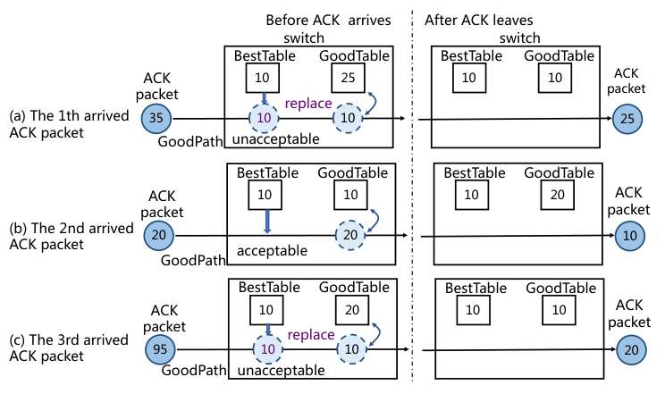
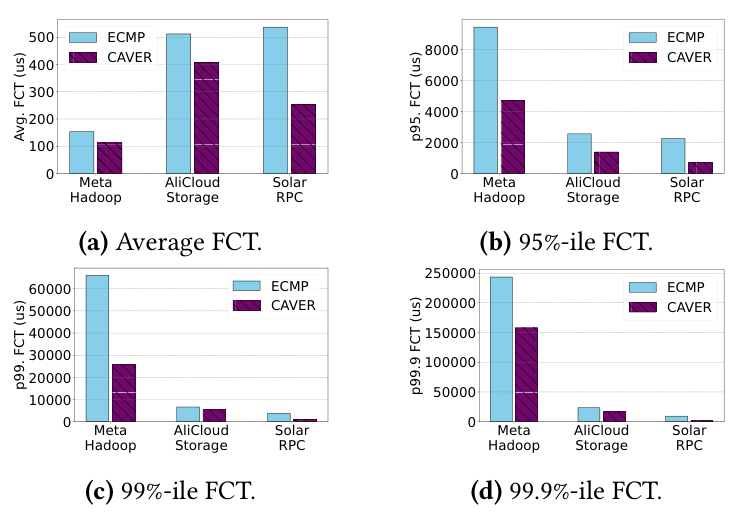
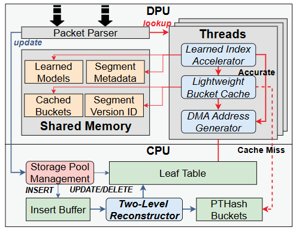
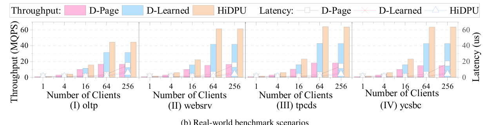
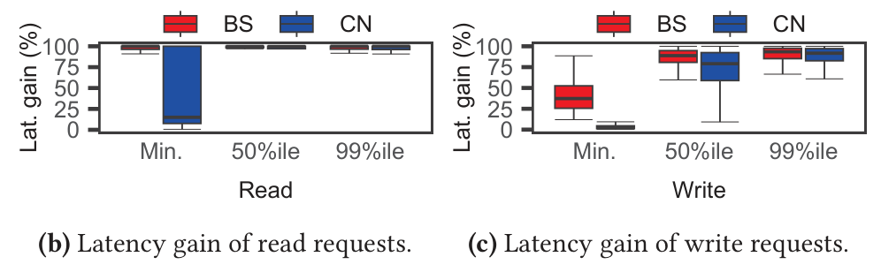

# 2026-11-18 RDMA 与分布式存储早报

[打开渲染页面](https://mingwangsong.github.io/rdma-daily/2026-11-18/)

本期为近期正式顶会论文回溯。未核实当日新增且正文可深入阅读的合格论文；数量以实际完成的深入阅读为准，不凑数。

## CAVER

## CAVER：新流不要再挤向“同一条最优路径”

**论文**：CAVER: Enhancing RDMA Load Balancing by Hunting Less-Congested Paths。**机构**：清华大学（Haotian Deng、Yuan Yang、Xiao Li、Junhao Dong、Yi Liu、Mingwei Xu）与北京航空航天大学（Jue Zhang、Menghao Zhang）。**正式收录**：ACM SIGOPS ATC 2026，会议日期 2026-11-15—18，香港；DOI 10.1145/3828523.3857047。这是正在举办的本届会议论文，非“今日首次发表”；单独上线日期未核实。官方录用名单与论文首页交叉确认。

### 问题与机制：拥塞信息的覆盖面，比更快重路由更先决定上限

ECMP无法知道哈希后路径是否拥塞；只凭现有流反馈，又只能观察已经走过的路径。CAVER针对这个盲区，不维护全网所有路径，而是让不同流的ACK在交换机中交换路径知识，使一次ACK可以携带不是它自身数据流走过的路径。核心目标是**把新流一开始放到较空闲路径**，而非承诺把所有已拥塞长流立即迁走。

1. **以瓶颈链路利用率描述路径**（§3.1）：每个出口维护随发送字节增加、周期衰减的DRE计数，折算成8-bit CE；路径CE取沿途链路CE最大值。交换机按目的端维护最佳路径BestTable和一个可接受候选GoodTable。返回ACK携带最佳与候选两组“路径+CE”，每经过一跳就结合本地出口状态更新。这样跨流共享路径信息，无需额外发探测包；但“无探测包”不等于零开销。
2. **可接受不等于唯一最好**：候选p满足 `255−CE(p) > β × (255−CE(best))`。比较的是剩余容量，而不是CE直接乘β。β接近1会把很多新流逼向少数路径；β为0则几乎退化为随意选路。默认β=0.8，默认状态有效期和估计窗口均50μs，适用数值依赖论文10μs基础RTT，不能照搬跨机房。
3. **Give-and-Take交换，而非寄存器内维护长候选数组**：ACK到达时，如果其候选或GoodTable候选已不可接受，先换成当前最佳；再交换ACK与GoodTable的候选。相继ACK因此携带不同路径，只需少量流水线状态访问，避免多次访问同一寄存器阵列导致报文recirculation。图4不是在计算一次最短路，而是在说明候选如何在ACK与交换机间轮换。
4. **源ToR一次性消费候选**（§3.2）：PathTable用默认4项的环形表收集新鲜候选，新流取最新尚未用过的有效项；同一项不连续分配给一批并发新流。无有效候选回退ECMP。FlowTable缓存该流路径，后续包保持同一路径；哈希冲突还需目的端校验，不能让冲突项把包转到错误目的。该设计降低同批流选同一候选的概率，但不是全网严格无冲突调度。

*图4，PDF第6页，Deng等，ATC 2026。图中最佳CE保持10，GoodTable里的25/10/20却随ACK交换；不可接受的35与95先退回最佳路径。读图重点是候选多样性来自跨包交换，而非缓存很多路径。CC BY 4.0；原图裁切。*

### 实验证据：仿真优于强基线，不代表真机做过同样对照

**仿真（§4.1）**：NS-3、256主机、k=8三层fat-tree、2:1超售、端点间16条路径，RoCEv2 RC Write，DCQCN+PFC；AliCloud Storage、Meta Hadoop、Solar RPC分布。FCT slowdown是“当前流完成时间/该流隔离运行完成时间”，不是存储操作时延或IOPS。图6的AliCloud Storage在80%负载下，相对其他方法中表现最好者，平均slowdown降低12%，尾部降低20%；比较特定ConWeave基线时正文给出的收益更高，不能混成相对最强基线的统一收益。图10在60%负载下：相对取消跨流信息共享的变体改善38.3%，相对只保存最佳路径而不保留可接受路径的变体改善18.8%，说明“看见更多路径”和“避免全选最好”都起作用。

**真机（§4.3、图15）**：两台Tofino1借多流水线虚拟为2个leaf+2个spine，交换机间10Gbps、主机接入25Gbps；服务器PCIe 3.0 x8限制了测试速率。开启PFC/DCQCN，负载60%。只和ECMP比较，未实现CONGA/HULA的P4版本，ConWeave又要求Tofino2特性。三种工作负载平均FCT降低11%—49%，作者报告最高尾FCT降幅86.5%。图15分别列平均、P95、P99、P99.9，不能把最高尾部收益写成所有负载P99均下降86.5%。此处没有400Gbps硬件验证，也没有直接跑分布式存储引擎。

*图15，PDF第13页，Deng等，ATC 2026，CC BY 4.0；原图裁切。纵轴是FCT（μs），四个面板刻度不同；Meta Hadoop的极端尾部改善明显，而AliCloud Storage与Solar RPC的收益幅度不同。应比较每个工作负载内的ECMP/CAVER柱，不能跨面板用柱高比较时延。*

### 资源、失效与部署边界

数据包增加4B路径头；ACK增加10B，对原62B ACK约16%增幅。默认仿真每个数据包一个ACK；§4.2另测稀疏ACK，论文测得特定ConnectX-6配置约52个数据包/ACK，此时仍有收益，但不能把高频ACK仿真收益无条件外推。反馈变稀疏、路径数量变多、流量冷启动都会减慢发现。

表2是**按10k主机规模配置表项时测得的资源占用**，不是实际部署1万主机：流级ToR SRAM16.5%、非ToR2.1%，包级各17.4%。寄存器每项最小128bit导致实际消耗高于字段相加；作者推算50k主机包级版本约25MB，超过其Tofino1的15MB。所有交换机都支持相应状态更新时才能获得完整收益，不能只改主机驱动落地。

§5讨论完整断链：ACK停止传播失效路径，候选到期删除；邻接交换机对已走该路径的包回退ECMP并更新转发头，端主机仍按原RDMA传输处理丢包。这不等于论文已穷尽验证故障恢复，也不提供存储事务的提交/持久化语义。冷启动时先回退ECMP；长期固定流路由与少量候选路径下，初始选路的优势可能减弱。包级版本仍需底层机制处理乱序，不能认为普通RC因此自动可安全逐包喷洒。

### 对分布式存储的可执行判断（分析推断）

适合验证于“副本写入/纠删码重建大流与小读RPC混跑、网络路径碰撞占主要瓶颈”的机架间路径，而不是CPU锁竞争或SSD服务时间主导的系统。收益应来自降低共享网络排队，不是减少存储协议轮次。若现有系统长期复用固定QP/流，必须先查新流识别粒度和路由缓存生命周期，不能用每条RDMA消息都重新选路的想象估计收益。

最小实验先复现两leaf、两spine及相同ACK策略的ECMP/CAVER，再以实际RPC尺寸分布叠加后台修复流。固定PFC/DCQCN参数，分开扫30%/60%/80%负载、ACK比例和并发扇出；同时记录流FCT、客户端读写P99/P99.9、重传、PFC暂停、链路利用率与交换机SRAM。加一条链路限速及断链，核对候选过期前后错误率与恢复时间。如果FCT改善而应用P99不动，应回查存储侧排队与持久化，而不是宣称网络方案失败或成功。需要Tofino或同等可编程交换机与运维可控的测试网，RNIC无需实现新的存储一致性协议。

**阅读与复现范围**：已读16页论文正文、机制/实验/讨论及图表；核查官方录用、作者PDF和作者P4/NS-3仓库README。未运行实验，未找到另行可核实的作者报告。P4说明使用BF-SDE-9.4.0；真实复现还依赖交换机SDK和设备，源码不是即装即用的软件包。

**参考资料**：[正式录用名单](https://atc.sigops.org/2026/accepted.html) · [DOI](https://doi.org/10.1145/3828523.3857047) · [作者PDF](https://zhangmenghao.github.io/papers/ATC2026-CAVER.pdf) · [P4实现](https://github.com/CAVER-LB/CAVER-P4) · [NS-3实现](https://github.com/CAVER-LB/CAVER-ns3)。论文首页明确CC BY 4.0，所选图未见第三方独立限制；两幅裁图据此归档，保留作者署名与来源；全文 PDF 已确认许可，上传仍待平台授权，当前未计为已备份。两个代码库页面标MIT，源码归档需保留LICENSE及第三方文件原许可。

通过ACK在交换机汇合已知路径信息，Best/Good候选防止新流同时选择同一个瞬时最优出口；没有探测包不等于没有ACK和状态开销。

来源：Haotian Deng, Jue Zhang, Menghao Zhang, Yuan Yang, Xiao Li, Junhao Dong, Yi Liu, Mingwei Xu，ACM SIGOPS ATC 2026，图4，PDF第6页。原文：https://zhangmenghao.github.io/papers/ATC2026-CAVER.pdf

两台Tofino1模拟四交换节点，10G网络互联、25G主机接入，60%负载。真机只对照ECMP；平均、P95、P99、P99.9不可混写为统一尾延迟收益。

来源：Haotian Deng, Jue Zhang, Menghao Zhang, Yuan Yang, Xiao Li, Junhao Dong, Yi Liu, Mingwei Xu，ACM SIGOPS ATC 2026，图15，PDF第13页。原文：https://zhangmenghao.github.io/papers/ATC2026-CAVER.pdf

## HiDPU

**正式发表**：FAST 2025，2025 年 2 月 25–27 日，论文集 pp.271–285。本期为往年研究补读，不是当日新论文。**机构**：山东大学（Wenbin Zhu、Zhaoyan Shen、Qian Wei、Dongxiao Yu）；天津大学与华为（Renhai Chen）；华为（Xin Yao）；香港中文大学（Zili Shao）。

## 瓶颈与机制
DPU 已接管数据传输，不意味着 CPU 已退出存储关键路径：逻辑地址 LA 到物理地址 PA 的查询仍可能进入主机软件。把整个映射表搬到 DPU 又遇到容量限制；简单地把查表算子搬过去，则多级表的每一级都可能产生 PCIe/DMA 往返。论文针对的是这个**地址翻译路径**，不是一种新 RDMA 传输或新的一致性协议。

HiDPU 将已排序的逻辑地址按连续性切成三类段（图 4、§3.1–3.2）：
1. **强连续 Accurate 段**：保存 first key 与表起址，用偏移直接确定位置，随后一次主机访问取得映射项。
2. **随机 PTHash 段**：先按哈希选择 bucket，取该 bucket 的 pilot，再以 pilot 修正的哈希定位无碰撞的映射槽。pilot 与映射项都在主机，朴素路径有两次依赖性往返。
3. **弱连续 LPTHash 段**：以 `(LA-firstkey)/div` 分桶，把相邻 LA 放入同一桶，共用 pilot；这不是单纯换一个更快哈希，而是让局部性能够进入 pilot 缓存。代价是桶大小不均、空桶和更难构造 perfect hash；构造超时扩大表，找不到合适分桶时退回 PTHash。

DPU 保存多层 learned index 与段描述，预测属于哪一段后再校正邻近位置；**预测不是最终映射结果**，最终段内查找是精确定位。主机保存大映射数组和 pilot 数组。默认 1,000 段的内部索引为 23.74 KB，另有 1 MB pilot cache，不能把“23 KB”写成全部内存成本。

**作者仓库架构图（对应论文 §3、区别于论文图 4）**：读图要看 DPU/CPU 边界。右侧 Accurate 虚线绕过 bucket cache；Cache Miss 虚线先到主机 PTHash Buckets 获取 pilot，才可确定 Leaf Table 中的映射位置。LPTHash 与 super-bucket 缓存的作用，是把连续请求的第一步留在 DPU 内，既降 PCIe 流量又消除串行依赖。缓存将相邻 pilots 合成 super-bucket，一次缺失带回邻居；冲突时优先保留 LPTHash pilot。并发读取把标识符与 pilot 一起搬入线程局部内存，匹配后才使用；写入通过组内原子计数器分配槽位（图 5）。实现还以定点预测替代无 FPU 的软件浮点、批量加载相邻 first keys，并重叠加载与比较（§4）。

## 更新、并发与失败边界
更新和删除原地改映射项；新键先进主机 cuckoo buffer，DPU 并行读取两个候选槽。缓冲满或驱逐链超阈值时局部重建：主机复制旧段、并入新项并生成新 pilots，再发布带递增版本与新数组地址的段元数据。DPU 中旧版本缓存失效；旧数组延迟回收，供已经读取旧元数据的请求完成。论文图 6 把发布步骤标为 atomic update，但没有给出可照搬到任意 RNIC/DPU 的原子粒度、内存屏障及崩溃恢复协议。不要据此声称具备持久线性一致映射更新。

局部重建不阻塞未受影响段。全局重建则通过根模型阻止新查询，等待在途查询完成，底向上重建并清空缓存。因此“异步更新”不等于全部重建零停机。论文报告 1.2 PB 数据规模全局重建低于 10 分钟，没有证明这能满足在线存储的尾延迟或恢复 SLO。

## 实验证据与不能外推的部分
平台是 96 核 2.4 GHz Xeon Platinum 8260、512 GB DDR4、华为 Hi1823；DPU 具有数百轻量核，每核 4 个物理线程、每线程 4 KB 局部内存和共享 4 MB。D-Page 与 D-Learned 均由作者移植到同一 Hi1823；D-Learned 使用相同的计算优化。不是拿未经优化 CPU 实现充当唯一对照。

图 8(b) 使用 Filebench OLTP/websrv、TPC-DS/PostgreSQL、YCSB/LevelDB 在 FEMU 环境收集的地址轨迹，重放测量**映射查询吞吐与平均延迟**。并发 1–256：HiDPU 吞吐较 D-Page 为 1.3–4.3×、较 D-Learned 为 1.3–1.5×；论文汇总 HiDPU 各场景延迟低于 5.76 μs，对照分别达到 17.39 与 8.15 μs。该图的左轴是 MQPS，右轴是 μs；不能写成存储带宽加速 4.3×，更不能替代 p99 I/O 延迟。

**图 8(b) 读图**：OLTP 的高并发增益小于另外三组，不是方法失效，而是小事务、随机访问降低了 pilot cache 与索引元数据复用。64 到 256 客户端时吞吐趋于平台，延迟却继续上升，说明收益不是随线程无界增长。

图 10 的消融进一步拆开收益来源：先加入 Accurate 段，吞吐最高 1.27×、延迟降至 78%；仅添加 pilot cache 平均吞吐增益 1.03×，原因是普通哈希破坏连续性，命中率最低 19%。改用 LPTHash 后，256 并发下各 trace 命中率达到 80–97%，在前一变体上吞吐再提高最高 1.1×、延迟降至 91%。这说明“加缓存”本身不是核心，**先设计能被缓存的局部性**才是关键。

图 9 的扩大 prn 轨迹测内存，1.35 billion 映射项下 D-Page 102 GB、HiDPU 29 GB。容量单位保留论文原记法；这里以 1.35 billion 映射项及对应内存测量为准，不另作容量换算。图 11(a) 的局部重建实验用一个线程连续 1,000 次查询为一批取均值，报告重建期间平均查询延迟 +0.69%、缓存命中率平均下降 0.15%，瞬时降幅最高 9.9%。这不能证明 p99/p999 无尖峰，也不是全局重建结果。

## 对分布式存储的具体落地判断（分析）
适合试在 DPU 前置块存储的 LBA→extent/page 映射，前提是映射数据能驻留主机 DRAM、地址具有连续性、查询远多于插入。它不直接加速数据复制、NVMe 设备访问或网络拥塞。对象存储的高熵对象 ID 不能假设具备同等 LPTHash 局部性；先转译到有连续性的内部 extent ID 才可能适配，且需要计入这一层开销。

建议最小实验分两阶段：①用作者 CPU simulator 重放本系统的真实 extent/LBA 轨迹，比较普通 page table、PTHash、LPTHash 的映射内存、pilot 命中率、构建时间，扫描段数 P、插入比例和碎片化程度；②在目标 DPU 上测每次查询 PCIe read 次数/字节数、每核 CPU 开销、平均及 p99/p999 翻译延迟，并在真实 I/O 中重新测端到端延迟。注入局部重建、全局重建、DPU reset、主机 crash，检查版本发布与旧表回收不会读到不一致地址。收益门槛应是“省下的 CPU/PCIe 成本大于新增缓存和维护成本”，不是只追一个倍数。

代价与落地风险：perfect-hash 重建消耗主机 CPU，copy-and-publish 暂时双份数组增加内存；高 churn 增加 buffer 与重建频率；全局暂停需要双版本索引或后台切换等额外设计。BlueField 兼容性是作者讨论，论文实验未证明在 BlueField、不同 PCIe 拓扑或 RoCE 端到端路径上同样有效。

## 阅读与资料
实际阅读：论文正文 §2–5、图 4–11 及结论；作者仓库 README 和 LICENSE。未运行代码、未验证硬件复现、未观看报告视频。
- 正式会议页：https://www.usenix.org/conference/fast25/presentation/zhu
- 论文：https://www.usenix.org/system/files/fast25-zhu.pdf
- 作者 slides：https://www.usenix.org/system/files/fast25_slides-zhu.pdf
- 作者源码：https://github.com/quieoo/lmpthash （检查版本 3b934e27c4b5d4da093f06a2ae1e9a673b1650cf）
- 公开代码是 CPU-only simulator，不含依赖专用 microcode 的完整 DPU 实现；README 提供 MSR/random/FEMU trace 入口。

图像依据：architecture.png 取自上述作者 MIT 仓库 documents/HiDPU.png，随附 LICENSE-code.txt；figure8b.png 是 FAST25 论文图 8(b) 的单一实验面板裁切，为逐项性能评论保留坐标/图例/单位，不替代论文，依据必要有限学术评论引用评估，非无限再发布授权。没有发现论文全文公开再分发许可，不上传全文或完整 slides；原文可通过 USENIX 链接阅读。保留来源和图号，版权例外适用性无保证。

Accurate 路径绕过 bucket cache；哈希路径命中缓存时直接查询 Leaf Table，缺失时先取 PTHash Buckets。底部 Two-Level Reconstructor 仍在主机，不能把卸载理解为消除维护成本。

来源：Wenbin Zhu, Zhaoyan Shen, Qian Wei, Renhai Chen, Xin Yao, Dongxiao Yu, Zili Shao，FAST 2025，pp.271–285，作者仓库架构图，MIT许可。来源：https://github.com/quieoo/lmpthash/blob/3b934e27c4b5d4da093f06a2ae1e9a673b1650cf/documents/HiDPU.png

左轴MQPS、右轴μs。OLTP相对增益较低，高并发下吞吐平台化而延迟上升。数据是地址轨迹回放的映射查询，不是NVMe或网络端到端延迟，更没有p99结论。

来源：Wenbin Zhu, Zhaoyan Shen, Qian Wei, Renhai Chen, Xin Yao, Dongxiao Yu, Zili Shao，FAST 2025，pp.271–285，图8(b)，PDF第10页。原文：https://www.usenix.org/system/files/fast25-zhu.pdf

## Skewness

**正式论文**：Hey Hey, My My, Skewness Is Here to Stay: Challenges and Opportunities in Cloud Block Store Traffic。EuroSys 2025，2025-03-30 正式出版（DOI 注册元数据），会议 03-30 至 04-03；本期为未覆盖的旧作补读，不是今日新论文。
**作者单位**：上海交通大学、阿里云，以及上海市可信数据流通与治理及 Web3 重点实验室。按实际阅读的作者 PDF 首页列机构；会议名单对个别作者归属与首页略有差异，不自行合并人事归属。

## 核心判断
这不是一篇“RDMA 再提速”的协议论文，而是解释为何后端已经采用 RDMA、端侧已经无锁轮询，仍会出现严重失衡的生产测量。它最值得用于验证三个设计前提：**队列数均衡不等于请求量均衡；全局写占优不等于读流量可以不均衡；缓存命中率上升不等于 p99 降低。** 文中的改善主要来自 trace 驱动仿真，不能表述为已经部署的新系统收益。

## 数据路径与根因
VM 发起块 I/O → 虚拟盘的 I/O QP → hypervisor 的 polling worker → 前端 RPC → BlockServer（BS）→ 后端 RDMA → ChunkServer（CS）→ SSD。这里的虚拟盘 QP 是 NVMe 风格 I/O 队列，**不是直接等同于 RNIC 的 RDMA QP**。BS 将 LBA 按 32 GiB segment 映射成文件，CS 提供 append-only 持久化，BS 周期执行空间回收。BS/CS 可以同机，但并不强制本地放置。

单个 I/O QP 固定归一个 worker，避免共享队列锁与 CPU cache miss，多个 QP 用 round-robin 绑定。这种结构实现的是“均摊队列”，没有拆分热点 QP 的执行压力。论文§4将节点分为 QP 不够多、热点 VM 只有单 QP、以及热点 VM 有多 QP但请求集中到少数队列三类；第三类占 78.9%。在 Linux blk-mq 的所述配置中，单 I/O 线程/同核线程可能集中到同一队列；仅增加队列数量不能制造有效并行。

**重绑定为什么不够？** 单个热点队列占据绝大部分负载时，把它从 worker A 移到 B，只会转移热点。作者以 10 ms 周期、最热 worker 流量超过最冷者 1.2 倍时交换队列模拟重绑定；而某些突发持续不足 10 ms，决策已滞后。论文重绑定 gain 的公式、方向说明与文字结果存在内部不一致，本报告不引用其“受益节点比例”。可独立核实的证据是全量 metric 显示 42.6% 节点的最热 QP 承载超过 80% 读流量。逐 I/O dispatch 可能拆开热点，但共享队列同步、每请求调度成本以及租户公平性需要重新设计，论文只提出 FPGA/ASIC 方向，未证明其部署收益。

## 四个值得落地验证的发现

| 问题 | 论文证据与实验条件 | 不能省略的边界 |
|---|---|---|
| 热盘被限速，其他盘额度闲置 | §5，multi-VD VM 在限速时，剩余吞吐/IOPS 配额比例中位数分别为 61.6% / 74.7%。模拟 limited lending 在 p=0.8 时，85.9% 样本的限速时长减少 | p 是借出闲置额度比例，不是吞吐加速比。即便 p=0.4，也有 5.2% 样本负收益，因出借盘随后突发。不能取消盘级保底，也不能跨租户无约束汇总 |
| 迁移在追逐刚刚消失的热点 | §6.1，最严重集群在 15 s 观察窗中频繁迁移占比 59.2%。当前最小流量目标与随机目标的归一化迁移间隔中位数均为 0.24；预知下一周期的 oracle 为 0.48 | 这只是同一最严重集群的模拟。0.48 不是 0.48 s；oracle 不可部署。迁移会暂停服务，减少迁移频次不自动等于尾延迟改善 |
| 只平衡写不足以平衡读 | §6.2，96.8% 集群的 read-CoV ≥ write-CoV。用 oracle 目标选择模拟 Write-then-Read，相比 Write-Only，读和写的分布均更均衡（图5c） | 读写 segment 通常各自占优是该策略的依据，不是证明完全无干扰；同一 RNIC、CPU、网络和SSD仍是共享资源。结果依赖理想目标选择 |
| 热点缓存更可能改善中位写延迟，而非尾延迟 | §7，4 KiB 页，64 MiB–2 GiB 容量，对比 FIFO、LRU、Frozen Cache（固定缓存最热 LBA、不逐出）；2 GiB 时 FC 命中分布接近两种基线。图7b/c显示写 p50 可受益、p99未显著改善 | 依据 1/3200 采样 trace 做仿真，热点先验与抽样会影响判断。写缓存必须冗余持久化后才确认，不能把 DRAM 或 RDMA completion 当作耐久完成 |

## 读图：不要被 “Latency gain” 的名字误导

图7(b,c)，作者版 PDF 第12页，Haonan Wu 等，EuroSys 2025。**纵轴实际定义是 L_with-cache / L_without-cache × 100%，越低越好，并非“提升百分比”。** BS-cache 仅跳过 CS 路径；CN-cache 命中可跳过存储集群路径，因此写请求的 Min 与 p50 中 CN 更占优。但是两者 p99 仍接近 100%，读 p50/p99 也接近 100%。这说明热点集中的数据并不必然覆盖长尾请求；将图中的写 p50 收益推广为“缓存改善全局尾延迟”是不成立的。框须理解为跨样本分布，不能将某个箱体中线直接换算成全平台统一延迟。原图最小必要面板用于此处实质性评论，非全文再发布。

## 数据可信度与可复现边界
作者采集 12 小时白天（10:00–22:00）数据，约 1 万租户、6 万 VM、14 万虚拟盘、三个数据中心。论文概述称约3.1亿 trace，表2读写 trace 分列为 56.9M / 247.1M；不要把两种统计精度强行凑为完全一致。单 I/O trace 的采样率为 1/3200；每秒 metric 来自全量 I/O，区分二者至关重要。DC-3 的前1% VM贡献75.4%读、42.6%写流量（表3）；这不是“所有云都遵循的比例”。论文不披露足以复建生产集群的 CPU/RNIC/链路/SSD型号，亦没有在生产集群实际部署这些候选算法。缓存/重绑定仿真不能替代真实排队、微突发、CPU cache、持久化和故障测试。

作者提供 [AE仓库](https://github.com/Nan-Ge/eurosys25_ae) 与 [天池数据集](https://tianchi.aliyun.com/dataset/185310)。AE README 将 R 绘图与 Python 模拟按章节组织，提示原始数据计算需数小时，并提供预计算数据路径；但下载说明仍留有 `[XXXX]`，本次未完成数据下载和复现，不声称获得可独立验证的完整运行环境。没有找到明确仓库许可证，不重新公开打包其代码。没有找到本次可独立核验的作者讲演材料。

## 对分布式存储研发的具体建议（本报告推断）
1. **先量瓶颈，再换传输。** 在现有 vhost/SPDK 到 RDMA target 路径记录每盘、每 I/O queue、每 worker 的 IOPS/字节量/服务时间及排队等待，并把 RNIC 利用率、SSD服务时间一并关联。最小实验用一个单队列热点盘加多个冷盘，保持 RNIC 型号、链路速率、核数与盘一致，对照静态绑定、周期重绑定及批量 dispatch。并列报告 CPU cycles/I/O、吞吐、p50/p99/p99.9、冷租户慢化，防止将“更均匀”当作“更快”。
2. **配额池必须带保底、回收和迟滞。** 仅在同租户授权范围试验借额，为出借盘保留最小额度，限制借额周期，设置快速归还。用“盘A突发后盘B紧接着突发”的序列测试最坏情况，关注总排队时长、每盘违约率，而不是平均带宽。论文的 borrowing 结果可做设计动机，不能当SLO承诺。
3. **迁移先做影子控制器。** 用当前最小负载、带冷却期/迁移预算的启发式、预测策略并行回放，记录即将再次迁移的 segment 以及读写共同资源压力；再小比例启用。保持副本分布约束和同盘 segment 分散约束。控制器本身的CPU和预测训练成本必须记账，不能用 oracle 的 2 倍间隔做上线预期。
4. **缓存要把耐久与迁移成本纳入实验。** 对比 CN、BS 和机架级 NVMe-oF 缓存时，统一冗余持久化确认规则，测试缓存节点故障、确认后掉电、VM迁移、元数据重建；不能一组 DRAM ACK、另一组落盘 ACK。机架级 NVMe-oF 是论文提出的方向，不是其验证过的实现。评估热区是否覆盖尾请求，并测缓存容量的跨节点不均：2 GiB热块设定下，CN可缓存盘数量标准差为BS的21倍（§7.3.2），意味着端侧省延迟可能换来显著容量过配。

**阅读范围**：通读作者版主文§1–10，重点核对§2–8与附录A–D；视觉检查图5与图7，截取图7两个面板；阅读作者AE README，未运行实验。
**核心资料**：[作者全文](https://yichao0319.github.io/assets/publications/eurosys25_wu.pdf) · [DOI](https://doi.org/10.1145/3689031.3696068) · [官方录用名单](https://2025.eurosys.org/accepted-papers.html) · [作者发表页](https://yichao0319.github.io/publications/) · [AE仓库](https://github.com/Nan-Ge/eurosys25_ae)。本篇作者版带传统ACM版权声明，未确认全文公开再分发许可，因此公开资料包不包含完整PDF。

纵轴为Lcache/Lbase×100%，不是提升百分比。CN缓存对写p50更有效，但p99仍接近100%；热点集中不等于长尾被缓存覆盖。

来源：Haonan Wu 等，EuroSys 2025，图7(b,c)，PDF第12页。原文：https://yichao0319.github.io/assets/publications/eurosys25_wu.pdf
