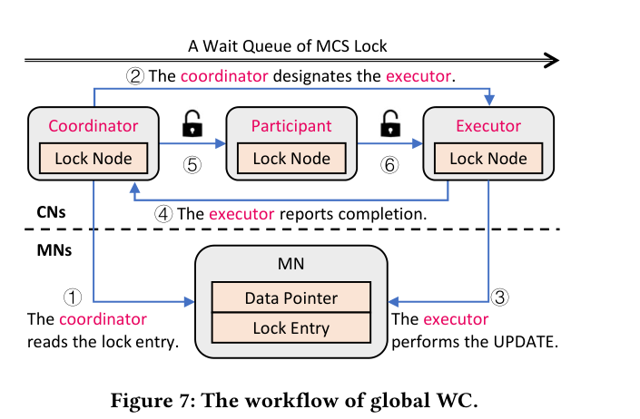
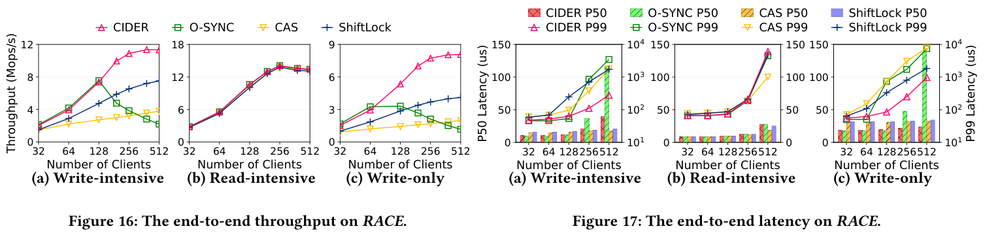
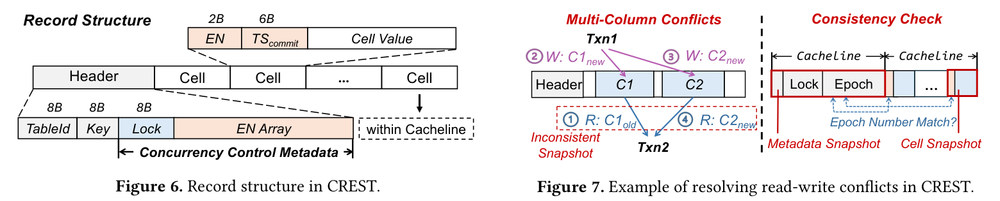
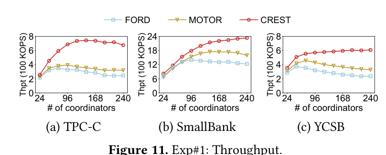
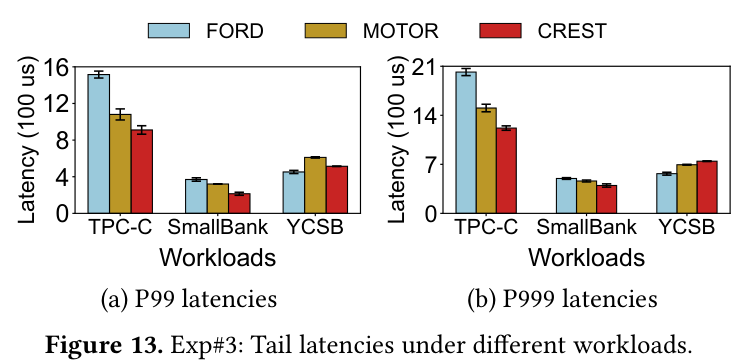
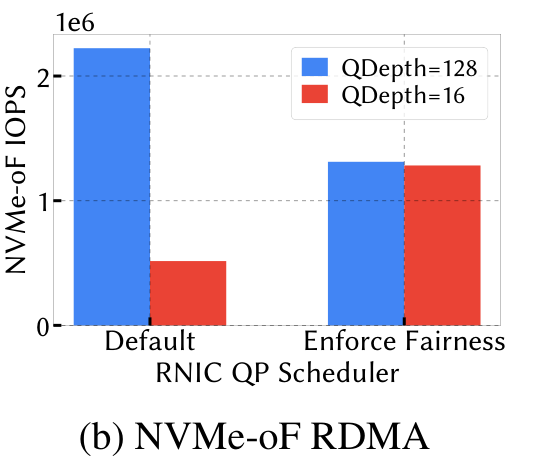
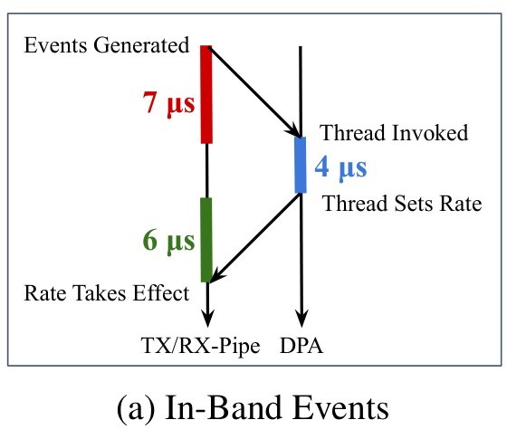

# 2026-11-19 RDMA 与分布式存储早报

[打开渲染页面](https://mingwangsong.github.io/rdma-daily/2026-11-19/)

本期为近期正式顶会论文回溯。未核实当日新增且正文可深入阅读的合格论文；数量以实际完成的深入阅读为准，不凑数。

## CIDER

**定位**：面向分离式 KV 的计算侧同步框架；不是新索引，也不是通用分布式事务协议。

**作者与机构**：Yuxuan Du、Xuchuan Luo、Xin Wang、Yangfan Zhou：复旦大学计算机科学技术与人工智能学院；Du/Luo/Zhou 同列并行与分布处理全国重点实验室。Jiacheng Shen：昆山杜克大学。正式发表于 **PVLDB 19(8), 1701–1714，2026**，DOI 10.14778/3811243.3811245。Crossref 记录印刷日期 2026-04-01、在线发表 2026-07-15；这是已发表论文补读，不是11月19日新录用。不能把4月3日arXiv首发当正式发表时间。

## 瓶颈发生在哪里
单边 RDMA 的 out-of-place 更新先写新 KV，再 CAS 切换索引中的指针。热点上多个客户端都已支付新对象写入、CAS 和失败重试的成本，最终仅留下最后一次写的值。直接换成 MCS 锁可以降低抢锁重试，却仍逐个完成马上被覆盖的更新；只在一个计算节点内做 write combining 又看不到其他节点的并发请求。CIDER 把“谁等待同一指针”的全局 MCS 队列同时用作“哪些更新可以合并”的发现机制，免去额外集中协调服务器。

## 数据路径与关键协议（§4.1–4.5）
1. **普通读不加锁**：读64位数据指针，再读指向的 KV。更新采用新位置写入，最后 CAS 发布指针。数据指针含60位地址、4位版本；锁入口含60位队尾、4位版本和64位 epoch。
2. **热点 UPDATE 合并**：首个获得锁的客户端成为 coordinator。如果本地 Next 已有后继，它读 MN 上的队尾，选定当时最后一个请求为 executor，再把所有权及 coordinator ID 交给它。executor 写入自己的新 KV，并 CAS 更新指针；成功结果回传 coordinator 后，coordinator 和中间参与者沿队列传递“已经合并”的结果，而不再重复写 MN。每批固定新增一次读队尾和两次跨 CN 通信，换掉这一批被覆盖的多次数据写与指针更新。只合并 coordinator 取得锁到确定 executor 这一时间窗口里的重叠操作，之后的请求留给下一批。
3. **不是任意写都能合并**：INSERT 不进队列，用 CAS 竞争空指针。DELETE 必须作为该队列最后执行者，先提高锁入口版本，完成删除时再提高数据指针版本；旧版本 UPDATE 加锁时被拒绝。这样避免槽位删除后重用，让旧 key 的等待者误覆盖新 key。这是协议正确性的一部分，不是可删除的优化代码。
4. **每个 CN、每个指针自适应**：credit>0 时扣一个信用进入悲观模式，成功合并批大小>1则加2，否则信用除2；连续两次乐观请求各发生至少2次重试，赋予初始36信用。两种模式即使同时存在，最终都以原子 CAS 发布指针，不要求全局停机切模式。注意这不是热度缓存策略：判断依据是冲突重试与合并收益，而不只访问频率。

**图7读法**：关键是 coordinator→executor→coordinator 的往返及队列内结果传播，不是“队尾任意越过前面请求”。只提交最后一个重叠更新的值，必须符合 KV 覆盖写的 last-writer-wins 语义。参与者仍需等待结果传回，因而极长队列并不会消灭尾延迟。来源：Du 等，正式PDF第5页，图7。

## 哪些实验真正支撑结论
**配置**：8台 CloudLab 物理服务器，每台双36核 Xeon、256GB DRAM、100GbE ConnectX-6；一台同时承担 CN/MN。最多128个CN是按每CN 4个物理核划分的逻辑节点，不是128台物理机器。预装6000万 KV，默认 key/value 各8B、Zipf=0.99；50%写/50%读、5%写/95%读、100%写三类负载。主比较基线 O-SYNC、CAS退避锁、ShiftLock **均启用local WC**；ShiftLock禁用了读写锁优化。实验不能直接等价于大value、复制持久化路径或真实跨机架128节点。

**图16/17读法**：左边是RACE吞吐，右边是同负载的P50柱和P99折线；P99用右侧坐标，写密集和全写面板为对数刻度，不能和P50共用纵轴读数。50%写时RACE在>128客户端后O-SYNC退化，CIDER继续增长；§5.3.1报告相对O-SYNC最高5.1×吞吐、P99降至1/12.4，相对ShiftLock最高1.5×吞吐、P99降至1/6.2。**但是512客户端的P50相对ShiftLock恶化1.9×**：自适应保留的乐观请求仍可受竞争影响。95%读时各方案吞吐基本接近，不应声称一概更快。来源：正式PDF第11页，图16/17。

SMART实验（图18/19）在50%写下，相对O-SYNC最高6.6×吞吐、P99降至1/13.8；但这是另外一种索引，不能将6.6×贴到RACE曲线上。全写时SMART收益受遍历开销限制：全局合并只作用于锁保护的指针修改，不能像local WC一样合并计算节点内的树遍历。

**消融值得注意**（图20/21）：图20为512客户端的pointer-array，特意关闭O-SYNC和ShiftLock的local WC；因此其中“22×”不是上面的端到端提升，不能混用。全局合并在该设置相对ShiftLock提高吞吐3.7×、P99改善至少5.4×，但P50基本不变；自适应主要降低冷key锁开销。图21说明合并率最高不等于整体最快：冷key小批合并无法摊薄跨CN协调成本。§5.5在2PL事务测试中**关闭了自适应与WC**，因其分别违背2PL和事务原子性；剩余方案甚至比ShiftLock低约1.2–1.3倍。这是明确的适用边界。

## 故障、成本与存储落地判断
**作者设计**：继承ShiftLock超时恢复；每次释放锁用FAA增加64位epoch，等待者在一个最大持锁时间内观察不到epoch增长就向MN报告，由MN重置锁。额外内存：MN每KV为8B指针+16B锁结构，CN对热点指针保留8B credit/retry统计。队列故障修复依赖内存侧管理能力，不是永远不运行远端CPU。

**工程推断与验证建议**：优先迁移到分布式缓存/元数据KV的“覆盖式 PUT→发布对象指针”路径，而非跨key事务、计数器累加、追加日志或要求每次中间状态持久化的路径。先对真实trace统计同key重叠覆盖比例、CAS重试、RNIC IOPS、value尺寸及每CN热点分布，再决定是否值得引入排队。做三CN+一MN小实验，对比原方案/local WC/仅MCS/CIDER，扫描Zipf、16B到4KB value、4–128并发以及热点迁移；同时报告吞吐和每key P99/P999，防止平均吞吐遮住冷key退化。故障注入应落在executor写新KV后、CAS前后、结果回传前和队列交接时，并加入客户端长停顿后恢复；验证超时重置后旧持有者是否仍可能发布指针、4位版本反复复用是否有ABA窗口、孤立的新对象怎样回收。论文没有给出上述完整故障矩阵，也没有证明它能替代复制协议或SSD持久化。

## 阅读与资料
已读正式PDF正文§1–7，重点逐项核对§4协议、§5.1配置、§5.3–5.5结果，并查看图7/16/17原图及作者代码README；未运行实验，未声称代码经过正确性审计。作者没有提供本次已核实可用的独立演讲/博客，故不以二手摘要补全机制。
- 正式论文：https://www.vldb.org/pvldb/vol19/p1701-du.pdf
- DOI：https://doi.org/10.14778/3811243.3811245
- 扩展预印本（不是正式收录证据）：https://arxiv.org/abs/2604.03007
- 作者代码：https://github.com/dmemsys/CIDER ，commit `c1bf14224272ca4924f08405f3191316d52ea373`，MIT；README只保证CloudLab r650验证。
- 正式PDF首页为CC BY-NC-ND 4.0。完整原件用于非商业学术归档，不修改原PDF；本报告选取图7和图16/17完整图框用于紧邻技术评论，未改动图内内容，保留署名、图号与原文。图形未发现另外标注的第三方例外；不据此授予商业使用权。

不是所有等待者都写MN：队尾executor写入，结果回传队首，再沿队列传播；每批付出固定跨CN协调开销。

来源：Yuxuan Du, Xuchuan Luo, Xin Wang, Yangfan Zhou, Jiacheng Shen，PVLDB 19(8), pp.1701–1714 (VLDB 2026)，图7，PDF第5页。原文：https://www.vldb.org/pvldb/vol19/p1701-du.pdf

50%写下吞吐/P99明显改善；95%读近乎持平；P99为右侧轴，不能与P50混读，512客户端P50较ShiftLock恶化1.9×。

来源：Yuxuan Du, Xuchuan Luo, Xin Wang, Yangfan Zhou, Jiacheng Shen，PVLDB 19(8), pp.1701–1714 (VLDB 2026)，图16–17，PDF第11页。原文：https://www.vldb.org/pvldb/vol19/p1701-du.pdf

## CREST

**作者单位**：Qihan Kang、Yongkang Hu：中科院计算所处理器芯片全国重点实验室、中国科学院大学；Mi Zhang：中科院计算所同实验室；Patrick P. C. Lee：香港中文大学计算机科学与工程系。**正式发表**：ASPLOS 2026 Volume 2，pp.511–527，2026-03-22发表，会议3月22–26日，DOI 10.1145/3779212.3790148。本期为2026年已发表研究补读，非当天新录用。

## 两种冲突，必须分开解决
RDMA事务把数据放在内存节点，计算节点承担执行与校验。旧系统先锁整行，取数据，在本地计算，再校验、写日志、回写和解锁。即使两个事务改同一行不同列，也会互相阻塞或abort，这是**假冲突**。真正改同一字段的事务则必须排序，细粒度锁无法消除其等待。CREST因此不是单独把锁拆细：它同时改记录布局、在同一CN共享未提交中间版本，并为这些版本的依赖设计并行提交。

## 从远程记录到提交点（§4–7）
**① 字段级锁，不为每个字段多付一个RTT。** 每个cell有2B epoch、6B提交时间戳和value；记录header集中存TableID、key、8B锁位图和epoch数组。用一个masked-CAS一次锁定多个字段位，用一个READ取得header验证多个字段。布局使字段锁和版本聚集在一个64B cacheline；如果仅把整行锁机械拆成多个远端地址，I/O数增加会抵消并发收益。

**图6/7读法**：图6左侧不是“每个cell一把独立远端锁”，而是集中锁位图+版本数组；图7指出即使单cell读写不撕裂，仍可能读到C1旧值与C2新值。读者拿到cell后，再取header快照，必须同时满足相关锁未被别人持有且header的epoch与读到的cell epoch匹配。写者先写全部cell，再更新header epoch，最后解锁，才使这次校验能识别跨字段不一致。来源：作者正式版PDF第5页，图6/7。

**② 本地早可见，不等于对外已提交。** 同一个CN维护record cache及未提交version list，缓存对象记录读者/写者引用计数。新事务可以读到前驱的未提交版本，把前驱事务ID加入依赖表。前驱abort则后继也abort，不能把这些中间值当成功结果对外确认。局部执行按程序员定义的execution blocks流水化：块内按(TableID,key)顺序取本地锁避免死锁，块末释放；全事务带单调TSexec，如果后续块读到时间戳更大的版本，就检测出逆序依赖并abort。应用必须以stored procedure描述访问列和依赖，不能无修改承接任意动态SQL。

**③ 提交同时处理远端冲突与本地依赖。** 校验只读cell的epoch是否被其他CN改变，以及依赖事务是否abort。通过后标记committable并赋TScommit。redo条目包含事务ID、修改日志和依赖ID，按协调器各自的log segment写入内存池。论文的提交条件是可提交且日志已持久记录。写者引用计数减至零的最后一个写者才把最新可提交版本写回并释放远端锁，避免同一CN重复覆盖回写。并行提交并不代表可以无视前驱：恢复也要按记录的依赖滚前。作者称系统提供ACID并用primary-backup保护记录；这不应被改写成“普通RDMA WRITE完成就具有跨掉电持久性”。实验用DRAM，具体持久化域、日志复制确认点与故障模型仍需部署时单独验证。

## 实验：吞吐收益不能替代尾延迟判断
**环境**：5台服务器，3CN+2MN，100Gb/s ConnectX-5 InfiniBand及同速交换机。CN为Xeon Platinum8260、48核，实验限定8GiB DRAM；MN192GiB；Ubuntu20.04/Linux5.4。默认每CN 40线程×2协程=80协调器，总240，每CN产生1000万事务。对比作者开源FORD、Motor。TPC-C默认40仓库、92%读写；SmallBank10万账户、Zipf0.99；YCSB100万记录、每行4个40B cell、默认事务访问4行。原型使用coroutine、doorbell batching、selective signaling。

**图11读法**：TPC-C的曲线不是无限扩展。CREST在144协调器达到峰值743.7 KOPS，比Motor峰值高72.4%、FORD峰值高112.6%，之后同样回落。固定240协调器时，TPC-C/SmallBank/YCSB相对Motor吞吐分别1.92×/1.46×/1.85×，相对FORD为2.76×/1.89×/2.58×。峰值比较与固定并发比较不能混为同一个提升。来源：PDF第10页，图11，§8.3 Exp#1。

**图13读法**：240协调器下，TPC-C P99相对Motor降低15.2%，SmallBank降低36.7%；YCSB的P99没有明显胜出，图中P999甚至高于两基线。原因是跨CN热点仍然互相阻塞，本地早可见没有解决所有远端竞争。图12的平均延迟相对Motor降低17.7–44.4%，不能拿来声称P99同比例下降；TPC-C在216/240协调器时Motor的P50更低，也应保留。来源：PDF第10页，图13、§8.3 Exp#2–3。

**图15读法**：高偏斜时，加入cell-level使TPC-C/YCSB吞吐分别提高65.9%/46.6%，SmallBank因只有一个字段而没有此收益；再加入localized execution和parallel commits，三负载进一步提高48.9%/78.1%/104.6%。这两个机制因正确性约束一起消融，不能拆出“并行提交单独贡献多少”。低偏斜YCSB中本地缓存管理反而降低吞吐3.6%。来源：PDF第11页，图15，§8.4。

其他边界（图18）：只读YCSB下Motor比CREST快12.8%，因为MVCC省去只读验证而CREST还维护缓存；低偏斜下CREST最多落后Motor10.1%。因此这是“高竞争写路径”设计，不是所有读写场景的新默认协议。

## 工程迁移：优先试元数据事务，先算清协议成本
**适合尝试的组件（分析推断）**：目录/inode/对象元数据记录中不同字段并发修改、且事务较短的元数据服务。先从trace建立“同一record不同cell”的假冲突矩阵；若主要冲突都在同一个引用计数，拆字段不会有收益，本地依赖执行才可能是有效部分。跨CN热点占比高时，可研究把关联事务调度到同CN，但这是后续思路，本文没有验证该调度方案。

**迁移前提与代价**：需要masked-CAS支持。作者README明确要求MLNX_OFED_LINUX-4.9-7.1.0.0的experimental verbs，不能把这个旧驱动依赖当作现有生产集群一定兼容的能力。header版本数组使独立cell上限为20，超过后把剩余列并成大cell，会重新引入假冲突。大于cacheline的cell依赖cacheline versioning；须在目标RNIC/PCIe/CPU平台验证论文依赖的原子可见性及写入顺序，不能把普通RDMA READ当作跨平台64B原子保证。2B epoch还有回绕问题，论文通过超时后读取完整record并检查提交时间戳处理，测试需覆盖长停顿与热点更新超过65536次。

**内存成本**：表1含cacheline padding的TPC-C额外空间，CREST41.30%、FORD19.61%、Motor63.92%。不是“细粒度元数据近乎免费”。CN还要保存活跃事务工作集和未提交版本，工作集超出本机内存时无法执行；论文只测短事务。实际系统应把依赖链长度、引用计数积压、缓存上限、abort级联及日志保留量纳入监控。

**最小验证计划**：先用2CN+2MN复现冲突矩阵，按字段不重叠/同字段两个子负载分别测试；再扩到论文3CN/2MN，比较原record锁、仅cell锁、完整CREST，扫描本地/跨CN请求比例和读写比。除吞吐/P50/P99/P999外，记录假abort、依赖abort、每事务RDMA verbs、CN缓存峰值和日志字节。故障注入选redo写入前后、最后writer回写部分cell时、释放锁前及依赖链中的前驱CN崩溃；核验事务原子性、恢复后可序列化历史与重复执行幂等性。正文没有单独的故障注入/恢复时延实验，不能把作者正确性论证当成生产容灾测量结果。

## 阅读与资料
已阅读作者正式版PDF正文§1–10、附录A，逐图查看图6/7、11、13、15；阅读作者README与artifact说明，未运行实验、未审计全部源码。未找到本次已核实的作者独立技术博客或演讲，未以二手解读填充。
- 正式DOI：https://doi.org/10.1145/3779212.3790148
- 作者论文原件：https://www.cse.cuhk.edu.hk/~pclee/www/pubs/asplos26.pdf
- 正式会议program：https://asplos-conference.org/asplos2026/program/index.html
- 作者开源：https://github.com/adslabcuhk/crest ，Apache-2.0，commit `4715fef9928f9c66c8ac6bca8e9731ce51773b9d`
- 作者实验归档：https://zenodo.org/records/18227294 （附录列出永久归档；本次未运行其中脚本）
- PDF首页CC BY4.0；所选作者图表无另行限制标记，截图仅去除周围正文，保留图例、坐标、单位及图号。正文及原图据此署名引用，源码另依Apache-2.0保留许可文件。

锁位图和epoch数组减少细粒度锁RTT；单cell原子可见仍不足以保证跨cell一致快照，必须检查锁和epoch。

来源：Qihan Kang, Mi Zhang, Patrick P. C. Lee, Yongkang Hu，ASPLOS 2026 Volume 2, pp.511–527，图6–7，PDF第5页。原文：https://www.cse.cuhk.edu.hk/~pclee/www/pubs/asplos26.pdf

144协调器TPC-C峰值743.7KOPS；240协调器相对Motor1.92×，这两种比较不能混用。

来源：Qihan Kang, Mi Zhang, Patrick P. C. Lee, Yongkang Hu，ASPLOS 2026 Volume 2, pp.511–527，图11，PDF第10页。原文：https://www.cse.cuhk.edu.hk/~pclee/www/pubs/asplos26.pdf

TPC-C/SmallBank P99更低；YCSB P99近似、P999未改善，跨CN热点仍在。

来源：Qihan Kang, Mi Zhang, Patrick P. C. Lee, Yongkang Hu，ASPLOS 2026 Volume 2, pp.511–527，图13，PDF第10页。原文：https://www.cse.cuhk.edu.hk/~pclee/www/pubs/asplos26.pdf

[原文图15（PDF第11页）](https://www.cse.cuhk.edu.hk/~pclee/www/pubs/asplos26.pdf#page=11)

字段锁不改善单字段SmallBank；本地执行与并行提交绑定消融；低偏斜YCSB反而降低3.6%。

来源：Qihan Kang, Mi Zhang, Patrick P. C. Lee, Yongkang Hu，ASPLOS 2026 Volume 2, pp.511–527，图15，PDF第11页。原文：https://www.cse.cuhk.edu.hk/~pclee/www/pubs/asplos26.pdf

## SCR

**White-Boxing RDMA with Packet-Granular Software Control** · NSDI 2025，正式论文集 pp.427–449；会议日期 2025-04-28–30（官网仅给出版月份，不能视作精确上线日期）。**近期回溯，非今日新发表**。作者：Chenxingyu Zhao、Jaehong Min、Arvind Krishnamurthy（University of Washington），Ming Liu（University of Wisconsin–Madison）。正式录用依据：USENIX 论文页及正式论文集首页。检索到的11/10–18仓库正文未见此前报道。

## 为什么对存储值得读

一条 4KB NVMe-oF 请求的隔离，不止受交换机拥塞影响。RNIC 取哪条 QP 的 WQE、何时发起 PCIe DMA、投入多少内部处理能力，已经决定租户能否获得发送机会。传统 DCQCN 只对 fabric 拥塞反馈：当网口总吞吐正常、但深队列租户吃掉大多数调度机会时，交换机并不一定发出拥塞信号。SCR 不把存储协议搬进软件，也不重新实现 RDMA transport；它把**每 QP 从内存取消息的速率**作为统一控制量，保留 ASIC 的 DMA、分段和可靠传输数据路径，在 BlueField-3 DPA 上执行可定制策略。

## 机制沿数据路径展开

1. 应用提交 WQE 并敲 doorbell，RNIC 更新 QP context、缓存 WQE。调度器依据 QP 元数据与逐 QP rate 生成 WQE 执行次序；随后硬件执行 DMA、分段、传输。SCR 通过 DOCA PCC 更新逐流 rate，使干预发生在占用 PCIe、RNIC 和网络资源之前，不是把完整 WQE 交给主机软件逐个拦截（§4.2，图3–4）。这里的 dequeue rate 用“取出的消息总字节/时间”度量，不等同于每秒取多少个 WQE。
2. 反馈来自三域：RNIC 的 TX/ACK/NACK/CNP/RTT；主机侧 PCIe 统计或探测延迟、应用提示；对端通过轻量 UDP 传回 credit/资源压力。BF3 当时没有所需 RX 事件接口，不能把它描述成任意读写全部 transport 状态。host agent 与 DPA 通过共享内存传信号，peer 控制包可按 RTT、采样字节数或异常触发发送（§4.3.1）。
3. 100GbE 上的 MTU 级事件远比弱 RISC-V 核可处理的速率密集。SCR 用硬件事件累加，再补软件 coalescing；每种事件、每条流各设 SPSC 队列，合并可采用累加、保留最新/最老，或稳定流减少重复处理。事件处理 run-to-completion、shared-nothing，同一流的同类事件归固定线程，从而不靠频繁锁和抢占协调（§4.3.2–3）。这保证的是控制事件处理的局部有序和低开销，**不是新增存储一致性协议**。
4. 公平调度例子：用 TX 事件的时间差与字节数估计逐流带宽，以 EWMA 平滑。简单的每流固定 `C/n` 会给小消息流分配用不完的配额，同时限制大消息流。water filling 让未满足需求的流逐步增长；新流加入时已有流额度乘 `(n−1)/n`，新流从 `C/n` 起步，流结束则回收额度。状态用 HashMap/Bloom filter 等紧凑结构、定点算术降低 DPA 工作集与执行时间。论文旨在展示控制框架的可表达性，并未证明这一策略对所有存储 QoS 都最优（§5.1）。

## 关键证据，不能混为 SSD 性能提升

平台是两台服务器、一台100GbE交换机；每台双路 Xeon Gold 6346、384GB DDR4、PCIe Gen4、BlueField-3，Ubuntu22.04/kernel6.5、DOCA2.6、SPDK24.05，租户用 SR-IOV VF（§3.2）。

**图21(b)，PDF第22页/论文p.447：NVMe-oF 的公平性，不是实盘 benchmark。** SPDK `nvmf_tgt` 后端使用 NULL device 排除介质瓶颈，两个 initiator 都发4KB write，QD分别128和16。默认调度下，柱高约2.2M与0.5M IOPS；SCR公平策略后约1.3M与1.3M IOPS。这些是读图近似值，不是作者提供的原始测量表。应读出的结论是：浅队列租户不再被深队列租户压制，总 IOPS 大致保留；不是“总吞吐翻倍”，更不能推导真实SSD的写持久化吞吐或p99改善。等大小I/O使该实验中带宽公平与IOPS公平近似对应，混合I/O大小时两者不再等价。

**图12与图13：规模和延迟证据须分开。** 多流 WRITE 实验最多1024 QP，消息大小在4KB–1MB间均匀采样、QD=4；4QP场景公平指数从0.51到0.96，约1.88倍，三种策略总体接近线速。超过100流时每流份额低于1Gbps，硬件Mbps级精细限速成为限制。另一个两租户实验是64KB/QD128带宽流与256B/QD4延迟流竞争，water filling 相对默认调度的延迟降幅最高52.8%，**这不是NVMe-oF的p99结论**。

**图22(a)，PDF第23页/论文p.448：包级可观测不等于亚微秒闭环。** 作者把带内事件反馈分为触发、控制计算、rate生效三段，分别测得可达7μs、约4μs、可达6μs；4μs用的是Swift计算及逐流记账，不是所有控制律的固定成本。三阶段揭示控制回路能显著落后数据平面；不能把三项最大/示例值直接当作普遍端到端p99。作者建议优先按RTT尺度设计策略，若要求更细粒度，则控制律必须容忍事件合并。这个限制对几微秒级存储读路径尤其重要。

## 可迁移到哪个组件，怎样验证

**分析推断：优先落在共享 RNIC 的 NVMe-oF initiator 侧租户 QoS，而不是索引或日志一致性路径。** 可把在线读、后台复制/重建、批量写分别映射到明确的 QP/VF 或租户组；首先实现组级预算，再在组内执行需求感知分配。仅按QP平分可被“多开QP”的租户获取额外份额，生产中必须让连接归属与租户权重绑定。远端响应方向也需要定位实际发送端，只控制请求发起端不保证READ返回数据隔离。

最小验证建议：两台 BF3/100GbE，复现 NULL后端的4KB写、QD16/128；测逐租户IOPS、总吞吐、Jain指数、收敛时间，再换真实SSD，加入4KB读与64KB后台写/复制，记录p50/p99/p99.9、CPU占用、DPA线程利用率、PCIe带宽及ECN/PFC。对照原生调度、静态配额、water filling；增加/删除租户及QP，检查公平收敛与误限速。只有介质瓶颈与网络调度瓶颈分别实验，才知道收益是否在真实存储系统保留。

落地成本与边界：需要BF3 DPA/PCC/FlexIO能力，不是任意普通RNIC的软件更新；实现约7.8K行C/C++。论文主机侧实验一个x86核足够，但不能称零CPU。正文微测用64个带内处理线程、16个带外处理线程，附录默认实现则描述25个fabric线程加host/telemetry/peer线程，不应把不同配置拼成一组固定资源规格。控制探测消耗网络带宽，flow状态消耗DPA缓存；精细限速、RX反馈不足、IPC经主机转接都是现实制约。

**失败与恢复尚缺证据：** 原文没有给出DPA控制进程崩溃/重启、异常credit、残留rate的完整存储服务恢复协议，也没有证明硬件重传可替代这些控制面恢复。生产试验应注入控制进程退出、peer控制包丢失和QP重建，定义rate watchdog、过期额度清理及安全回退；这些是本报告提出的工程验证项，不是SCR已实现特性。RDMA传输可靠性不等同于写持久化、复制确认或事务提交。

## 阅读与资料

已读正式PDF机制§3–6，重点核对§4.2–4.3、§5.1、§6.1–6.4、附录A.9–A.12及图21/22；其他扩展案例未作为主要结论。已查看作者报告中公平调度及More Use Cases对应页面（报告印刷页24），未观看全程视频。官方论文页与作者PDF入口均可访问；尚未发现可核实的官方SCR源码仓库，不能声称已fork或可直接复现全部代码。

- 正式论文/录用：https://www.usenix.org/conference/nsdi25/presentation/zhao-chenxingyu
- 论文PDF：https://www.usenix.org/system/files/nsdi25-zhao-chenxingyu.pdf
- 作者PDF备选：https://homes.cs.washington.edu/~arvind/papers/scr.pdf
- 官方报告：https://www.usenix.org/system/files/nsdi25_slides-zhao-chenxingyu.pdf
- 官方视频：https://www.youtube.com/watch?v=6fda5-FH4zY

图注统一来源：Zhao et al., NSDI2025正式版本，Fig.21(b)/22(a)，仅裁取用于逐图评论的两个面板。未发现明确全文再分发许可，公开归档不放整篇PDF/幻灯片。图像按研究评论所需最小范围有限引用，详细逐图评估见figure-use.json；不以署名替代授权，也不声称法律例外保证适用。

默认约2.2M/0.5M IOPS，公平控制后约1.3M/1.3M（均为读图近似）。浅队列租户得到份额，总IOPS大致保留。NULL后端隔离网络瓶颈，不能据此声称实盘吞吐、持久化延迟或p99改善。

来源：Chenxingyu Zhao, Jaehong Min, Ming Liu, Arvind Krishnamurthy，NSDI 2025，图21(b)，PDF第22页。原文：https://www.usenix.org/system/files/nsdi25-zhao-chenxingyu.pdf

事件触发可达7μs、Swift计算及记账约4μs、rate生效可达6μs。三者为不同阶段测量，不是普遍端到端p99；说明短存储请求可能在控制完成前已执行，需按RTT尺度或容忍coalescing设计策略。

来源：Chenxingyu Zhao, Jaehong Min, Ming Liu, Arvind Krishnamurthy，NSDI 2025，图22(a)，PDF第23页。原文：https://www.usenix.org/system/files/nsdi25-zhao-chenxingyu.pdf
