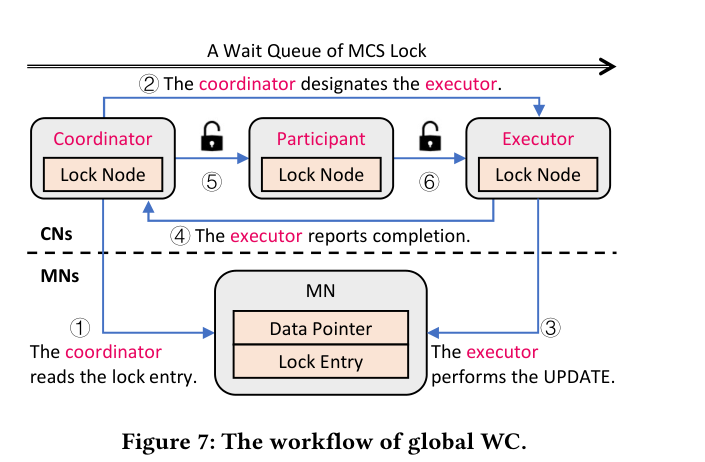
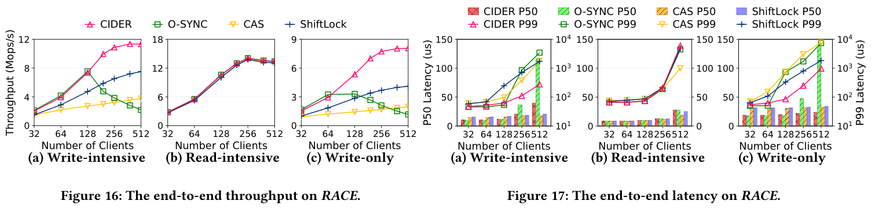

# CIDER：不是让所有请求排队，而是只让热点更新进入跨节点合并队列

**定位**：面向分离式 KV 的计算侧同步框架；不是新索引，也不是通用分布式事务协议。

**作者与机构**：Yuxuan Du、Xuchuan Luo、Xin Wang、Yangfan Zhou：复旦大学计算机科学技术与人工智能学院；Du/Luo/Zhou 同列并行与分布处理全国重点实验室。Jiacheng Shen：昆山杜克大学。正式发表于 **PVLDB 19(8), 1701–1714，2026**，DOI 10.14778/3811243.3811245。Crossref 记录印刷日期 2026-04-01、在线发表 2026-07-15；这是已发表论文补读，不是11月19日新录用。不能把4月3日arXiv首发当正式发表时间。

## 瓶颈发生在哪里
单边 RDMA 的 out-of-place 更新先写新 KV，再 CAS 切换索引中的指针。热点上多个客户端都已支付新对象写入、CAS 和失败重试的成本，最终仅留下最后一次写的值。直接换成 MCS 锁可以降低抢锁重试，却仍逐个完成马上被覆盖的更新；只在一个计算节点内做 write combining 又看不到其他节点的并发请求。CIDER 把“谁等待同一指针”的全局 MCS 队列同时用作“哪些更新可以合并”的发现机制，免去额外集中协调服务器。

## 数据路径与关键协议（§4.1–4.5）
1. **普通读不加锁**：读64位数据指针，再读指向的 KV。更新采用新位置写入，最后 CAS 发布指针。数据指针含60位地址、4位版本；锁入口含60位队尾、4位版本和64位 epoch。
2. **热点 UPDATE 合并**：首个获得锁的客户端成为 coordinator。如果本地 Next 已有后继，它读 MN 上的队尾，选定当时最后一个请求为 executor，再把所有权及 coordinator ID 交给它。executor 写入自己的新 KV，并 CAS 更新指针；成功结果回传 coordinator 后，coordinator 和中间参与者沿队列传递“已经合并”的结果，而不再重复写 MN。每批固定新增一次读队尾和两次跨 CN 通信，换掉这一批被覆盖的多次数据写与指针更新。只合并 coordinator 取得锁到确定 executor 这一时间窗口里的重叠操作，之后的请求留给下一批。
3. **不是任意写都能合并**：INSERT 不进队列，用 CAS 竞争空指针。DELETE 必须作为该队列最后执行者，先提高锁入口版本，完成删除时再提高数据指针版本；旧版本 UPDATE 加锁时被拒绝。这样避免槽位删除后重用，让旧 key 的等待者误覆盖新 key。这是协议正确性的一部分，不是可删除的优化代码。
4. **每个 CN、每个指针自适应**：credit>0 时扣一个信用进入悲观模式，成功合并批大小>1则加2，否则信用除2；连续两次乐观请求各发生至少2次重试，赋予初始36信用。两种模式即使同时存在，最终都以原子 CAS 发布指针，不要求全局停机切模式。注意这不是热度缓存策略：判断依据是冲突重试与合并收益，而不只访问频率。

**图7读法**：关键是 coordinator→executor→coordinator 的往返及队列内结果传播，不是“队尾任意越过前面请求”。只提交最后一个重叠更新的值，必须符合 KV 覆盖写的 last-writer-wins 语义。参与者仍需等待结果传回，因而极长队列并不会消灭尾延迟。来源：Du 等，正式PDF第5页，图7。

## 哪些实验真正支撑结论
**配置**：8台 CloudLab 物理服务器，每台双36核 Xeon、256GB DRAM、100GbE ConnectX-6；一台同时承担 CN/MN。最多128个CN是按每CN 4个物理核划分的逻辑节点，不是128台物理机器。预装6000万 KV，默认 key/value 各8B、Zipf=0.99；50%写/50%读、5%写/95%读、100%写三类负载。主比较基线 O-SYNC、CAS退避锁、ShiftLock **均启用local WC**；ShiftLock禁用了读写锁优化。实验不能直接等价于大value、复制持久化路径或真实跨机架128节点。

**图16/17读法**：左边是RACE吞吐，右边是同负载的P50柱和P99折线；P99用右侧坐标，写密集和全写面板为对数刻度，不能和P50共用纵轴读数。50%写时RACE在>128客户端后O-SYNC退化，CIDER继续增长；§5.3.1报告相对O-SYNC最高5.1×吞吐、P99降至1/12.4，相对ShiftLock最高1.5×吞吐、P99降至1/6.2。**但是512客户端的P50相对ShiftLock恶化1.9×**：自适应保留的乐观请求仍可受竞争影响。95%读时各方案吞吐基本接近，不应声称一概更快。来源：正式PDF第11页，图16/17。

SMART实验（图18/19）在50%写下，相对O-SYNC最高6.6×吞吐、P99降至1/13.8；但这是另外一种索引，不能将6.6×贴到RACE曲线上。全写时SMART收益受遍历开销限制：全局合并只作用于锁保护的指针修改，不能像local WC一样合并计算节点内的树遍历。

**消融值得注意**（图20/21）：图20为512客户端的pointer-array，特意关闭O-SYNC和ShiftLock的local WC；因此其中“22×”不是上面的端到端提升，不能混用。全局合并在该设置相对ShiftLock提高吞吐3.7×、P99改善至少5.4×，但P50基本不变；自适应主要降低冷key锁开销。图21说明合并率最高不等于整体最快：冷key小批合并无法摊薄跨CN协调成本。§5.5在2PL事务测试中**关闭了自适应与WC**，因其分别违背2PL和事务原子性；剩余方案甚至比ShiftLock低约1.2–1.3倍。这是明确的适用边界。

## 故障、成本与存储落地判断
**作者设计**：继承ShiftLock超时恢复；每次释放锁用FAA增加64位epoch，等待者在一个最大持锁时间内观察不到epoch增长就向MN报告，由MN重置锁。额外内存：MN每KV为8B指针+16B锁结构，CN对热点指针保留8B credit/retry统计。队列故障修复依赖内存侧管理能力，不是永远不运行远端CPU。

**工程推断与验证建议**：优先迁移到分布式缓存/元数据KV的“覆盖式 PUT→发布对象指针”路径，而非跨key事务、计数器累加、追加日志或要求每次中间状态持久化的路径。先对真实trace统计同key重叠覆盖比例、CAS重试、RNIC IOPS、value尺寸及每CN热点分布，再决定是否值得引入排队。做三CN+一MN小实验，对比原方案/local WC/仅MCS/CIDER，扫描Zipf、16B到4KB value、4–128并发以及热点迁移；同时报告吞吐和每key P99/P999，防止平均吞吐遮住冷key退化。故障注入应落在executor写新KV后、CAS前后、结果回传前和队列交接时，并加入客户端长停顿后恢复；验证超时重置后旧持有者是否仍可能发布指针、4位版本反复复用是否有ABA窗口、孤立的新对象怎样回收。论文没有给出上述完整故障矩阵，也没有证明它能替代复制协议或SSD持久化。

## 阅读与资料
已读正式PDF正文§1–7，重点逐项核对§4协议、§5.1配置、§5.3–5.5结果，并查看图7/16/17原图及作者代码README；未运行实验，未声称代码经过正确性审计。作者没有提供本次已核实可用的独立演讲/博客，故不以二手摘要补全机制。
- 正式论文：https://www.vldb.org/pvldb/vol19/p1701-du.pdf
- DOI：https://doi.org/10.14778/3811243.3811245
- 扩展预印本（不是正式收录证据）：https://arxiv.org/abs/2604.03007
- 作者代码：https://github.com/dmemsys/CIDER ，commit `c1bf14224272ca4924f08405f3191316d52ea373`，MIT；README只保证CloudLab r650验证。
- 正式PDF首页为CC BY-NC-ND 4.0。完整原件用于非商业学术归档，不修改原PDF；本报告选取图7和图16/17完整图框用于紧邻技术评论，未改动图内内容，保留署名、图号与原文。图形未发现另外标注的第三方例外；不据此授予商业使用权。
