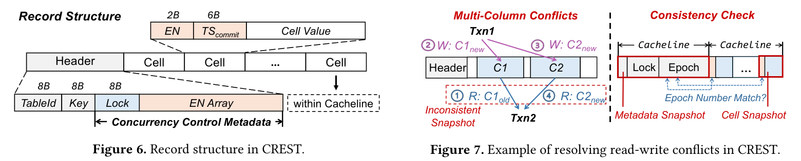
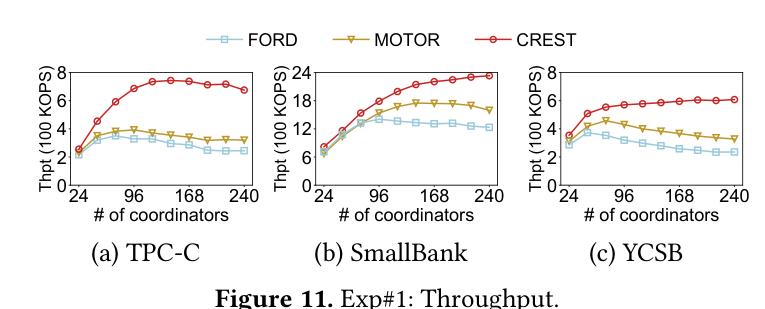
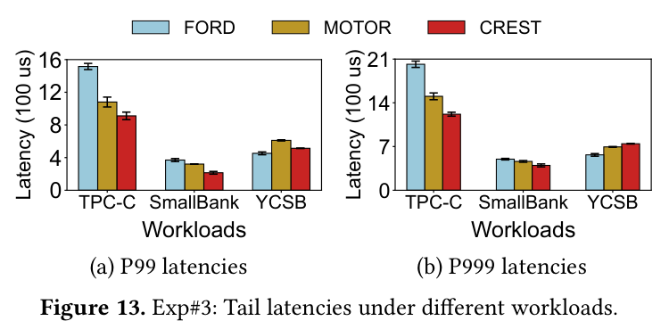

# CREST：把“同一行冲突”拆到字段，并让本机事务先消费未提交版本

**作者单位**：Qihan Kang、Yongkang Hu：中科院计算所处理器芯片全国重点实验室、中国科学院大学；Mi Zhang：中科院计算所同实验室；Patrick P. C. Lee：香港中文大学计算机科学与工程系。**正式发表**：ASPLOS 2026 Volume 2，pp.511–527，2026-03-22发表，会议3月22–26日，DOI 10.1145/3779212.3790148。本期为2026年已发表研究补读，非当天新录用。

## 两种冲突，必须分开解决
RDMA事务把数据放在内存节点，计算节点承担执行与校验。旧系统先锁整行，取数据，在本地计算，再校验、写日志、回写和解锁。即使两个事务改同一行不同列，也会互相阻塞或abort，这是**假冲突**。真正改同一字段的事务则必须排序，细粒度锁无法消除其等待。CREST因此不是单独把锁拆细：它同时改记录布局、在同一CN共享未提交中间版本，并为这些版本的依赖设计并行提交。

## 从远程记录到提交点（§4–7）
**① 字段级锁，不为每个字段多付一个RTT。** 每个cell有2B epoch、6B提交时间戳和value；记录header集中存TableID、key、8B锁位图和epoch数组。用一个masked-CAS一次锁定多个字段位，用一个READ取得header验证多个字段。布局使字段锁和版本聚集在一个64B cacheline；如果仅把整行锁机械拆成多个远端地址，I/O数增加会抵消并发收益。

**图6/7读法**：图6左侧不是“每个cell一把独立远端锁”，而是集中锁位图+版本数组；图7指出即使单cell读写不撕裂，仍可能读到C1旧值与C2新值。读者拿到cell后，再取header快照，必须同时满足相关锁未被别人持有且header的epoch与读到的cell epoch匹配。写者先写全部cell，再更新header epoch，最后解锁，才使这次校验能识别跨字段不一致。来源：作者正式版PDF第5页，图6/7。

**② 本地早可见，不等于对外已提交。** 同一个CN维护record cache及未提交version list，缓存对象记录读者/写者引用计数。新事务可以读到前驱的未提交版本，把前驱事务ID加入依赖表。前驱abort则后继也abort，不能把这些中间值当成功结果对外确认。局部执行按程序员定义的execution blocks流水化：块内按(TableID,key)顺序取本地锁避免死锁，块末释放；全事务带单调TSexec，如果后续块读到时间戳更大的版本，就检测出逆序依赖并abort。应用必须以stored procedure描述访问列和依赖，不能无修改承接任意动态SQL。

**③ 提交同时处理远端冲突与本地依赖。** 校验只读cell的epoch是否被其他CN改变，以及依赖事务是否abort。通过后标记committable并赋TScommit。redo条目包含事务ID、修改日志和依赖ID，按协调器各自的log segment写入内存池。论文的提交条件是可提交且日志已持久记录。写者引用计数减至零的最后一个写者才把最新可提交版本写回并释放远端锁，避免同一CN重复覆盖回写。并行提交并不代表可以无视前驱：恢复也要按记录的依赖滚前。作者称系统提供ACID并用primary-backup保护记录；这不应被改写成“普通RDMA WRITE完成就具有跨掉电持久性”。实验用DRAM，具体持久化域、日志复制确认点与故障模型仍需部署时单独验证。

## 实验：吞吐收益不能替代尾延迟判断
**环境**：5台服务器，3CN+2MN，100Gb/s ConnectX-5 InfiniBand及同速交换机。CN为Xeon Platinum8260、48核，实验限定8GiB DRAM；MN192GiB；Ubuntu20.04/Linux5.4。默认每CN 40线程×2协程=80协调器，总240，每CN产生1000万事务。对比作者开源FORD、Motor。TPC-C默认40仓库、92%读写；SmallBank10万账户、Zipf0.99；YCSB100万记录、每行4个40B cell、默认事务访问4行。原型使用coroutine、doorbell batching、selective signaling。

**图11读法**：TPC-C的曲线不是无限扩展。CREST在144协调器达到峰值743.7 KOPS，比Motor峰值高72.4%、FORD峰值高112.6%，之后同样回落。固定240协调器时，TPC-C/SmallBank/YCSB相对Motor吞吐分别1.92×/1.46×/1.85×，相对FORD为2.76×/1.89×/2.58×。峰值比较与固定并发比较不能混为同一个提升。来源：PDF第10页，图11，§8.3 Exp#1。

**图13读法**：240协调器下，TPC-C P99相对Motor降低15.2%，SmallBank降低36.7%；YCSB的P99没有明显胜出，图中P999甚至高于两基线。原因是跨CN热点仍然互相阻塞，本地早可见没有解决所有远端竞争。图12的平均延迟相对Motor降低17.7–44.4%，不能拿来声称P99同比例下降；TPC-C在216/240协调器时Motor的P50更低，也应保留。来源：PDF第10页，图13、§8.3 Exp#2–3。

[原文图15（PDF第11页）](https://www.cse.cuhk.edu.hk/~pclee/www/pubs/asplos26.pdf#page=11)
**图15读法**：高偏斜时，加入cell-level使TPC-C/YCSB吞吐分别提高65.9%/46.6%，SmallBank因只有一个字段而没有此收益；再加入localized execution和parallel commits，三负载进一步提高48.9%/78.1%/104.6%。这两个机制因正确性约束一起消融，不能拆出“并行提交单独贡献多少”。低偏斜YCSB中本地缓存管理反而降低吞吐3.6%。来源：PDF第11页，图15，§8.4。

其他边界（图18）：只读YCSB下Motor比CREST快12.8%，因为MVCC省去只读验证而CREST还维护缓存；低偏斜下CREST最多落后Motor10.1%。因此这是“高竞争写路径”设计，不是所有读写场景的新默认协议。

## 工程迁移：优先试元数据事务，先算清协议成本
**适合尝试的组件（分析推断）**：目录/inode/对象元数据记录中不同字段并发修改、且事务较短的元数据服务。先从trace建立“同一record不同cell”的假冲突矩阵；若主要冲突都在同一个引用计数，拆字段不会有收益，本地依赖执行才可能是有效部分。跨CN热点占比高时，可研究把关联事务调度到同CN，但这是后续思路，本文没有验证该调度方案。

**迁移前提与代价**：需要masked-CAS支持。作者README明确要求MLNX_OFED_LINUX-4.9-7.1.0.0的experimental verbs，不能把这个旧驱动依赖当作现有生产集群一定兼容的能力。header版本数组使独立cell上限为20，超过后把剩余列并成大cell，会重新引入假冲突。大于cacheline的cell依赖cacheline versioning；须在目标RNIC/PCIe/CPU平台验证论文依赖的原子可见性及写入顺序，不能把普通RDMA READ当作跨平台64B原子保证。2B epoch还有回绕问题，论文通过超时后读取完整record并检查提交时间戳处理，测试需覆盖长停顿与热点更新超过65536次。

**内存成本**：表1含cacheline padding的TPC-C额外空间，CREST41.30%、FORD19.61%、Motor63.92%。不是“细粒度元数据近乎免费”。CN还要保存活跃事务工作集和未提交版本，工作集超出本机内存时无法执行；论文只测短事务。实际系统应把依赖链长度、引用计数积压、缓存上限、abort级联及日志保留量纳入监控。

**最小验证计划**：先用2CN+2MN复现冲突矩阵，按字段不重叠/同字段两个子负载分别测试；再扩到论文3CN/2MN，比较原record锁、仅cell锁、完整CREST，扫描本地/跨CN请求比例和读写比。除吞吐/P50/P99/P999外，记录假abort、依赖abort、每事务RDMA verbs、CN缓存峰值和日志字节。故障注入选redo写入前后、最后writer回写部分cell时、释放锁前及依赖链中的前驱CN崩溃；核验事务原子性、恢复后可序列化历史与重复执行幂等性。正文没有单独的故障注入/恢复时延实验，不能把作者正确性论证当成生产容灾测量结果。

## 阅读与资料
已阅读作者正式版PDF正文§1–10、附录A，逐图查看图6/7、11、13、15；阅读作者README与artifact说明，未运行实验、未审计全部源码。未找到本次已核实的作者独立技术博客或演讲，未以二手解读填充。
- 正式DOI：https://doi.org/10.1145/3779212.3790148
- 作者论文原件：https://www.cse.cuhk.edu.hk/~pclee/www/pubs/asplos26.pdf
- 正式会议program：https://asplos-conference.org/asplos2026/program/index.html
- 作者开源：https://github.com/adslabcuhk/crest ，Apache-2.0，commit `4715fef9928f9c66c8ac6bca8e9731ce51773b9d`
- 作者实验归档：https://zenodo.org/records/18227294 （附录列出永久归档；本次未运行其中脚本）
- PDF首页CC BY4.0；所选作者图表无另行限制标记，截图仅去除周围正文，保留图例、坐标、单位及图号。正文及原图据此署名引用，源码另依Apache-2.0保留许可文件。
